# S0项目基础架构
## 双进程
测试方式是
```
# 终端 A
uv run kama-core

# 终端 B
uv run kama ping
```
两个进程分别是kama-core(daemon,常驻)和kama(CLI,一次性)
daemon：启动时读取配置，初始化日志，在本地的7437开一个TCP监听，注册core.ping方法，然后等待
CLI：敲一次`uv run kama ping`存活几十毫秒，解析命令行，读取配置，连接daemon，发出一行json请求，接收一行响应并解析打印，退出
两者的关系是服务端和客户端，对话就是json请求和响应。两者不共享内存，不共享文件句柄，各自读同一份配置才知道对方在7437(要是只改一个就无法对话)
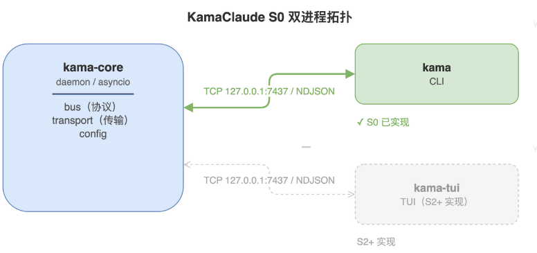
## 从main.py开始吧
在`Claude/src/kama_claude/cli/main.py`中
### 命令行解析器parser
作为一个翻译器，输入是命令行的一串字符串，输出的是程序内部能直接用的结构化数据
```
敲：python /tmp/clidemo.py ping
操作系统给的 sys.argv = ['/tmp/clidemo.py', 'ping']
```
parser做的4件事：
- 匹配：拿用户输入的每一项，去对照登记过的规则
- 转换：把字符串变成程序要的类型
- 检验：类型不对，取值不在范围内，必填项没填都会被拦住
- 兜底：没给的参数填上默认值，把结果打包成一个对象返回

parser没有自己的业务知识，认识的字段是因为登记过
### args
是parse_args()返回的一个对象，装着这次命令行解析出来的所有结果
类型是`argparse.Namespace`
存储了一些字段，因为当前只登记了--version与子命令，所以只有version和command两个字段

### 代码步骤
1. 用户敲 kama ping 回车 → shell 启动 .venv/bin/kama → shim 先 import cli.main（main.py 顶部的 import 都执行完），然后调用 main()，main 从这里进入。
2. 进 main 后的四行是配置参数：给 argparse 登记 --version 和 ping；然后 parse_args() 把用户输入翻译成 args（version=False, command='ping'）。
3. 接着两个判断：args.version 是假，跳过；args.command == "ping" 命中，于是：
- get_config() —— 获取配置：host 127.0.0.1、port 7437
- setup_logging(config) —— 装好日志
- cmd_ping(config) —— 拿着 host/port 去连 daemon，发一行 JSON-RPC，收一行，打印 pong ...
4. 然后进程退出。（如果敲的是 kama --version，会在第二个判断前就命中并 return；如果只敲 kama，走 else 打印帮助。）

### 测试实例
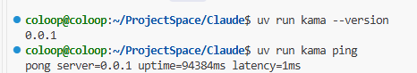

## config.py
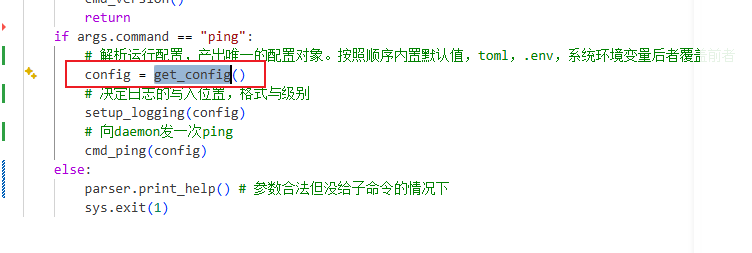
在`Claude/src/kama_claude/core/config.py`
步骤如下：
1. 文件里先定义了两个数据类。`LoggingConfig` 是日志子配置，有三个字段：level、file、format；`KamaConfig` 是全配置，有 host、port，以及一个 `LoggingConfig` 对象。两个类的字段都带默认值，所以能直接构造出一份完整配置。

2. 获取配置的入口是 `get_config()`。CLI 和 daemon 都调用它，各自拿到一份配置对象。

3. `get_config()` 第一步是造一个 `KamaConfig()`，此时所有字段都是默认值。

4. 第二步调用 `load_dotenv` 读 `.env`，把里面的键值对注入环境变量。这一步只动环境变量，没动 config。这里写入了override=False保证不被覆盖

5. 第三步确定要读的 TOML 路径（`KAMA_CONFIG` 指定的或默认的 `~/.kama/config.toml`），文件存在就解析成字典，交给 `_apply_toml`。

6. `_apply_toml` 把字典里的内容逐字段覆盖到 config 上：文件里写了哪个字段就覆盖哪个，没写的保持原值。同时做校验，未知小节、未知字段、类型不对都直接退出程序。

7. 最后一步 `_apply_env` 用环境变量覆盖 config 的对应字段。因为 `.env` 的内容已经在第 4 步进了环境变量，所以它也在这一步一起生效。

8. 覆盖顺序就是优先级：默认值 → TOML → 环境变量（含 `.env`）。比如 TOML 里写 port=9000，但 `.env` 里是 KAMA_PORT=7437，最终结果是 7437。

9. 返回 config 给调用方。 

### 四种配置
按"存在哪里"其实只有三种物理位置：代码里、文件里、进程内存里。
1. 默认值：写在代码里。就是 config.py 第 11-16 行那几个 _DEFAULT_* 常量。
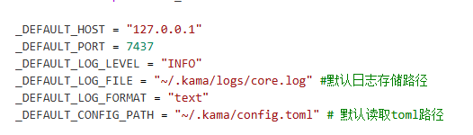
2. TOML：在文件里，默认路径是 ~/.kama/config.toml，可以用环境变量 KAMA_CONFIG 换成别的路径。你这台机器上这个文件不存在，所以这一层目前是空的——配置全靠默认值和 .env。
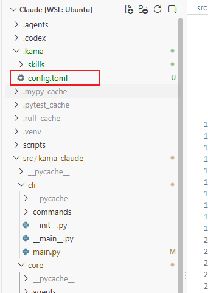
3. .env：也在文件里，位置是**项目根目录**。里面现在有 KAMA_HOST、KAMA_PORT、KAMA_LOG_LEVEL、KAMA_LOG_FILE、KAMA_LOG_FORMAT、KAMA_LLM_DEFAULT_MODEL、KAMA_MAX_STEPS 这几项。
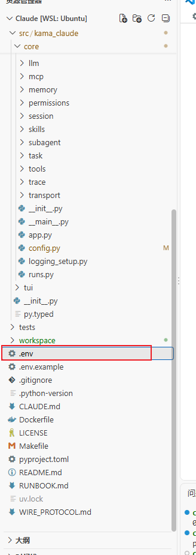
4. 环境变量：不在文件里，是运行中进程内存里的一张表（os.environ）。它由启动这个进程的 shell 传进来。下图说明切换了默认监听端口
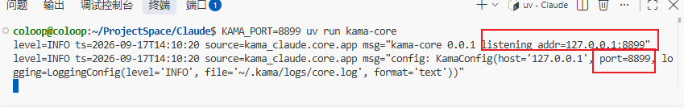

## ping.py
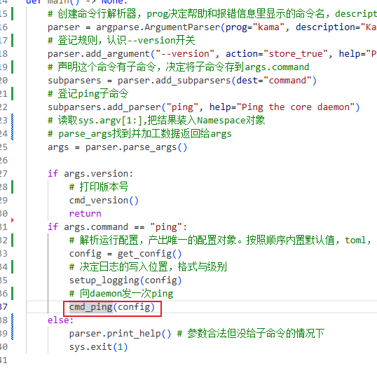
在Claude/src/kama_claude/cli/commands/ping.py
### 协程asyncio
- 协程是一个能在执行中途暂停、之后从暂停处继续的函数。用 async def 定义。关键是：调用它并不会执行，只得到一个协程对象，必须交给事件循环才会跑
协程在异步编程中可以把等待结果写成看起来像普通函数调用的样子，但不阻塞线程
> 比如asyncio.run时，会像正常函数一样运行，但通过await等待数据实现暂停，协程是一个可以暂停与保留状态的函数，不同于线程其特点是非抢占，在等待时让出CPU的执行权(事件循环的执行权)
- asyncio.run()：启动整个异步程序。
- asyncio.sleep()：异步等待，让出 CPU。
- asyncio.create_task()：把协程变成后台任务，实现并发。
- asyncio.gather()：等一组任务全部完成，并收集结果。
- asyncio.Event：协程间发通知，类似“信号灯”。
- asyncio.Queue：协程间传数据，类似“管道”。

在代码中的`reader, writer = await asyncio.open_connection(config.host, config.port)`
我们就拿这个举例，这里函数在执行TCP连接，这个连接是需要等待数据的，需要时间的，这段时间函数不会一直霸占CPU执行权，如果有其他协程来做事，就应该让出CPU（否则应该在等待时让CPU休眠，不会空转），等待没有人时通知这个协程继续下面的事情，不过如果改成`socket.connect()`就会一直霸占线程

### 具体流程
1. 这个模块由 main.py 的 ping 分支调用，传进来的参数是已经组装好的 config。

2. cmd_ping 本身是同步函数，它只做一件事：用 asyncio.run 启动内部的 _ping 协程，然后等它跑完。

3. _ping 一开始记下当前时间点，作为后面算延迟的起点。

4. 接着拿 config 里的 host 和 port 建立 TCP 连接，成功的话得到两个对象：一个用来读、一个用来写。

5. 如果对方没在监听，这里会抛连接错误，被 cmd_ping 接住，打印 core not running 并退出，退出码 1。

6. 连接成功后组装请求：协议版本、请求标识、方法名 core.ping，参数里带上 CLI 自己的版本号。

7. 把请求序列化成一行 JSON、末尾补一个换行符写出去，再等 drain 确认发完。

8. 然后等一行响应，最多等 10 秒。超时不会被接住，会直接报错退出。

9. 拿到响应后先算出这次往返的毫秒数，再关掉连接。

10. 解析这一行：如果带 error 字段，说明是协议级错误，打印错误码和消息后退出，退出码 1。

11. 如果是正常响应，先校验消息外壳，再校验里面的业务字段，取出服务端版本和运行时长。

12. 最后打印一行 pong server=... uptime=...ms latency=...ms，进程正常退出。

## envelop.py
在Claude/src/kama_claude/core/bus/envelope.py
仅仅是定义了检验客户端发来的json-rpc请求是否符合标准
定义了客户端发到服务端的请求格式，以及成功时与失败时需要发回客户端的格式，以及规定了错误码

这个py文件只处理id和方法，但对于具体业务数据，比如请求参数与返回结构不管

## app.py
在Claude/src/kama_claude/core/app.py中,这里是kama-core的入口函数
### 事件
在并发编程中，Event(事件)是一种同步原语，本质是"一个可以被多个协程等待，可设置的标志位"
可以做到让等待的协程可以收到信号，或者让协程或者其他触发源能够发出信号让等待的协程收到
从抽象来看，event有两个核心操作
- wait(),如果标记未设置(set)就会挂起，设置了就切回上下文运行。由一个或多个等待协程调用
- set(),设置标记，唤醒所有等待这个事件的协程，触发者通常只有一个，并且可以来自各种信号源(事件循环本身，另一个协程，普通回调函数，其他线程)
```
loop = asyncio.get_running_loop() # 拿到当前正在运行的时间循环对象
        shutdown = asyncio.Event() # 可以想象为一个开关事件
        # 把Ctrl+C绑定在打开开关上，表达意思是收到Ctrl+C时调用shutdown.set
        loop.add_signal_handler(signal.SIGINT, shutdown.set) 
        loop.add_signal_handler(signal.SIGTERM, shutdown.set) # kill也绑定在打开开关上

        await shutdown.wait() # 等待退出信号，也就是Ctrl+C或者kill
```

比如上面就将两个信号绑定到shutdown.set上，当接收到这两个信号就会触发shutdown.set，然后结束shutdown,wait的等待
### app.py的run函数出现在socket_server.py的server.start()与server.stop()
在Claude/src/kama_claude/core/transport/socket_server.py中，是run调用的两个函数
```
    # 启动 TCP 服务器；若端口已被占用则退出进程
    async def start(self) -> str:
        try:
            # 有趣的设计，如果能连上说明已经有daemon了，所以要终止进程。连不上才说明端口空闲
            _r, w = await asyncio.open_connection(self._host, self._port)  #占用检测，分别是读与写的连接
            # 很有趣的是，其实读和写是同一条TCP连接的两个视角，而因为读压根就没有关闭方法，所以直接关闭写连接即可
            w.close()
            await w.wait_closed()
            raise SystemExit(f"core already running at {self._host}:{self._port}")
        except (ConnectionRefusedError, OSError):
            pass

        # 这是asyncio标准库提供的协程函数，职责是"创建监听套接字并开始接收连接"
        self._server = await asyncio.start_server(
            # start_server可以接收普通的回调函数，也可以接收协程，被自动转换成task
            self._handle_connection, #回调，每来一个新连接自动创建一个协程调用这个函数
            host=self._host,
            port=self._port,
            limit=_MAX_LINE_BYTES, #限制一行最大1MB
        )
        return f"{self._host}:{self._port}"

    # 关闭服务器，最多等待 2 秒
    async def stop(self) -> None:
        # 没有启动过服务器就不用关啊
        if self._server is None:
            return
        self._server.close()
        await asyncio.wait_for(self._server.wait_closed(), timeout=2.0) #如果关不掉也会退出整个run流程


```
#### 在server.start()中嵌套的_handle_connection以及_handle_connection嵌套的_read_loop
别着急，在我们的start函数中重点是执行了标准库函数start_servr,其中就封装了一个回调函数或者说协程(因为协程本质上就是封装的回调函数呀)

```
   # 处理单个客户端连接，完成后关闭写流
    async def _handle_connection(
        self,
        reader: asyncio.StreamReader,
        writer: asyncio.StreamWriter,
    ) -> None:
        # 取出客户端地址，以便放入日志，peername也就是在服务器视角下的对面客户端地址，取不到则返回unknown
        peer = writer.get_extra_info("peername", "<unknown>") 
        logger.debug("client connected: %s", peer)
        try:
            await self._read_loop(reader, writer) #然后进入永远的读取循环，直到结束，读取循环就在下面写了
        finally:
            writer.close() # read_loop声明周期结束，连接关闭
            try:
                await asyncio.wait_for(writer.wait_closed(), timeout=1.0) #等待结束
            except TimeoutError:
                pass
            logger.debug("client disconnected: %s", peer)

    # 持续读取换行分隔的 JSON 行并逐行分发处理
    async def _read_loop(
        self,
        reader: asyncio.StreamReader,
        writer: asyncio.StreamWriter,
    ) -> None:
        while True:
            try:
                line = await reader.readline() #等待读取到一行并返回给line
            except asyncio.LimitOverrunError: #单行超过上限时的处理
                await self._send(writer, make_error(None, INVALID_REQUEST, "Request too large"))
                return

            if not line: #并不是line，也就是检测到EOF，客户端已经关闭了
                return

            await self._handle_line(line, writer) #交给解析和分发逻辑处理，在下面实现↓
```
##### 在read_loop中嵌套的_handle_line函数，以及handle_line嵌套的send
对于解析与分发逻辑还在下面实现

```
    # 解析单行 JSON-RPC 请求并调用对应 handler，将结果或错误写回客户端，这是将字节流变成handler返回值的过程
    async def _handle_line(self, line: bytes, writer: asyncio.StreamWriter) -> None:
        try:
            raw: Any = json.loads(line) #检查是否是json
        except json.JSONDecodeError as e:
            await self._send(writer, make_error(None, PARSE_ERROR, f"Parse error: {e}"))
            return

        try:
            #检查是否符合结构，别忘了我们之前看过JsonRpcRequest在envelope中，这是表示信封的意思
            req = JsonRpcRequest.model_validate(raw) 
        except ValidationError as e:
            await self._send(writer, make_error(None, INVALID_REQUEST, "Invalid Request", str(e)))
            return

        handler = self._handlers.get(req.method) #查找是否存在对应方法,查不到会返回None
        if handler is None:
            await self._send(
                writer,
                make_error(req.id, METHOD_NOT_FOUND, f"Method not found: {req.method}"),
            )
            return

        try:
            #真正调用业务处理函数，填入参数，返回的是PongResult实例对象，别忘了我们的实例对象是在commands中定义了
            result = await handler(req.params) 
        except ValidationError as e: #说明参数不对
            await self._send(
                writer,
                make_error(req.id, INVALID_REQUEST, "Invalid params", str(e)),
            )
            return
        except Exception as e:
            logger.exception("handler %s raised: %s", req.method, e)
            await self._send(writer, make_error(req.id, INTERNAL_ERROR, "Internal error"))
            return

        # 把处理函数的返回值包装成相应对象
        result_data: Any = result.model_dump() if isinstance(result, BaseModel) else result
        #  真正将消息序列转换成一行JSON写出去
        await self._send(writer, JsonRpcSuccess(id=req.id, result=result_data))

    # 将 pydantic 消息序列化为 JSON 行并写入流，随后刷新缓冲区
    async def _send(self, writer: asyncio.StreamWriter, msg: BaseModel) -> None:
        # msg.model_dump_json是pydantic自带的序列化方法，直接将模型变成json字符串
        writer.write(msg.model_dump_json().encode() + b"\n")
        await writer.drain() #等待数据被真正写出去
```

##### self._handlers与handler与handler(req.params)
1. self._handlers:在SocketServer类中是一个字典，其结构是str:CommandHandler,而CommandHandler是一个别名 在上面的代码中定义`type CommandHandler = Callable[[dict[str, Any]], Awaitable[Any]]`
2. handler:在` handler = self._handlers.get(req.method)`中，表示从字典中取出的函数（没错，返回值可以是函数的),这个函数实际上是_ping_handler
3. handler(req.params)：因为前面说了，这是函数_ping_handler,所以可以处理请求的参数，返回值是PongResult
其实_ping_handler我们见过，就在app.py中
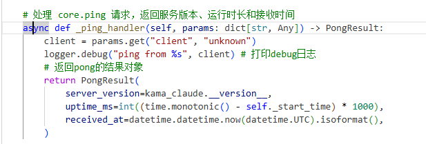
### 具体流程
1. kama-core的入口在core/app.py中

2. run() 只有一行：先构造 CoreApp 实例（构造函数里记下启动时间），再用 asyncio.run() 把它的 run 协程跑起来。

3. 进到 run 协程后，先重新记一次启动时间，然后读配置拿到 host 和 port，再按配置把日志装好。

4. 接着创建 TCP 服务器对象。这时候只是把地址和端口存下来，还没有真正监听。

5. 然后把 core.ping 这个方法名和处理函数 _ping_handler 绑定起来。这是 S0 里 daemon 对外唯一的能力。

6. 调用 server.start() 开始监听，拿到返回的地址，紧接着打两条日志：一条说明自己监听在哪，一条把完整配置打出来。

7. 拿到当前事件循环，创建一个 Event 当退出开关，把 SIGINT 和 SIGTERM 都注册成"打开这个开关"。

8. 主协程停在 await shutdown.wait() 上。daemon 的"常驻"状态就是停在这一行不动。

9. 这期间有客户端连进来时，由 transport 层为每个连接单独开协程处理，跟主协程无关。命中 core.ping 就调用 _ping_handler，它算出运行时长、带上版本号和时间，返回一个 PongResult，由 transport 层序列化成一行 JSON 发回去。主协程始终停在第 8 步那一行。

10. 收到 Ctrl+C 或 kill 后，开关被打开，主协程恢复执行，先打一条 "shutting down"。

11. 然后调用 server.stop() 关闭监听（最多等 2 秒），run 协程结束。

12. asyncio.run 关闭事件循环，进程退出。
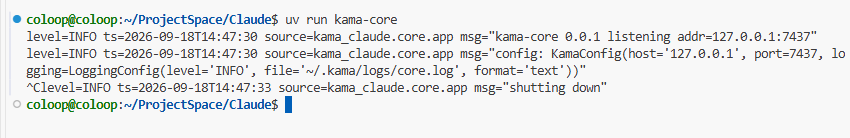
在屏幕中输入Ctrl+C会打印shutting down

## 仅仅是发出ping与收到pong的过程
我们来重新梳理整个流程，项目怎么发出ping与收到pong的吧
在启动`uv run kama-core`之后
0.在新的终端打出`uv run kama ping`
**以下部分是在cli客户端**
### 1.在main的命令解析器中解析，进入`ping.py中的cmd_ping`,具体解析逻辑请看前置知识的args命令解析器
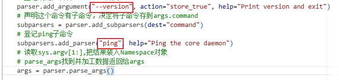
测试逻辑：
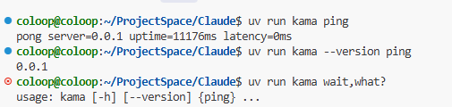
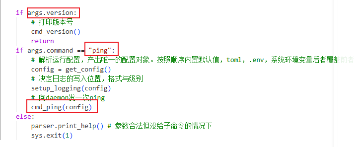
### 2. 在cmd_ping中运行协程_ping，在协程_ping中拼出JSON-RPC请求体
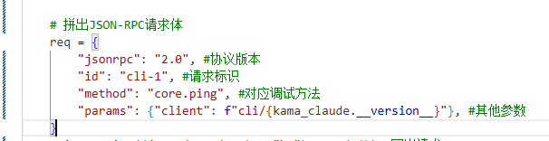

要说的是，我们命令在解析后，与这里的请求体毛都没有关系，这里写死的core.ping，并且id这些也是写死的

### 3.在_ping中建立TCP连接，写出与等待写出
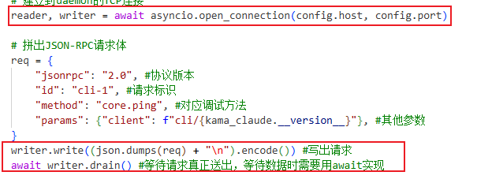
上面框选的是输入地址与端口建立与服务端的连接
下面框选的是，根据req请求体写出请求的过程与等待协程writer.drain()结束的过程

**以下部分是在daemon服务端**

### 4.连接与处理连接之后的事情
我们服务端在启动后，接收到客户端的连接，就会使用对应的回调函数`_handle_connection`处理连接
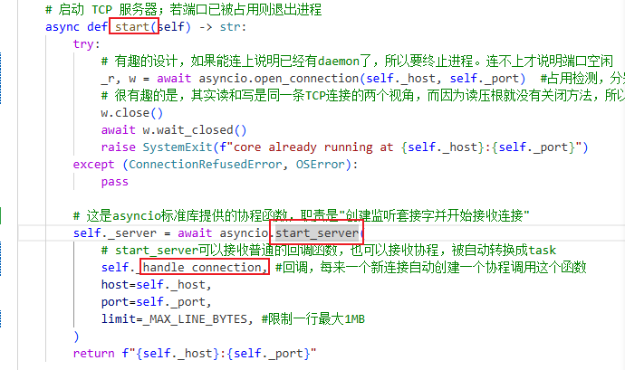

在获取好地址之后就会进入读取循环read_loop
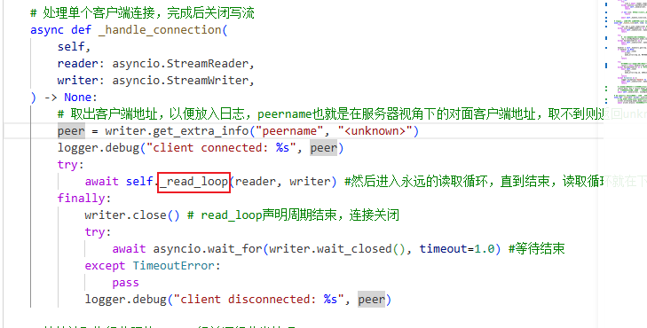

在读取循环中，检查发出的JSON-RPC 请求，确实不是EOF后，交给_handle_line处理
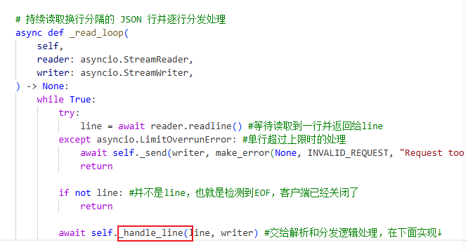

5.进一步检查JSON-RPC的请求，以及真正的解析方法
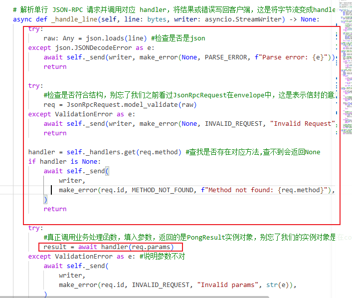

上面框选的都是检查请求的格式问题,下面会处理出一份result

5. 构造PongResult
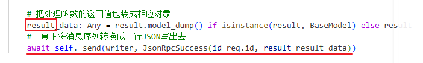

对于函数返回的result，依次进行判断，归一化，与包装
并且通过_send函数发出填入了result_data与req.id的JsonRpcSuccess
6.TCP写回与等待写回
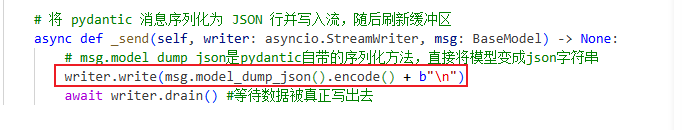

在_send函数中在真正执行只会给客户端的操作，别忘了writer才是连接通道

**以下操作发生在客户端**
### 5.解析与验证响应
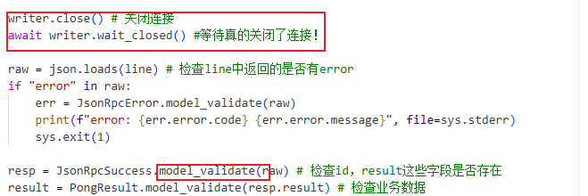

回到客户端的ping.py中
在writer确定关闭连接后，如果有错误也要解析错误，没有错误就检查字段等是否存在
### 6.打印pong的结果
真实绕了很大一圈啊
最终我们接收到确认之后终于可以打印了
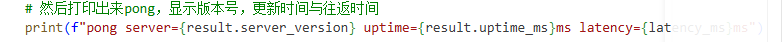
更新时间表示从启动到处理结束的时间，往返时间表示这次请求往返用了多久


## 协议与代码？
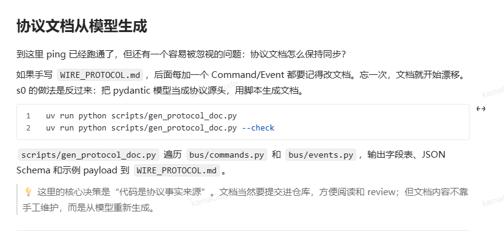
在教程中说了这样的话，本质上就是让代码去决定协议，协议文档只是代码的投影

## 从zero开始吧
没想到仅仅是研究s0就做了两三天，写了1万字的长文和一些普及，不过不要害怕，让我们继续完成吧！
