# S1 让Agent开始运行吧
## 再次从main开始
在`main.py`中大部分和原来相同，只是新增了子命令解析器run_parser，制定规则要读取--goal后面的字符串
现在我们可以测试一下新的功能了，比如让agent试着以这样的形式回复你或调度工具？
`uv run kama run --goal "想说什么就说吧"`
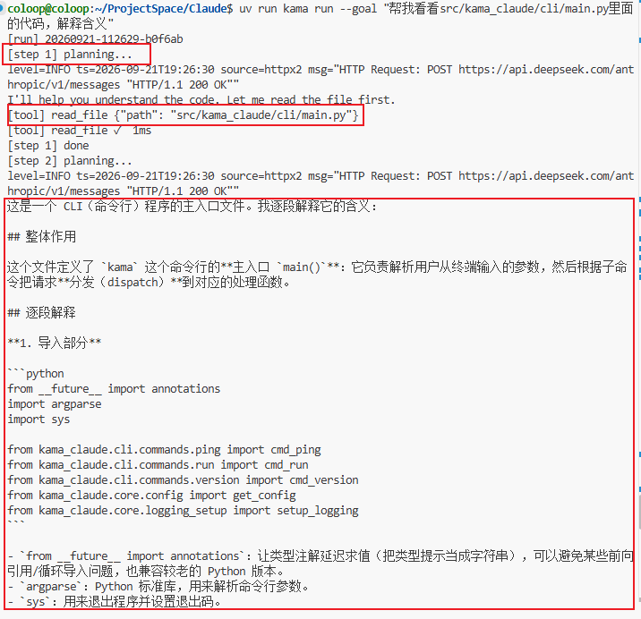

可以看到现在agent已经有拆解步数，调用工具与流式输出的功能了
在输入上述代码后，会判断执行这段函数
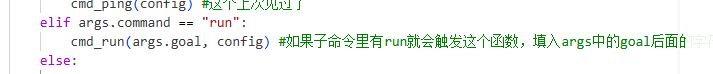

### 进入`run.py`
在cmd_run中存在打印器对象与runner，然后还会调度`runner.run`并加入我们输入的字符串，这个runner我们还不知道是什么，所以继续看吧
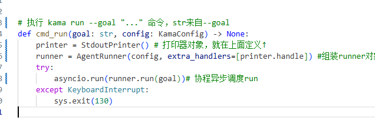

上面有对于打印器对象的详细定义，值得一提的可能是流式输出的方式，也就是通过不积攒缓冲，每次有token产生就输出出来
贴在这里各位可以看看
```
class StdoutPrinter:
    # 订阅事件总线并将运行进度格式化打印到终端
    def __init__(self) -> None:
        self._inline = False  #当前光标是否停在一行中间
        self._run_start: float = 0.0 

    def _ensure_newline(self) -> None:
        if self._inline: #如果真的停在一行中间
            print() #那就先换行
            self._inline = False

    # 判断事件种类打印对应命令，isinstance类型检查器
    async def handle(self, event: BaseModel) -> None:
        if isinstance(event, RunStartedEvent):
            self._run_start = time.monotonic() #记录起点时间
            print(f"[run] {event.run_id}")

        elif isinstance(event, StepStartedEvent):
            self._ensure_newline()#确认换行
            print(f"[step {event.step}] planning...")

        elif isinstance(event, LlmTokenEvent):
            print(event.token, end="", flush=True) #这是流式输出的关键，也就是不攒缓冲，一个一个往外打
            self._inline = True

        elif isinstance(event, ToolCallStartedEvent):#换行后打印工具名和参数，当需要调用工具时才会有这个
            self._ensure_newline()
            params_str = json.dumps(event.params, ensure_ascii=False)
            print(f"[tool] {event.tool_name} {params_str}")

        elif isinstance(event, ToolCallFinishedEvent):#打印上面的工具成功，打印耗时
            print(f"[tool] {event.tool_name} ✓  {event.elapsed_ms}ms")

        elif isinstance(event, ToolCallFailedEvent):#打印上面的工具失败，打印错误信息
            print(
                f"[tool] {event.tool_name} ✗  {event.error_message}",
                file=sys.stderr,
            )

        elif isinstance(event, StepFinishedEvent):#说明步数与该轮结束
            self._ensure_newline()
            print(f"[step {event.step}] done")

        elif isinstance(event, RunFinishedEvent):#打印运行状态，总部署，总耗时
            self._ensure_newline()
            elapsed = time.monotonic() - self._run_start
            print(f"[run] {event.status}  {event.steps} steps  {elapsed:.1f}s")

```

### 组装AgentRunner
这里要进入core/run.py才能看到AgentRunner
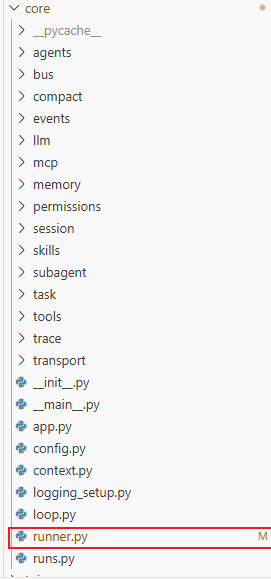

前面执行的run就是这里AgentRunner的方法
这里的AgentRunner的初始化很包容，它可以接收模型接口，额外函数列表和运行地址初始全部为空，等待run函数启动再创建，也就是说第一次构造runner时为空而不是被上一次污染，也不会存在一开始就绑定的情况，因为这时候我们还没开始运行

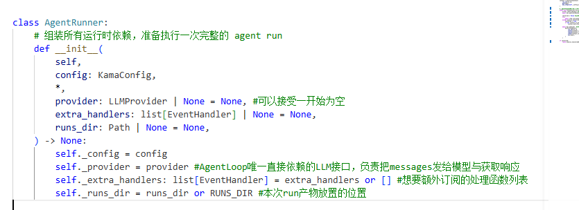

对于run的函数，注释已经写的很清楚了，这里直接贴上注释
```
# 执行一次完整的 agent run：生成 run_id、接线事件总线、驱动 AgentLoop
    async def run(self, goal: str) -> None:
        #本次run的身份与落盘位置
        run_id = new_run_id()
        run_path = self._runs_dir / run_id
        run_path.mkdir(parents=True, exist_ok=True) #即使父目录缺失也可以创建，这是幂等建目录的写法

        #通过EventBus创建私有的事件总线bus，从而订阅所有监听者
        bus = EventBus()
        for h in self._extra_handlers: #前面说的StdoutPrinter就是从这里订阅的
            bus.subscribe(h)

        #如果没创建接口就先做(因为一开始是None)
        provider = self._provider or AnthropicProvider(self._config.llm.default_model)
        registry = ToolRegistry() #创建工具注册表
        registry.register(ReadFileTool()) #并注册，因为我们这个阶段只有readfile一个工具
        loop = AgentLoop(provider, registry, bus) #循环控制器，输入以上三个参数

        #上下文对象，注册当前run的身份，把第一条信息注册为我们输入的goal，现在最大步数就是最新的
        context = ExecutionContext(
            run_id=run_id,
            goal=goal,
            max_steps=self._config.agent.max_steps,
        )
        
        #和你认识的文件操作很像，这其实是一种可以在结束时自动收尾的语法糖
        async with EventWriter(run_path / "events.jsonl") as writer:
            writer.subscribe(bus) #把writer的handle注册进总线，其实和bus.subscribe(writer.handle)是一样的意思
            await bus.publish(RunStartedEvent(run_id=run_id, goal=goal, ts=_now())) #发出第一条事件，标记run开始

            cancelled = False #给下面的逻辑进行判断的，这里说明
            try:
                await loop.run(context) # 交给loop让它把任务跑完，经典的协程对吧
            except asyncio.CancelledError: # 被请求协程终止，比如使用了Ctrl+C
                cancelled = True
                if not context.is_done(): #其实表示正在运行时，因为run被取消但是status还停留在running
                    context.mark_failed("cancelled") #把status=failed

            await bus.publish(  #等待最后一条事件，把最终状态、原因和步数写入
                RunFinishedEvent(
                    run_id=run_id,
                    status=context.status,
                    reason=context.reason,
                    steps=context.step,
                    ts=_now(),
                )
            )

        if cancelled: 
            raise asyncio.CancelledError() #抛出异常，会停止当前函数，将异常抛给上个文件run.py中的KeyboardInterrupt
```

不过还有很多疑点，这里并不是这么好理解的
首先cancelled这个变量表示的其实是"如果是false，表示正常取消了。如果是True，表示的是因为外部协程终止，比如按下Ctrl+C，意外取消"，也就是用来确认是否是正常取消的
为什么要这么说？或者这有啥用
对于不熟悉Python语法的作者这段其实很费解，我们来阅读吧
对应with ...as ,try...except和raise已经写在前置知识了(作者在大学Python课上也没有认真听，结果是相当重要的东西，悔恨莫及啊)
各位在了解之后就不会这么眩晕了

### 生命(周期)在于运动(run)与抛球(异常)游戏
我们从run这个函数开始讲起吧
首先注意这个函数是一个协程
简单的注册身份与落盘地址，以及幂等建目录的写法创建目录
然后是创建事件总线，订阅所有监听函数
还有比如大模型接口与工具注册表与循环控制器的创建，因为这些玩意还没讲到，所以这里一笔带过
以及上下文对象的初始注册，注意区分cmd_run与runner.run与loop.run。因为这里是runner.run所以我们仅仅是启动这个上下文对象，自然放入的是第一条信息goal
然后是对于events.jsonl的编辑
你可以在这里看到编辑的内容
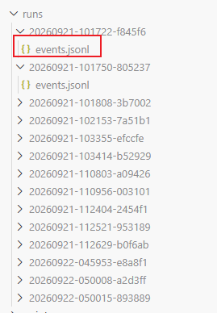
把writer.handle注册进总线里面
然后才是重头戏，我们之前说cancelled是检查协程与文件是否是正常关闭的
你看，如果是正常的运行完loop.run，我们的cancelled一直是false，这是正常的
但如果某些原因，协程被终止了，我们要说明并不是正常情况关闭的，进入except里面，处理cancelled=true,还有检查状态context.is_done
这里的状态检查很有趣
如果是running状态会返回false，否则无论是正常关闭还是错误终止都返回true
我们需要把状态status改写为failed
也就是非正常情况下终止状态都会是failed，而且就算终止了，也知道会运行下面这段写入最终事件，你可以试试
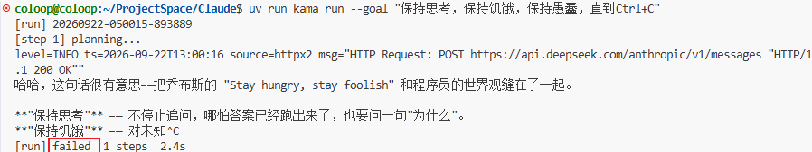

然后是最难理解的最后一段话
```
if cancelled: 
    raise asyncio.CancelledError() 
```
你要知道，如果cancelled=true,说明什么？说明我们触发了except asyncio.CancelledError
根据我们得知的raise上抛过程它应该抛给当前函数向上的对应类型异常，诶诶，等等，我可没动源代码的缩进，我们可以看到if是和 EventWriter同一级的，咱们的异常实例不会给这里面的asyncio.CancelledError。但函数要跑完了，只能继续向上抛，抛过当前层的runner,run(),抛给cmd_run,哦好在这里还有一个except,东西交给你行了收工
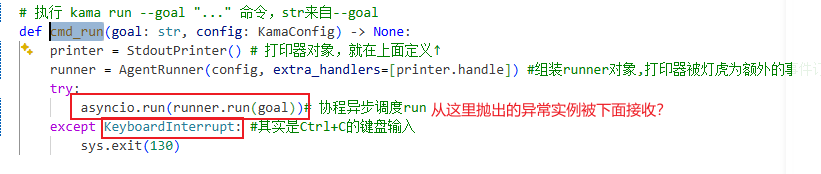

但是开什么玩笑！Python课老师和你说了，异常类型一直才能被接收，这里明显一个是KeyboardInterrupt的异常类型，一个是asyncio.CancelledError()，货不对板啊老大

别忘了，我们的run到底是什么，谁的生命周期结束了，又轮到了谁
还有一个run我们没有注意到asyncio.run啊
所以全部的流程是这样的cmd_run->try:asyncio.run->runner.run->loop.run
loop.run出现问题，退出后，轮到runner.run执行到最后一行抛出asyncio.CancelledError()
被asncio.run接收！我们看看它干了什么
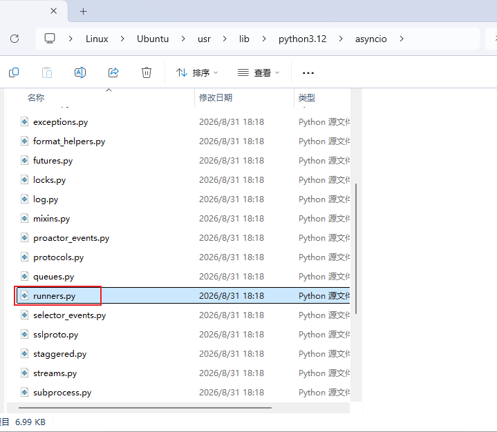
这是Python源码中的runner.py里面对应的run函数
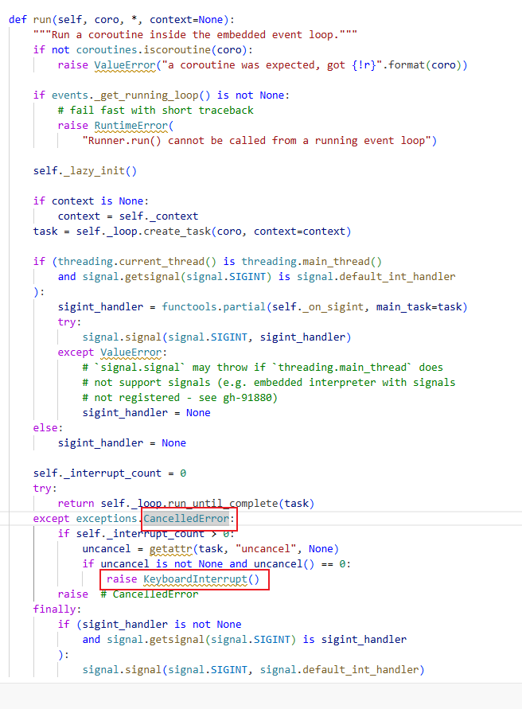

看清楚了吗？我们确实被接收了，然后继续抛出了KeyboardInterrupt类型的异常实例，再次退回cmd_run被接收并且退出
现在你终于理解了全部吧

## 事件总线或者广播总线EventBus
让我们再理解事件总线吧，所以回调函数都在这里注册
```
class EventBus:
    def __init__(self) -> None:
        self._subscribers: list[EventHandler] = [] #准备一个空列表当做订阅者名册的容器

    # 注册一个事件处理函数
    def subscribe(self, handler: EventHandler) -> None:
        self._subscribers.append(handler) #apepend就是将handler追加到容器的队尾

    # 按注册顺序依次调用所有订阅者
    async def publish(self, event: BaseModel) -> None:
        for handler in self._subscribers:
            await handler(event)
```

很好理解，在外部串行注册，加入订阅名册的list容器，执行publish串行调用
我们在s1只会有两种订阅者，传入这里按照顺序依次执行
1. StdoutPrinter.handle 使用extra_handlers加入
这是在cmd_run中构造对象时就写入的
`runner = AgentRunner(config, extra_handlers=[printer.handle]) `
然后在runner.py中被依次订阅
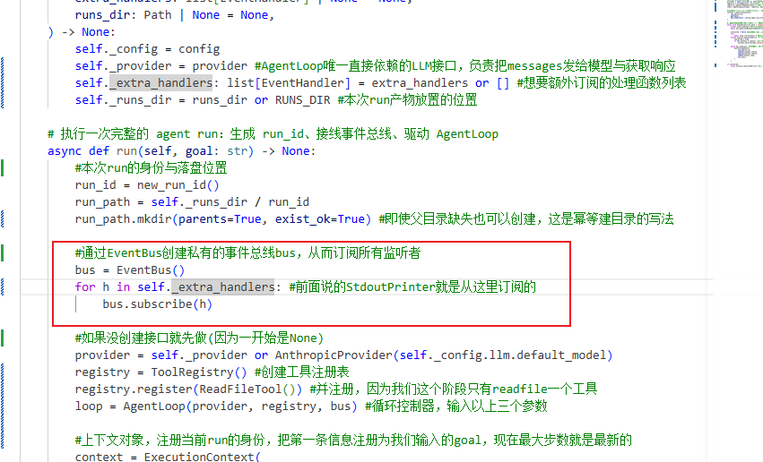
2. EventWriter事件写入器 这是在runner中写死的，一定会注册的
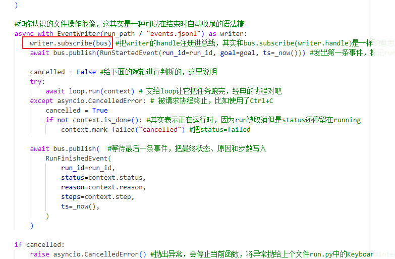
而调用的handle在这里 （core/events/writer.py）
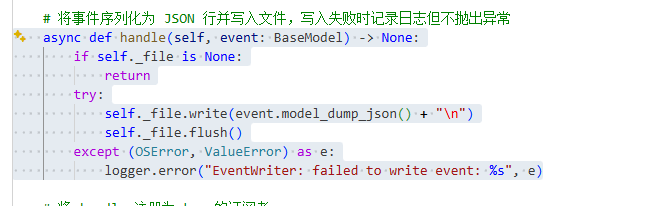

它们的共性实际上是都在进行写入或者打印的动作。这些handle只是在读取事件而不是额外创造事件，也就是"广播已经发生的事"，至于这件事怎么创建，怎么处理，就不是它关心的事情了

话说至于为什么这么多要继承BaseModel或者使用BaseModel当做参数的，其实这是一个检验装置，可以辅助字段检验和序列化之类的，具体我也不清楚
## 上下文ExecutionContext
这是Agent的工作记忆，代码已经在项目中注释好了，这里想区分一下我们的三种添加方式
这个记忆或者message消息是以字典为元素的列表，而且所有格式都是需要符合Anthropic API的格式要求
我们会根据角色role这个字段来首先区分，存在三种格式user', 'assistant', 'system'
我们这里只讨论前两种
举个例子，比如我想命令行这样询问会怎么样呢？
`uv run kama run --goal "帮我看看src/kama_claude/cli/main. main.py里面的代码，解释含义"`
1. role为user的初始提示词
`{"role": "user", "content": "帮我看看src/kama_claude/cli/main. main.py里面的代码，解释含义"}`
这是作为初始提示词输入进入的，content为--goal后的内容
2. role为assistant,输出打印在终端上
一般种类会有两种形式，text或者tool_use，作为代码块出现，比如像这样
```
{"role": "assistant", "content": [
    {"type": "text",     "text": "我先读一下"},
    {"type": "tool_use", "id": "t1", "name": "read_file", "input": {"path": "README.md"}}
]}
```
一般来说，text部分是打印在终端的信息，而tool_use则是向工具发起的申请，这里就是readfile的工具调用
3. tool_use的调用
对于工具的使用是一个来回，跨了助手与用户两个角色，所以可能会有以下两种情况
```
assistant: [{"type": "tool_use",    "id": "call_00_abc", "name": "read_file", "input": {"path": "main.py"}}]
user:      [{"type": "tool_result", "tool_use_id": "call_00_abc", "content": "<文件全文>"}]
```
这里role是user并不代表是用户发起的信息，而是工具侧发送的消息，因为我们的角色只有三种，所谓当做是外部用户发来的消息，user这个身份更像是外界或者环境中的信息

并且在代码中也可以看到，如果一直是工具侧发送消息会整合到一个block里面，而不是重新创建一个字典元素
```
{"role": "user", "content": [
    {"type": "tool_result", "tool_use_id": "t1", "content": "README 的内容…"},
    {"type": "tool_result", "tool_use_id": "t2", "content": "file not found", "is_error": true}
]}
```
多个来着工具的消息会被合并到一起，这是`add_tool_result`的合并逻辑

所以可以总结一套上下文的回复流程应该是
初始用户发出消息，role：user->AI总结消息，打印文字向终端role:assistant，type:text.并且向工具发出请求role：assistant,type:tool_use->工具返回消息，多条消息被整合到一起role:user,type:tool_use->AI总结信息返回给用户,role:assistant.type:text ->如果任务到此为止，就结束返回步数，staus=success

## Agentloop
AgentLoop的循环其实很简单，按照以下循环完成

1. 当循环未结束时继续以下流程
2.  完成步数开始之前的所有广播
3. plan:`response = await self._provider.chat(
                    messages=context.messages,
                    tool_schemas=self._registry.tool_schemas(),
                    bus=self._bus,
                    run_id=context.run_id,
                )`
将上下文与工具调用清单交给大模型，获取LlmReponse
4. observe:将获取到的LlmReponse根据种类分为text与tool_use,封装好放入同一个消息块blocks中
5. act:如果满足`response.stop_reason == "tool_use"`即调用其中需要的工具，调用的过程是一个协程，将返回的结果合并成一个user加入消息历史
6. 检查`response.stop_reason == "end_turn"`或者步数用尽，如果满足就标记`context.is_done`下一次循环不执行
7. 回到1继续判断

### 异常处理raise
如果各位读过前置知识中关于raise就知道，这里的raise会上抛asyncio.CancelledError类型的异常实例，至于抛向哪里可以反推
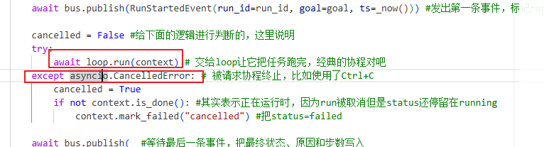
↓↓↓
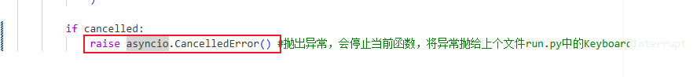
↓↓↓
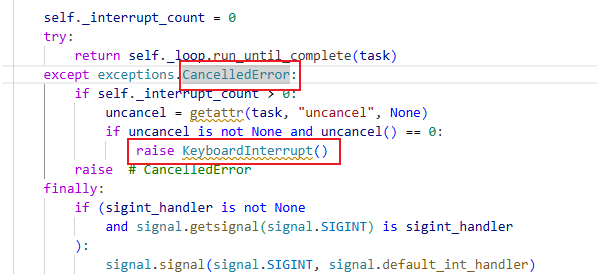
↓↓↓
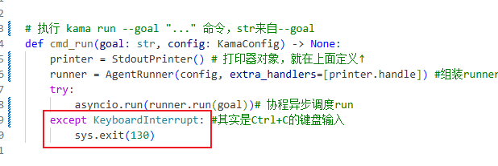
怎么样，是不是完全理清楚了？

### 循环终止
对于循环终止也有这样几种条件
- `response.stop_reason == "end_turn` -> `context.mark_success()`
- 步数达到max_steps -> `context.mark_failed("exceeded_max_steps")`
- LLM API 报错 - > `context.mark_failed("llm_error")`
- Ctrl+C:可以发生在任何位置，所以位置都会通知回到cmd_run处理 ->`sys.exit(130)`
- 工具执行出错 ->各位使用AI应该遇到很多这种事，答案是不终止，错误作为结果送回LLM

## AnthropicProvider，与大模型对话的接口
我们先回忆是从哪里开始创建provider 在core/runner.py中
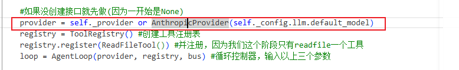

进入core/llm/provider.py中
对于AnthropicProvider类，首先会解析是否存在API KEY，如果没有会直接退出程序
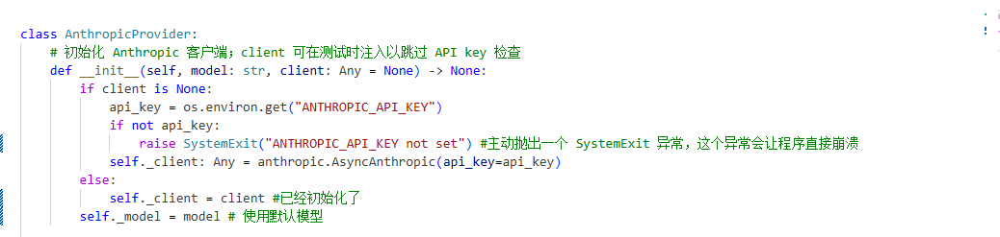
接下来才是重头戏，chat是我们与大模型规划的关键

### 提示词_SYSTEM_PROMPT
系统提示词是智能体的关键，但本质上它是我们发出消息的一部分，作为前置说明的一部分
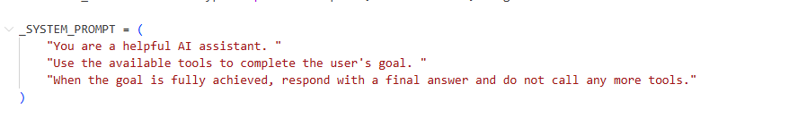
仅仅是提示大模型的一段文本，让它正确回复与使用工具

不过即使这样大模型还是会返回正确消息

但这样的提示会禁止它调用工具
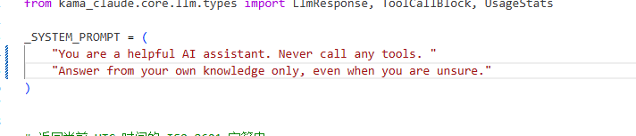
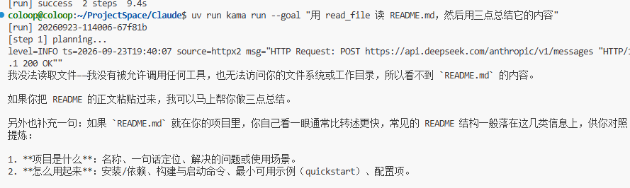

### 流式循环
所谓流式循环是当LLM生成文本时，不等待全部生成完才返回，而是每生成一个token就立刻返回。
这其中涉及到一个很酷的异步调度，不过作者能力有限，我尽量讲清楚一点，并且这一部分就不写在前置知识了

1. 流式循环的关键 遍历stream.text_stream
在我们的函数中只写了这一段代码可以证明这是流式循环
下面这个bus调用的函数，如果你有印象的话，这是打印器的流式输出函数
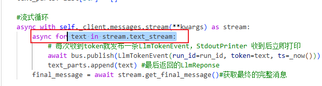
2. text_stream到底是什么？
你可以觉得text是字符串(从后面的表现来看，它几乎一定是字符串)
那后面的stream.text_stream应该是字符串列表？
或许让这段代码实现流式输出没这么简单
要找到关键需要在这里看到(别问为啥找到这里来了)
Claude\.venv\lib\python3.12\site-packages\anthropic\lib\streaming
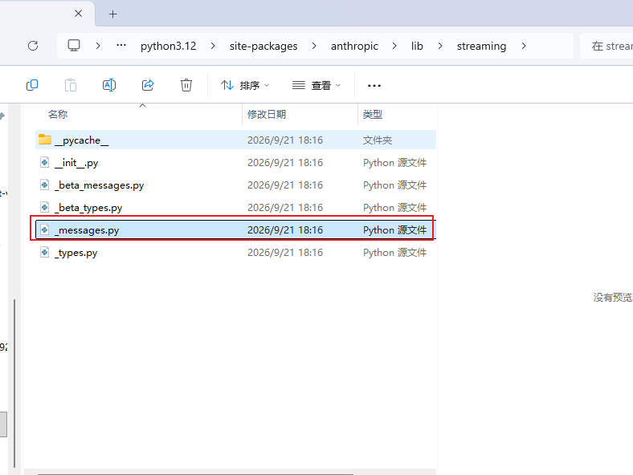
这里写清楚了text_stream是函数__stream_text__()的返回值
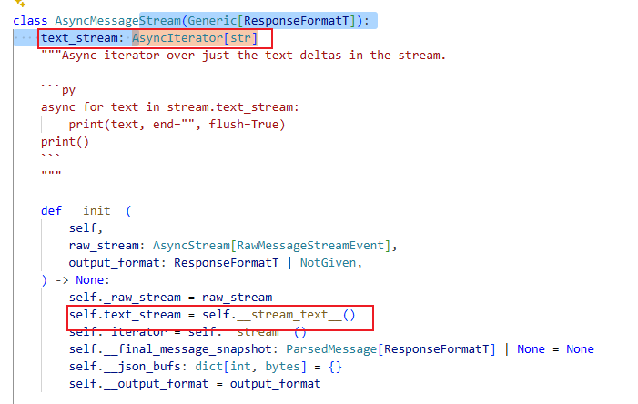
3. __stream_text__()在做什么
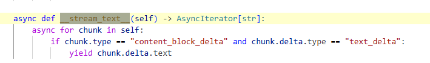
函数代码在这里，不过这样做大家可能还不能理解到底在做什么
我们简短把yield和async解释一下吧
4. yield与async
这是异步代码的写法，yield表示一个可暂停的返回，当函数运行到这里时返回后面的值，但是下一次进入时会从yield位置后面继续而不是从头开始
async是单线程内的"协作式并发"，靠一个函数主动让出控制权，让同一个线程去干别的事
会不会有点熟悉？这不就是协程的概念吗，其实async本质上就是协程，只是不同的语法
5. 退回第3步
解释完之后我们再来看这段代码到底在干嘛，也就是如果chunk.type检查出对应的数据，就立即返回一段text
而返回值应该是这个AsyncIterator[str],这玩意可不是字符串列表，而是异步生成器对象？
6. 所谓迭代与迭代协议与异步生成器对象
诶不是？这个什么什么对象，为什么可以被for循环呢？答案可能还要复杂,各位可能没有细想为什么一个变量可以被迭代，这其实是因为它们拥有迭代协议
> 一个可迭代的对象，只要写清楚迭代协议就能被正确迭代
在usr\lib\python3.12\_collections_abc.py中找到，原话描述是返回下一个物品或者当耗尽时结束
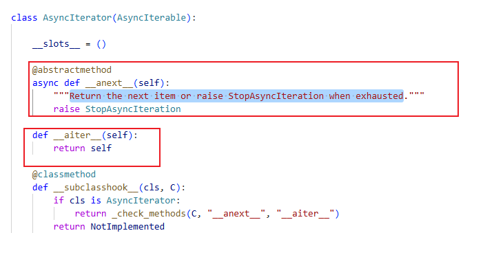
抱歉这节课并不是来讲python底层的，所以真的真的没必要深究了(我已经过于深入了！)
各位只要记住，调用这段代码可以实现流式调用，当大模型返回一个token，就搬运一个token出来，然后因为打印器接收到通知，就会打印对应的token，这样理解就简单很多

### cache_control与缓存命中
#### 缓存命中
当模型每次读取prompt时，每读取一个token都会算出一个中间结果(KV状态)，这个计算昂贵所以计算完不应该丢弃，当下次请求到来时，如果要算的一部分与上次完全一样，就可以把结果直接拿来使用，不需要重新计算的话，价格也自然会便宜
但因为命中的是缓存，并不改变输出，处理输入可以并行，将prompt中的所有token一次性算完
而输出只能串行，对每一个token的输出都需要分别处理，每生成一个token都需要把全部模型权重和已生成内容的KV从显存中读取一遍，对于数据搬运量的需求很大，尽管GPU的算力很大，但瓶颈在显存带宽

##### 命中原理
命中其实是看的前缀，这是因为大模型在计算时会根据前面的所有token预测下一个token。比如模型在计算第5000个token时，结果就包含了前面4999个token的信息，如果前面4999个token都被正确缓存，那第5000个就可以被直接输出

- 服务器端把请求渲染成一个扁平的token序列，取前缀计算指纹，比对之前存过的指纹是否相同。尽可能找到更长的前缀去匹配，从而省下更多的钱与计算力

##### KV缓存与提示词缓存
- KV缓存：这是注意力机制算出的中间结果，模型处理每个token时，会为它算出一对Key和Value向量，后续的token需要对前面所有KV向量会看。如果不存储KV向量，每生成一个新token就需要把前面所有token重算，这相当不划算
- 提示词缓存：将KV缓存的前缀存储，为之后的其他请求复用，如果新请求的开头与之前某个请求完全一样(取前缀计算指纹)，那这一段KV状态可以原样使用，跳过重算

#### cache_control与请求设计
真实应用中的请求往往是这样的
> 一段固定的长开头+一小段每次都变化的后缀
系统指令、工具定义、知识库文档、多轮对话的历史往往占用请求的大多数，而且往后推进时前面的这些几乎不会变。每轮对话真正变化的只有最后询问的话与刚生成的内容
这是提示词缓存的基本策略，就是为了实现每轮对话的复用

因为我们学习的是claude的策略，使用Anthropic使用prompt caching功能，Anthropic需要自行确定断点，而OpenAI使用启发式规则猜测

在这个阶段中我们为系统提示词与工具列表设置了断点，这两个部分不会在下一次提问时重新计算了
不过我们的对话历史message，并没有被设置断点，或许要在后面的阶段完善？
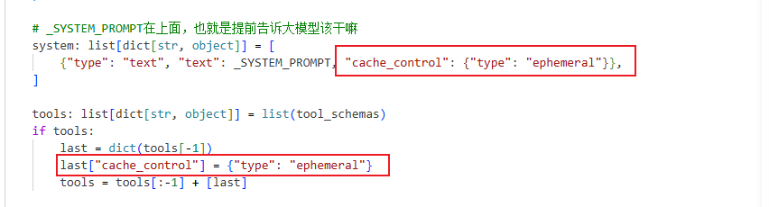

## 工具列表
对应工具调用函数在这里实现core/tools/base.py
其中BaseTool是一个抽象类，而invoke是一个抽象方法，从ABC和@abstractmethod可以看的出来
对于抽象类在前置知识中有所提到
```
class BaseTool(ABC):
    name: str  #工具名 
    description: str #工具描述
    input_schema: dict[str, object] #输出参数格式定义

    # 执行工具调用，返回结果或错误
    @abstractmethod
    async def invoke(self, params: dict[str, object]) -> ToolResult: ...

```

### 工具注册
core/tools/registry.py在这里实现工具注册,其作为AnthropicProvider中chat函数的参数使用
```
    # 返回所有工具的 Anthropic 格式 schema 列表
    def tool_schemas(self) -> list[dict[str, object]]:
        return [
            {
                "name": tool.name,
                "description": tool.description,
                "input_schema": tool.input_schema,
            }
            for tool in self._tools.values()
        ]
```

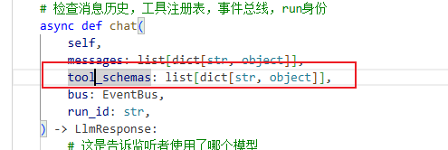

### invoke_tool
调度工具的流程注释已经很完善了，其实实际调度工具只用到了一行代码
`result = await asyncio.wait_for(tool.invoke(dict(tool_call.input)), timeout=timeout)`
其他的部分都是识别各种失败情况，比如工具不存在，参数不完整，工具报错，超时与异常都使用准备好的`_fail`函数

其中需要区分的可能是对于required和missing的关系
- required是从input_schema中获取的(我们下一节可以看到),这里是要使用这个工具，需要填入什么参数
- tool_call.input:实际上模型给出的参数
- missing：两者之间的差值，如果有漏掉的参数就无法继续

### 工具readfile使用
首先我们知道ReadFileTool是需要继承BaseTool并实现方法的
然后每个工具都需要填入工具名、工具描述与输出参数格式定义
再来复习一下BaseTool
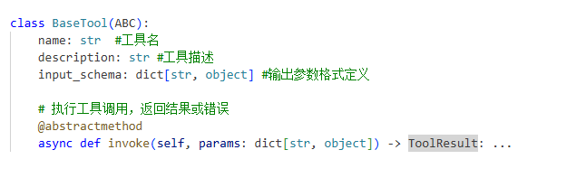

而对于这里的input_schema也写的很清楚了，我们必须要填入路径才能使用工具
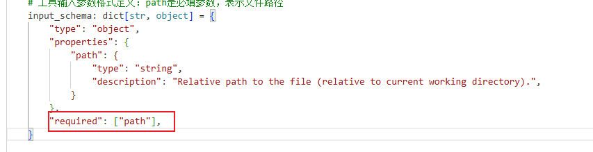

这里的invoke函数也需要检查路径，不允许..的出现也不允许路径长度大于512KB(真有人用这么大的路径吗)
如果一切正确就输出解码为UTF-8字符串发给到context中

### 工具系统流程
我们来重新理解工具调用的全部流程吧

0. 开始调用
工具调用是loop循环的一部分，从这里开始进入
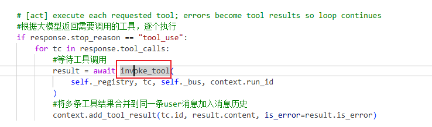

1.  发布工具调用开始事件
进入invocation.py
``` 
 #发布工具调用开始事件
    await bus.publish(
        ToolCallStartedEvent(
            run_id=run_id,
            tool_use_id=tool_call.id,
            tool_name=tool_call.name,
            params=dict(tool_call.input),
            ts=_now(),
        )
    )
```    
2. 注册与查找工具
如果失败进入_fail
```
tool = registry.get(tool_call.name)
    if tool is None:
        return await _fail(
            bus, run_id, tool_call,
            "runtime_error", f"unknown tool: {tool_call.name}", elapsed(),
        )
```

3. 检查必填参数
检查工具要求参数与大模型给出参数的对应关系
如果缺少，使用missing检查出，并且返回缺少参数给fail_
```
#语义同required = tool.input_schema.get("required", [])，但是类型检查器会报错，所以使用cast
    required: list[str] = cast(list[str], tool.input_schema.get("required", []))
    #required是必填参数，这里是查找有哪些应该填但没有填上的
    missing = [p for p in required if p not in tool_call.input]
    if missing:
        return await _fail(
            bus, run_id, tool_call,
            "schema_error", f"missing required parameters: {', '.join(missing)}", elapsed(),
        )
```

4. 执行工具
`result = await asyncio.wait_for(tool.invoke(dict(tool_call.input)), timeout=timeout)`
这个阶段我们只有一个工具readfile,所以实现的invoke逻辑是

```
async def invoke(self, params: dict[str, object]) -> ToolResult:
        path_str = str(params["path"]) #获取参数

        if ".." in Path(path_str).parts: #还有..路径遍历的情况，禁止。所以说要给出具体路径啊
            raise PermissionError(f"path traversal not allowed: {path_str}")

        path = Path(path_str) #转换成Path对象
        raw = path.read_bytes()  # 文件不存在会抛异常，交给上层处理
        truncated = len(raw) > _MAX_BYTES
        text = raw[:_MAX_BYTES].decode("utf-8", errors="replace") #解码为UTF-8字符串
        if truncated: #判断是否被截断
            text += "\n[truncated]" #这里截断就是告诉大模型内容不完整，避免大模型误以为内容完整

        return ToolResult(content=text)

```

5. 如果工具结果正常，发布工具调用完成事件

```
        await bus.publish(
            ToolCallFinishedEvent(
                run_id=run_id,
                tool_use_id=tool_call.id,
                tool_name=tool_call.name,
                elapsed_ms=ms,
                ts=_now(),
            )
        )
```

并且返回ToolResult
返回的结果是工具调用返回的值`return ToolResult(content=text)`
这个值在base.py中有严格规定

```
@dataclass
class ToolResult:
    content: str  #工具输出内容，只会输出字符串
    is_error: bool = False  # 如果结果出错则为True,下面是错误类型
    error_type: str | None = None  # "runtime_error" | "timeout" | "schema_error"
```

6. 如果出现工具不存在/缺少参数/超时/运行异常/工具返回错误,调用_fail

```
async def _fail(
    bus: EventBus,
    run_id: str,
    tool_call: ToolCallBlock,
    error_type: str,
    error_message: str,
    elapsed_ms: int,
) -> ToolResult:
    await bus.publish(
        ToolCallFailedEvent(
            run_id=run_id,
            tool_use_id=tool_call.id,
            tool_name=tool_call.name,
            error_type=error_type,
            error_message=error_message,
            elapsed_ms=elapsed_ms,
            ts=_now(),
        )
    )
    return ToolResult(content=error_message, is_error=True, error_type=error_type)
```

并且发布工具调用失败事件与返回ToolResult

## 全部流程
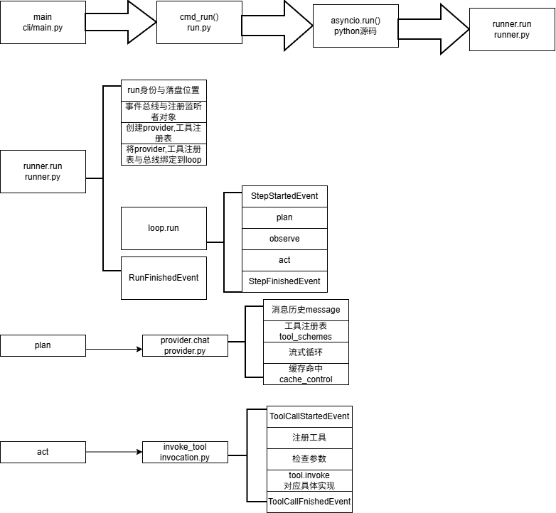