# S2 把事件流外化为IPC

## 名词解释
可能各位遗忘掉了一些关键性的名词，在这里解释一下更好理解后面的过程
- IPC:进程间通信。进程是操作系统资源分配的最小单位，每个进程都有自己的虚拟地址空间，A进程不能直接读写B进程的内存，如果它们要交换数据、发通知、做同步，需要操作系统提供一套机制，即IPC
- CLI：命令行界面，我们正在用到的交互形式，当输入文本命令后，解析完成程序执行后把结果打印到终端中，在这个项目中我们一般指客户端打开的进程部分
- daemon：守护进程，一个长期在后台运行的进程，特点是不依附任何终端，无人与之交互，启动后一直挂着等待事件或请求，直到被显示关闭，在这个项目中指kama-core。这个词的来源挺有趣的，有兴趣可以去了解一下？

## 从1到2
如果你关注过s1阶段的代码结构，我们进入main之后很自然地执行了构造Agentrunner的函数，然后通过runner实现了一系列操作，包括调度大模型，事件总线EventBus，工具调用等等
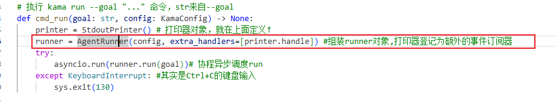

不过问题是这些操作都是在我们发起`uv run kama run --goal "输入的命令"`后完成的，也就是全程守护进程，也就是kama-core并没有参与，不信你可以去看全程kama-core在命令行有没有动静。显然kama-core在s0的ping时建立了通信，但我们在s1阶段的全程都把它给忘了

这样真的好吗？当然不好，首先是执行任务本来就不应该交给客户端，其次是试想真实场景中，我打开一个智能体询问一些事情，但是因为信号不好或者其他问题，我的客户端断连了，那本次的所有消息历史全部完蛋；并且由于客户端进程是私有的关系，不允许有其他客户端看到本次的消息历史，也就是说如果上下文长度用光了，那这段对话也不能继续

所以本阶段的目标就是当kama  cli进程只负责连接，订阅，发出命令与等待结果，剩下的交给kama-core来做

## 从main再一次开始的路径
按照思路，我们检查一下main的执行
在s2阶段我们添加了一些在cli中关于kama-core的操作命令，我们可以查询开始与停止kama-core
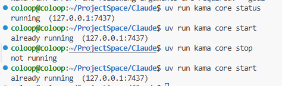

不过我们的`cmd_run`入口依旧没有变动，也就是一开始依旧是从这里开始的

### cmd_run
我们的cmd_run依旧在cli/commands/run.py中
不过函数已经发生了变化，这里在异步执行`_run_async`的函数，这个函数就在cmd_run的上面
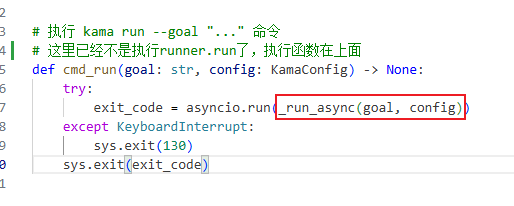

### `_run_async` 前半
对于`_run_async`我们需要拆成两部分，我们先理解如何构造客户端与TCP连接
以及一个内嵌的回调on_event

```
# 异步核心：连接 daemon，订阅事件，触发 run，等待 run.finished
# 接收目标文本和配置，返回一个整数作为进程退出码
async def _run_async(goal: str, config: KamaConfig) -> int:
    # 建立客户端，参数为127.0.0.1和7437，是我们的daemon监听端口
    client = SocketClient(config.host, config.port)
    try:
        await client.connect() # 这里才开始分配给客户端端口以及与daemon连接
    except (ConnectionRefusedError, OSError):
        print(f"error: core not running ({config.host}:{config.port})", file=sys.stderr)
        return 1

    printer = StdoutPrinter()
    finished = asyncio.Event() #完成信号
    exit_code = 0 #退出码

    # 内嵌回调，python就是自由，这个函数是为了解析服务端来的各种推送事件并且打印或者处理结束事件
    async def on_event(event: dict[str, Any]) -> None:
        # nonlocal意思是在嵌套函数里，声明某个变量不是本函数的局部变量，也不是全局变量，而是外层函数作用域里的变量
        # 表明这里的退出码是外层的退出码，并且允许直接修改它
        nonlocal exit_code
        await printer.handle(event) 
        # StdoutPrinter实例返回的run.finished是终局事件
        if event.get("type") == "run.finished":
            # 错误时返回1或者其他错误码，返回0表示 本次调用成功
            if event.get("status") != "success":
                exit_code = 1
            finished.set() #把事件设为已触发，唤醒所有正在 wait() 的协程

    client.on_event(on_event) #加入_event_handlers列表
```

关于最后的finished的原理，可以到前置知识中了解asyncio.event的原理，这是一个对于协程的标志位

#### SocketClient
关于很多具体实现细节，我认为应该先看SocketClient类中的实现
抱歉这里确实有点混乱，如果我们只看run_async我们大多数关于SocketClient的内容并不理解，但是我们如果看ScoketClient又很难以其他地方建立联系
##### 1.建立连接
在`run_async`中存在建立两端的连接
`await client.connect() # 这里才开始分配给客户端端口以及与daemon连接`
而这段代码在SocketClient中是这样实现的:
```
    # reader和writer获取到socket
    async def connect(self) -> None:
        self._reader, self._writer = await asyncio.open_connection(
            self._host, self._port, limit=_MAX_LINE_BYTES
        )
```

关于reader和writer的具体内容请看前置知识中有解释，这是一堆对于socket的高级封装实例，不过我们这里可以简单理解为读和写的管道或连接
##### 2.推送事件on_event
在run_async中有:
`client.on_event(on_event) #加入_event_handlers列表`
在SocketClient中的实现是：
```
def on_event(self, handler: EventHandler) -> None:
        self._event_handlers.append(handler)
```
虽然两者都是on_event但请注意并不一样
一个是作为回调参数在run.py中的on_event，在run.py中有具体的实现逻辑，一个是socket_clinet中的on_event,只是负责将对应on_event加入到_event_handlers列表中，而在后面的dispatch中执行
而_event_handlers是存储事件处理函数的列表`list[EventHandler] = []`

这里应该说明清楚,run.py中的on_event是负责解析服务端推送过来的事件：展示事件内容，并在收到结束事件时通知主任务
对应事件在run.py中StdoutPrinter解析有：
- run.started：记录开始时间，打印运行编号。
- step.started：打印当前步骤开始规划。
- llm.token：输出模型生成的文本片段，不立即换行。
- tool.call_started：打印工具名称和参数。
- tool.call_finished：打印工具执行成功及耗时。
- tool.call_failed：向 stderr 打印工具错误。
- step.finished：打印步骤结束。
- run.finished：打印最终状态、步数和总耗时。

请各位先小心这里关于EventHandler，具体细节我们到下面的dispatch函数再说明，这里各位只需要知道是将run_async的on_event塞入了SocketClient的_event_handlers就行
##### 3.发送命令send_command()
这里出现了一个重要的概念，future未来容器，这表示当前还为空但未来会为其填补上，如果各位不了解可以去看看前置知识中的相关概念
我们先说关于_pending是什么
`self._pending: dict[str, asyncio.Future[dict[str, Any]]] = {}`
前面的str是请求id，在`send_command()`中随机生成`req_id = str(uuid.uuid4())`
而请求表_pending和fut的关系是这样的
`self._pending[req_id] = fut `
这其实说明fut是命令请求返回的命令响应结果，既然是响应结果，那自然不能立即获得，这也是为什么后面会有等待结果的`return await fut`

然后再把这一段说完
```
self._writer.write(request.model_dump_json().encode() + b"\n") #写入缓存
        await self._writer.drain() #等待写入缓冲区压力降低到水位线
```

这里属于TCP通信了，也就是把我们的请求转换为字节流写入连接中，发送给服务端
各位可以理解为一根管子，我们从这端读写发送给对端，现在我们发送了请求，在未来一段时间后就可以收到回信了，可以在`run_event_loop`中读取响应

##### 4.run_event_loop读取循环
在看socketclient的具体实现之前，我们可以留意到在run.py中有
`loop_task = asyncio.create_task(client.run_event_loop())`
在我们说明完socketclient之后我们就会回来继续讲解loop_task与run_async的组成与关系
在函数中有这样的部分
```
while True:
                try:
                    #逐行读取缓冲区信息
                    line = await self._reader.readline()
                except (ConnectionResetError, OSError):
                    break
                if not line:  #返回空字符串说明到达EOF
                    break
                await self._dispatch(line) #将所有消息交给派遣函数
```

说明这是一个反复读取的循环，只要当连接建立并且缓冲区一直有信息就会反复读取
这里`line = await self._reader.readline()`不一定是之前在`self._writer.write(request.model_dump_json().encode() + b"\n")`写入请求的响应，也可能是其他的事件推送消息

咳咳，那我们应该正式说明在我们的TCP连接中存在两种消息
- 命令响应：JSON-RPC格式，带有"jsonrpc:":"2.0"和"id"字段，是对应之前某次发出的命令请求send_command()
发出于`socket_server.py`中的
```
 result_data: Any = result.model_dump() if isinstance(result, BaseModel) else result
        await self._send(writer, JsonRpcSuccess(id=req.id, result=result_data))
```

对于JsonRpcSuccess的结构，在`envelope.py`中：
```
class JsonRpcSuccess(BaseModel):
    jsonrpc: Literal["2.0"] = "2.0"
    id: str
    result: Any
```

- 事件推送：带有"kind":"event"字段，是守护进程主动发来的
发出于`ipc_broadcaster.py`中的
```
envelope = EventPushEnvelope(event=event_dict)
                sub.writer.write(envelope.model_dump_json().encode() + b"\n")
```

我们再来复习一遍EventPushEnvelope的结构,在`envelop.py`中
```
class EventPushEnvelope(BaseModel):
    kind: Literal["event"] = "event"
    event: dict[str, Any]  # Event.model_dump() 的序列化结果
```
##### 5._dispatch派遣函数
在前面我们也说了在连接中存在两种消息：命令响应和事件推送，而它们会混在一个缓冲区，所以需要在这里进行区分
 
1. 命令请求：
```
if "jsonrpc" in msg:
            req_id: str | None = msg.get("id") #从msg字典中取出id对应的值存入req_id如果不存在就获得None
            if req_id and req_id in self._pending:
                fut = self._pending.pop(req_id) #获取请求结果并在请求表中弹出
                if not fut.done():
                    if "error" in msg:
                        err = msg["error"]
                        fut.set_exception(
                            IpcError(err.get("code", -1), err.get("message", "unknown"))
                        )
                    else:
                        fut.set_result(msg.get("result") or {})
```
检查获得的消息如果带有'jsonrpc'则说明是JsonRpcSuccess或者JsonRpcError，如果是JsonRpcSuccess说明成功响应，将成功的结果加入到fut反馈给send_command,让对应的send_command等待结束

2. 事件推送
```
 elif msg.get("kind") == "event":
            event_data: dict[str, Any] = msg.get("event", {})
            for handler in self._event_handlers:
                await handler(event_data)
```
检查到kind中带有event字段说明是事件推送消息，取出_event_handlers中的handler并且解析
各位没忘记handler其实是run.py中的on_event对吧，所以这表示解析服务端的事件推送消息


### `run_async`后半
好，我们应该回来了，在理解socketclient的函数之后，我们应该对于上面这段函数有更深的理解了吧
接下来的部分是
```
loop_task = asyncio.create_task(client.run_event_loop()) #启动一个持续读取消息的任务

    try:
        await client.send_command(
            "event.subscribe",
            {
                "topics": ["run.*", "step.*", "tool.*", "llm.token", "llm.usage"],
                "scope": "global",
            },
        )
        await client.send_command("agent.run", {"goal": goal})
    except IpcError as e:
        print(f"error: {e}", file=sys.stderr)
        loop_task.cancel()
        await client.close()
        return 1

    await finished.wait()

    loop_task.cancel() #关闭循环读取任务
    try:
        await loop_task
    except asyncio.CancelledError:
        pass

    await client.close()
    return exit_code
```

这里其实可以分成三个部分，循环接收任务，发出两种命令请求，关闭连接

#### 1.发出两种请求
我们发出的请求会通过服务端`socket_server.py`中的`line = await reader.readline()`->`await self._handle_line(line, writer)`->`handler = self._handlers.get(req.method)`->`result = await handler(req.params)`执行
**可能各位看到这里都昏头了，如果当前不想管我们的请求会怎么进行处理，单纯理解发出请求进入一个黑盒就好，我也觉得后面有点写的太杂了(＃°Д°)**
我们可以根据send_command对于两种请求进行分割
对于前者有
```
method = "event.subscribe"
params = {
    "topics": ["run.*", "step.*", "tool.*", "llm.token", "llm.usage"],
    "scope": "global",
}
```
而在app.py中可以看到对应方法与对应函数的注册关系


而对应的注册函数则在上面实现
```
# 注册客户端事件订阅，可选先回放 events.jsonl 历史再接收实时流
    async def _subscribe_handler(self, params: dict[str, Any]) -> EventSubscribeResult:
        cmd = EventSubscribeCommand.model_validate(params)
        writer = get_connection_writer()

        replayed_count = 0
        if cmd.replay_from_run is not None:
            replayed_count = await self._replay_events(
                cmd.replay_from_run, writer, cmd.topics
            )

        sub_id = self._broadcaster.subscribe(writer, cmd.topics, cmd.scope)
        return EventSubscribeResult(subscription_id=sub_id, replayed_count=replayed_count)
```

各位现在就先理解为注册客户端事件订阅就行

对于后者也在这段代码里面被注册
`server.register("agent.run", self._agent_run_handler)`
而实现函数有在上面
```
# 启动一次 agent run：立即返回 run_id，后台 task 执行 runner.run()
    async def _agent_run_handler(self, params: dict[str, Any]) -> AgentRunResult:
        assert self._config is not None
        cmd = AgentRunCommand.model_validate(params)

        if self._current_run_task is not None and not self._current_run_task.done():
            raise RuntimeError("a run is already in progress")

        run_id = new_run_id()
        runner = AgentRunner(self._config, bus=self._bus)
        self._current_run_task = asyncio.create_task(
            runner.run(cmd.goal, run_id=run_id)
        )
        return AgentRunResult(run_id=run_id)
```
#### 2.循环接收任务
其实这一部分只有一小段代码
`loop_task = asyncio.create_task(client.run_event_loop()) #启动一个持续读取消息的任务`
不过这段代码可一点都不简单，我需要讲解一下create_task()的特性，create_task既能创建task，也安排其中的协程运行，不需要手动调用启动，也不需要`awaite loop_task`启动它，当主任务挂起时，事件循环就有机会运行接收循环任务，两个任务通过等待交替运行

流程如下：`run_async`主任务按顺序执行->执行到`send_command`->执行到`return await fut`->事件循环切换到接收任务loop_task->接收任务loop_task运行,读取数据后交给dispatch()->执行到没有数据可读后在`line = await self._reader.readline()`挂起->事件循环切回主任务run_async->run_async恢复，await得到结果，继续执行后面的任务

#### 3.关闭连接
```

    loop_task.cancel() #关闭循环读取任务
    try:
        await loop_task
    except asyncio.CancelledError:
        pass

    await client.close()
    return exit_code
```
由代码所示，先关闭循环读取任务，再关闭客户端连接，最后返回退出码

我去，虽然各位看起来只有简单几十行代码，但真的相当相当绕，对于TCP连接产生不同函数的联系以及协程与事件循环导致任务的切换，都让这段代码相当费解，希望各位可以理解到，代码之间的耦合不只是调用和被调用，甚至有更隐藏深层的关系

### 目前的流程图
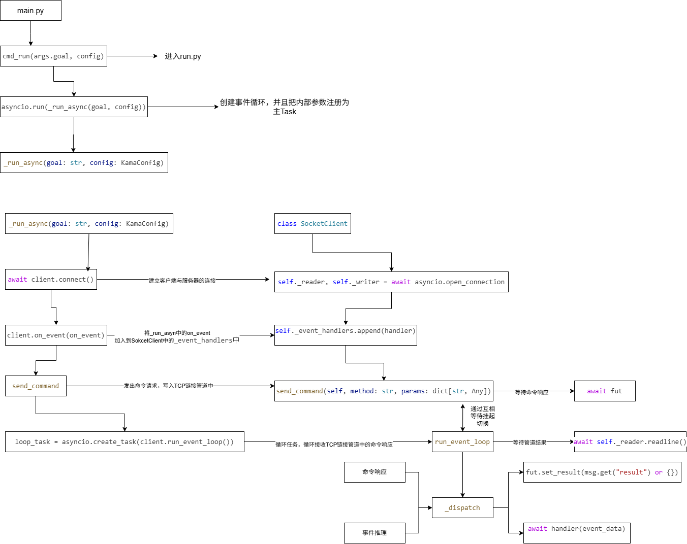

## 从更早之前的pyproject.toml理解这一切
其实我们到目前为止都一直在讲main启动的流程，但其实我们早就知道这是双进程的系统，所以我们一直在研究的是cli的运作流程，那为什么s1不学习守护进程的流程呢？答案是s1的守护进程只注册了ping这一个函数，所以没什么可讲的，好吧，让我们理解一下这几个部分是怎么运作的吧
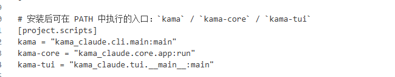

在pyproject.toml里面说明很清楚了，当我们运行`uv run kama ...`时会启动main，如果这时候是`uv run kama run --goal "..."`则会则会进入cmd_run函数
让我们首先理清楚s1和s2两个进程分别流程顺序的区别吧:
s1:
- `uv run kama --goal "..."`:cli.main->cli.run.cmd_run->asyncio.run->runner.run->loop.run
- `uv run kama-core`:app.run->asyncio.run()->CoreApp().run()->server.start()->core.ping
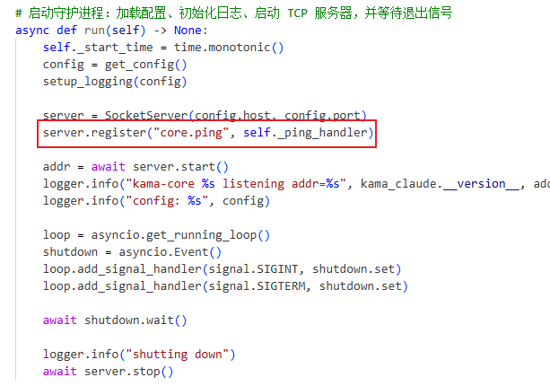
s2:
- `uv run kama --goal "..."`:cli.main->cli.run.cmd_run->asyncio.run->_run_async->client.send_command/client.run_event_loop()
-`uv run kama-core`:app.run->asyncio.run()->CoreApp().run()->server.start()->(core.ping,agent.run,event.subscribe)
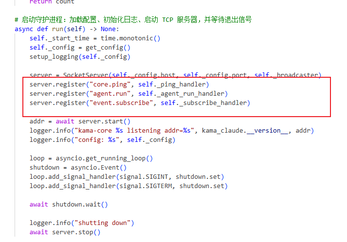

可以发现s2多了三个函数，而且我们的agentrunner与loop在哪里调用得从后面说起了

### `app.py`,`socket_server.py`与三个注册handler
在前面我们说在注册了三个handler函数，这三个handler在`app.py`的上方都有实现
要找到它们的调用位置我们需要从`socket_server`说起
#### 把视角转向`socket_server.py`吧
我们从start方法开始看起，前半部分是测试连接，后半部分有一个函数是
```
self._server = await asyncio.start_server(
            self._handle_connection,
            host=self._host,
            port=self._port,
            limit=_MAX_LINE_BYTES,
        )
```

其负责监听TCP连接，当有客户端连接进来时就执行对应函数
`host`与`port`是监听的地址与端口
`_handle_connection`是对应连接的处理函数
`limit`是每条连接的StreamReader读取限制

顺着`_handle_connection`依次的链路是`_handle_connection`->`_read_loop`->`_handle_line`->`handler`
到了handler就会根据请求req中的`req.method`执行对应handler
不过你们可能发现了一个神奇的参数叫做`ContextVar`
#### 上下文变量ContextVar
首先解释ContextVar是用来管理当前任务的上下文变量的，避免在多个任务中来回切换导致全局变量丢失获取无法获取到对应变量
也可以了解这篇[Python contextvars：跨异步任务的上下文管理利器](https://blog.csdn.net/fydw_715/article/details/149227323)
上下文变量的定义是在`socket_server.py`的开头
`_writer_var: ContextVar[asyncio.StreamWriter] = ContextVar("_writer_var")`
其需要存储的实例是writer连接，而这个连接只会在`_handle_connection`的参数中传入
谁需要这个writer的值呢？
我们回过来再看这里
`_writer_var.set(writer)`这表示将writer存入上下文中，当前任务(Task)中的上下文
```
def get_connection_writer() -> asyncio.StreamWriter:
    return _writer_var.get()
```
表示取出这个writer
这个函数的调用要回看app.py中的这个函数
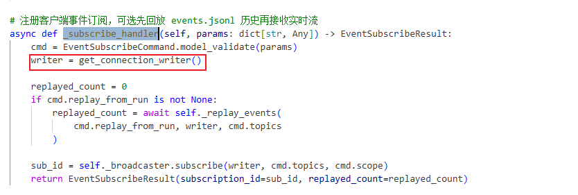

因为事件广播需要注册并将事件信息写入对应连接的TCP缓存
那为什么不作为参数传入呢？答案是首先所以handler的执行都是只传入params的，不能针对`_subscribe_handler`单独传入writer
对于`_subscribe_handler`的参数，我们回看到`run.py`
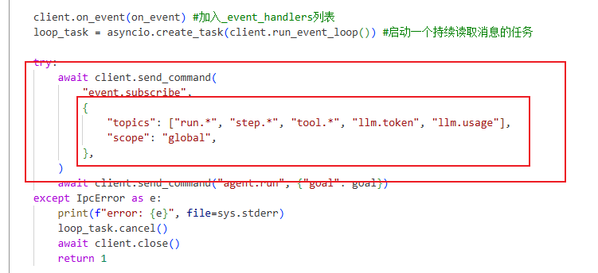

果然没有writer连接对吧，而且我们根本就无法传入，因为`_subscribe_handler`需要服务端的writer，客户端压根没有

1.来分析调用过程吧
```
  _handle_connection()
         └─ await _read_loop()
              └─ await _handle_line()
                   ├─ _writer_var.set(writer_A)
                   └─ await _subscribe_handler()
                        └─ get_connection_writer()
                             └─ _writer_var.get()
```
我们得到了一些条件，首先params无法获取到writer，想要获取到writer只能跨越模块获取
其次，writer并不是服务端一开始就能知道的，reader、writer：由前面的 asyncio.start_server 在接受新连接后提供
2. 全局变量与思考
虽然需要跨越模组，那我们设置一个全局变量，一开始标记为None，再获取后再更新不行吗？
在我们做算法题时经常会用到的方法，不过在这里不行，因为这里是多协程并发

该从哪里讲起来呢？对于上面的调用过程我们称为任务(Task)
按照我们的运行逻辑
- 每接收一条连接，asyncio都会为异步回调创建一个Task，两个连接就可以有Task，这些Task共用一个线程，我们的客户端只会有一条线程
- 把上述各种协程封装到Task中，交给事件循环调度Task需要等待的await处挂起，等待条件满足后再由事件循环安排恢复，再挂起期间其他Task的协程是可以拿到CPU执行权并运行的
- 我们会发现一个问题，如果把writer变成全局变变量记录，在新的任务某一个时刻，可能会被修改，导致前面的任务拿到了错误的writer

深呼吸，我们理清楚这几个逻辑，首先我们需要一个类似全局变量的方法来解决`_subscribe_handler`获取`writer`的问题，但是全局变量会被修改，那其实ContextVar的处理方法很简单，就是利用每个Task固有的上下文，这个数据容器，存储当前Task的writer，等到需要时再取出，每个Task中的writer是可以不一样的，其用不同的`_writer_var`标识

当然对于`_subscribe_handler`我们还没有认识完，但现在我们换过来吧

### 交给守护进程启动的_agent_run_handler
我们之前在s1阶段，我们把agent启动与运行都交给客户端进程了，这其实有很大的问题，而我们现在把它转换成handler了，你应该清楚我们对于handler的处理流程了吧

在最开始客户端在run.py发送了`await client.send_command("agent.run", {"goal": goal})`的命令，然后被`socket_server.py`中的`_read_loop`读取到了，然后执行对应的handler，很合理吧，自然将agent的启动与运行都交给了守护进程，也就是我们的服务端
不过各位看到这里应该知道后面到底发生了什么吧
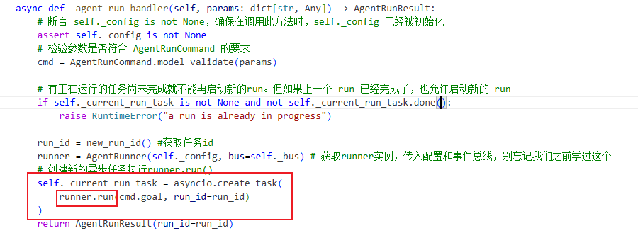

完整的流程是
1. `await client.send_command("agent.run", {"goal": goal})`发出请求信息，说明需要的handler是`_agnet_run_handler`
2. 服务端通过TCP连接接收到消息，read_loop->_handle_line，然后解析执行对应handler
3. 执行`_agnet_run_handler`,注意这里是服务端创建了新的异步任务Task，现在你应该清楚我们的异步任务到底在做什么了吧
4. `runner.run()`订阅事件总线，组装并运行`loop.run`，写 events.jsonl
5. `loop.run`依次执行plan，observe，act三步

除了`asyncio.create_task`会创建协程任务，并使用事件循环维护其中的任务，其他的内容和我们s1学习的一样

## IPC事件广播
让我们回到`ipc_broadcaster.py`吧，这是我们完整链路的最后一块拼图
### 1.订阅函数
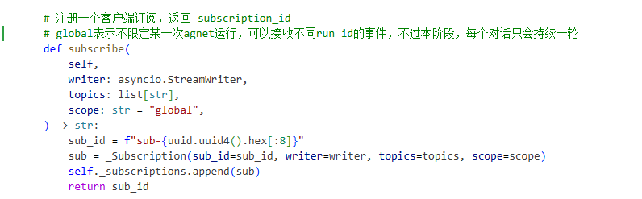
出现在这里的订阅函数用于对应客户端的订阅，而这个订阅函数在这里调用
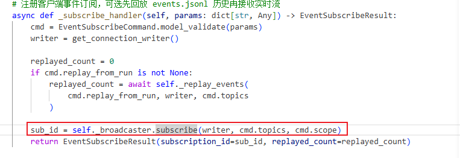
这也是我们需要使用writer的原因之一

### 2.handle处理函数
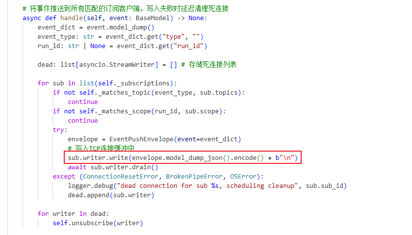
最关键的是这里将对应的事件消息信息发送到了TCP连接的缓冲中，各位如果没忘掉的话，我们的TCP连接会向用户端写入两种消息，一种是来自大模型的响应消息，一种是这里的事件触发消息，这些消息会一并送到socket_client.py中的dispatch()中完成解析

### _mathes_topic/_matches_scope匹配函数
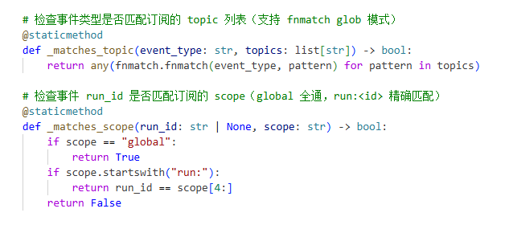

首选说说静态方法staticmethod，静态方法不需要访问实例属性，通过实例(self)调用时，不会自动传入self

然后我们来解释第一个事件类型匹配函数
这里分为event_type,各位在上面追根溯源的话，可以找到其对应事件消息的event字段
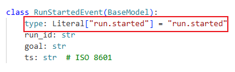

后面的pattern是topics的元素，这个东西其实我们以前也见过，没错，就是在run.py中用户发出的信息
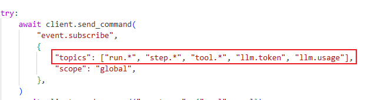
其规则就是满足其中任意一个条件即可，比如run.started对应了run.*

后面一个函数_matches_scope是范围匹配函数
因为我们每一轮运行都会启动一个新的agnet任务，产生新的run_id（在app.py)
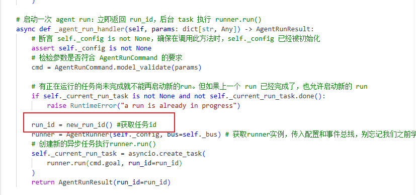

如果scope是global的话就全部通过，否则只允许匹配的run_id允许

## 事件回放
在我们的`_subscribe_handler.py`中还有一个函数我们之前没有说明，到现在终于可以把它解释清楚了
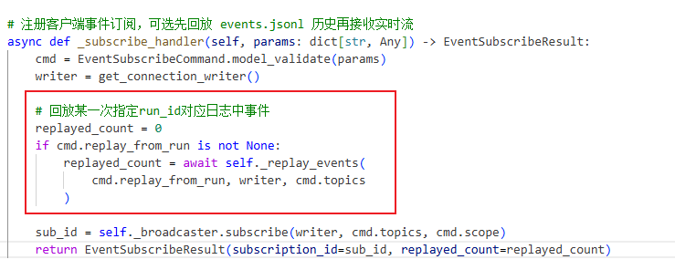

你知道我们所有的对话都有对应的run_id，这些run_id对应了其的events.jsonl
比如我们记住这里的run_id
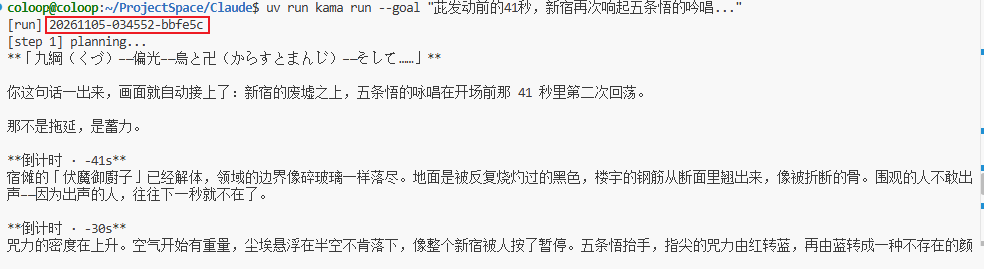

到文件夹的对应位置寻找，当然各位也知道events.jsonl的写入是怎么实现的吧
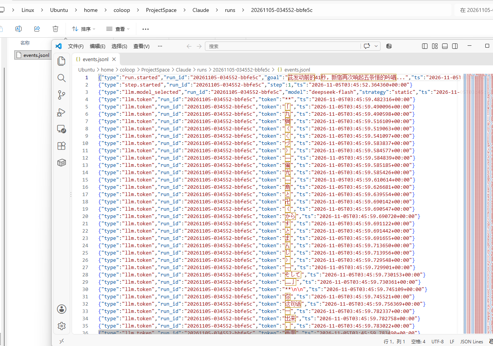

```
# 从 events.jsonl 向 writer 回放匹配 topic 的历史事件，返回已回放条数
    async def _replay_events(
        self,
        run_id: str,
        writer: asyncio.StreamWriter,
        topics: list[str],
    ) -> int:
        # 填入的run_id就是上面上传的cmd.replay_from_run
        path = events_file(run_id) # 找到对应run_id的event.json路径
        if not path.exists():
            return 0

        count = 0
        # 逐行解析事件
        for line in path.read_text().splitlines():
            if not line:
                continue
            try:
                event = json.loads(line)
            except json.JSONDecodeError:
                continue
            event_type: str = event.get("type", "") # 获取事件类型
            #如果不是用户要求的事件类型就跳过
            if not any(fnmatch.fnmatch(event_type, p) for p in topics):
                continue
            envelope = EventPushEnvelope(event=event)
            # 将对应历史事件包装成推送消息写入客户端
            writer.write(envelope.model_dump_json().encode() + b"\n")
            count += 1

        # 完成写入并返回数量，并进行流量控制
        if count:
            await writer.drain()
        return count 
```

这段代码的含义就是找到对应events.jsonl的位置并且逐个解析事件

不过各位可能会疑惑一点就是`cmd.replay_from_run`从哪里来呢？
可以回看到，在commands.py中存在对应事件注册命令的格式，其中replay_from_run是可选参数，所以我们只需要在send_command的对应参数中填入对应run_id即可
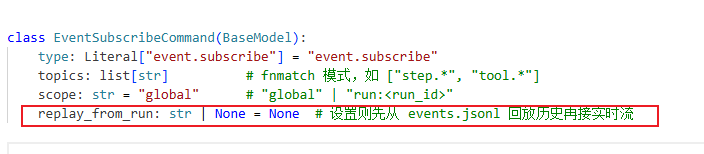

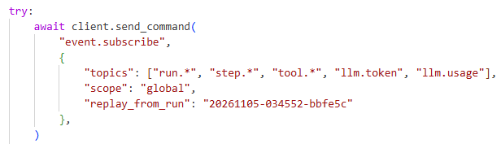

然后我们再试试输入命令会怎么样
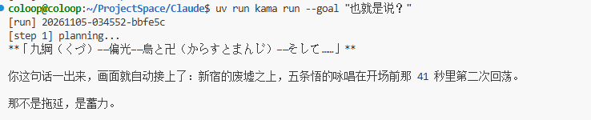
按照流程我们确实会根据事件的消息打印到终端，不过各位可能也注意到了一点，就是我们本次对话中的消息并没有得到回复，这是因为在历史事件中存在run.finished事件，当on_event读取到时就会finished.set()终止本次对话，如果我们尝试删掉就可以正常出现接下来的对话了

## tui客户端
这部分使用[textual](https://textual.textualize.io/)实现，感兴趣的话可以深入了解一下

### 超长马拉松
其实一直从开始到正式调用我们app.py中的代码有相当麻烦的函数调用，各位简单看一下就好，这部分我也看晕了

1. 我们知道从一开始输入`uv run kama-tui`会进入tui.__main__:main中
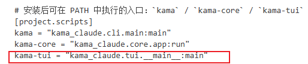

2.构造KamaTuiApp对象，并且调用run()方法
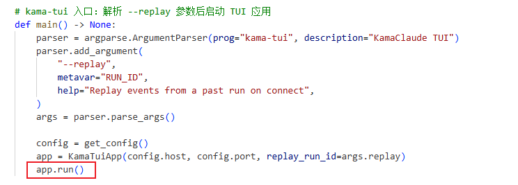

3.  然而这个run方法并不是我们定义的，实际上KamaTuiApp集成了textual中的app
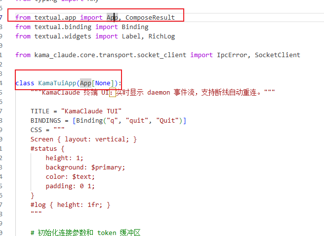

4.  在lib库中可以看到textual中有对应的app.py
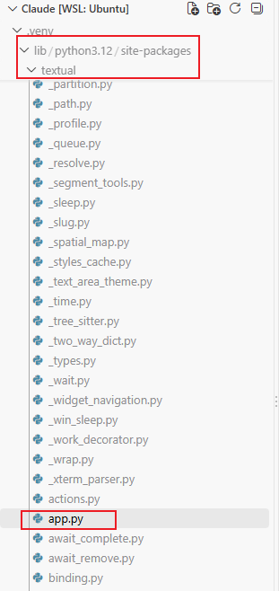
在这个位置找到run函数
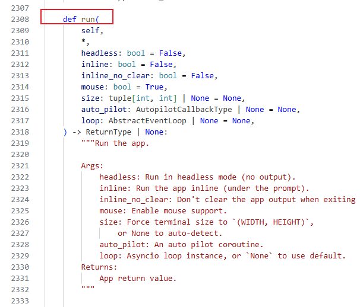

5.  从这里进入run_app()
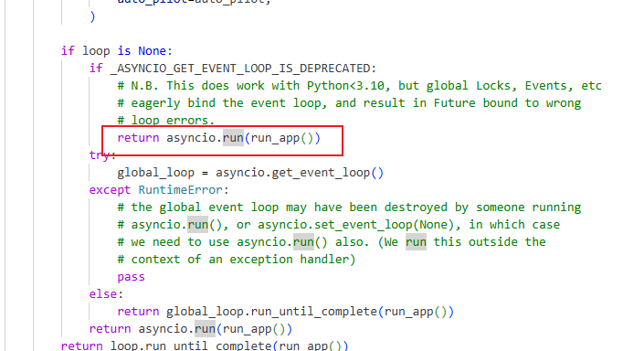

6.  从run_app进入run_async中
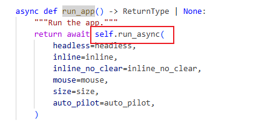
7.在大约2220行时有run_async，其运行了_process_messages函数
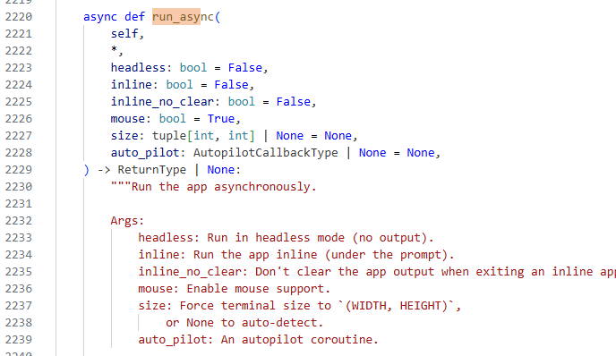
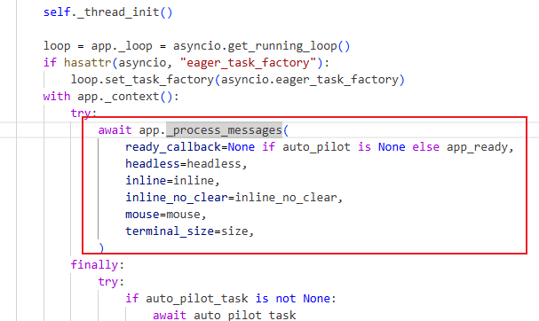

8.   在大约3364行中出现_process_messages,而在更下面会运行_dispatch_message
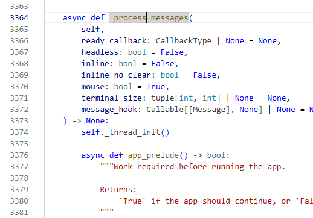
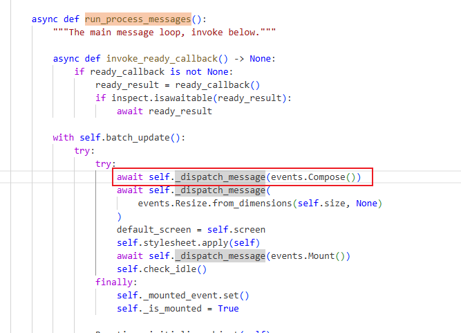

9. 在另一个模块message.py中，会将Compose修改为on_compose()函数并运行
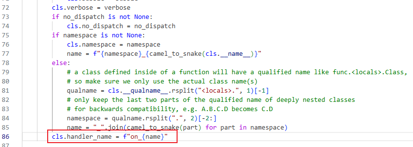

10. 在on_compose中运行了compose
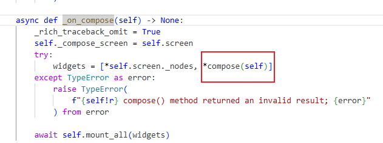

欧耶，根据子类发放覆盖父类的原理，这里调用的就是我们的自己写的compose函数
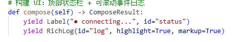

看起来确实很痛苦，我也不知道自己讲清楚没有，总之各位记住run之后进入了compose函数就好

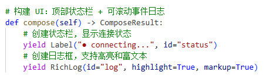
在compose创建完状态栏和日志框之后，我们再回看到_on_compose函数

11.其会调用mount_all函数，这个调用另一个继承了Widget的Screen
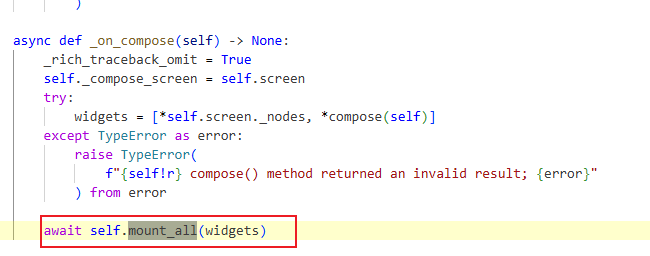
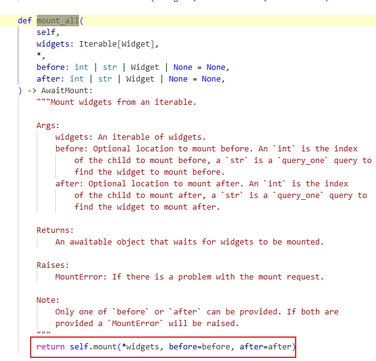

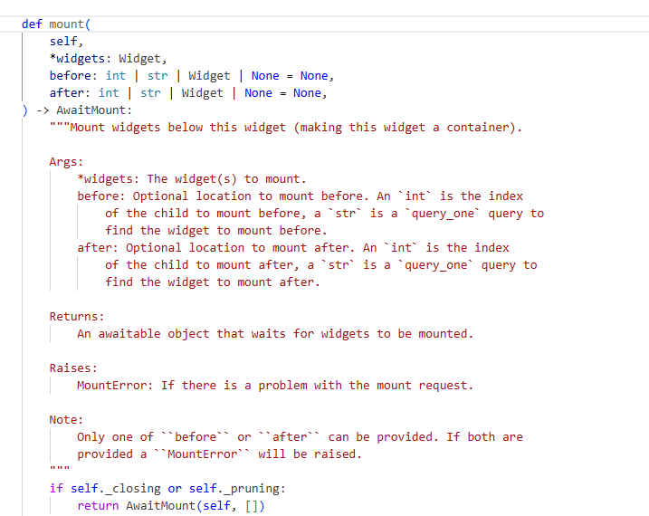
这个函数的作用是把我们创建好的状态栏与日志框加入到屏幕上

12.   等待上面的mount完成之后继续执行这里的任务中的Mount，按照之前的意思，会转换成我们app.py中的函数on_mount
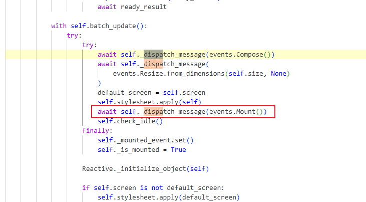

13.
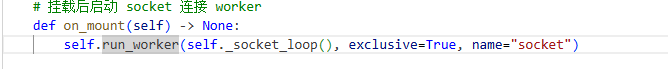
- self._socket_loop()：创建网络协程，里面负责连接守护进程、订阅事件、持续接收和断线重连。
- self.run_worker(...)：Textual 提供的方法，将这个协程作为后台异步任务运行并管理其生命周期。
- exclusive=True：取消同组中已有的其他 Worker；name="socket" 是给这个 Worker 起名，方便识别。

可以理解为asyncio.create_task()


### _socket_loop
前面的代码确实有点抽象，各位也不必过于纠结，总之从`socket_loop`开始理解就好
该从哪里讲起来呢？
首先是注意到tui其实是一个新的客户端，它在概念上和其他的cli客户端没有差别，通过RichLog渲染到终端，通过Label显示状态
不过我们的tui和其他cli是在不同进程的，应该可以理解吧，每一次cli都在不同进程，但守护进程只有一个

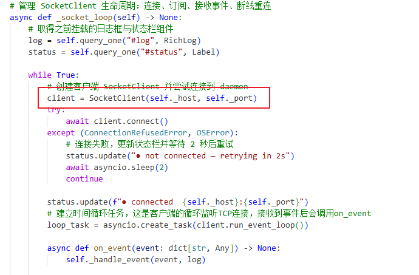

然后会遇到我们的老熟人，客户端的读取循环，这是tui监听的关键，然后注意下面的client.on_event注册的是我们的on_event,其是调用了下面的_handle_event

然后还请注意这里我们并没有调用run_event_loop,现在还仅仅是循环任务，需要主任务交出CPU执行权才行
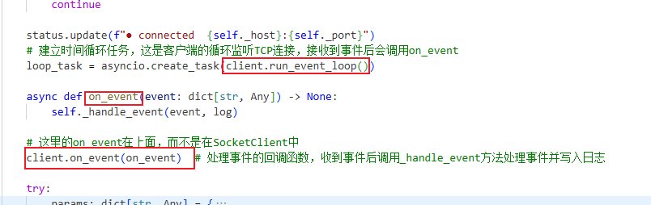

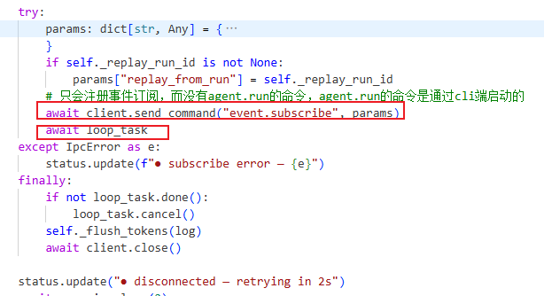

不过在我们发出"event.subscribe"之前，因为没有向IPC广播注册，所以我们其实是拿不到事件的，所以其实也只有在这之后才会真正开始打印(不过在之前，如果send_command卡住，loop_task是真的会执行的)

然后一个比较有趣的写法是，我们知道我们的llm.token是按照token发送的(废话)，那如果我们每一次都log.write就会出现比如，'你'，'好'依次到达，但是屏幕上是
```
你
好
```
这样肯定不美观，所以我们采取的操作是使用缓冲token_buf,当事件是llm.token，先写入token.buf中，如果下一次也是llm.token也写入，直到遇到的不是llm.token,才会执行flush_token，把这些token一次性打印出来
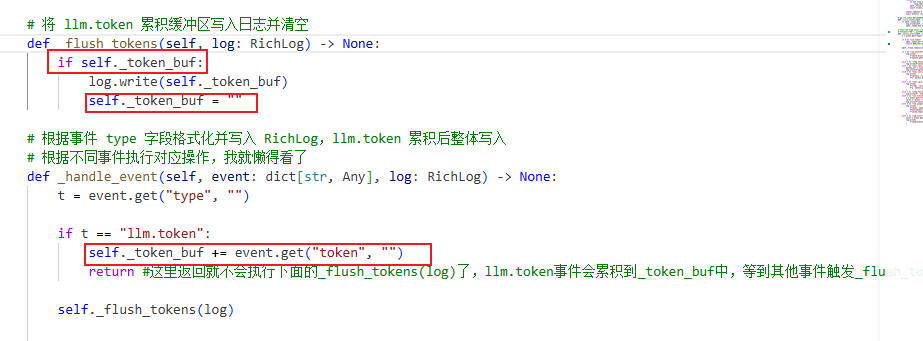

剩下的_handle_event就是一些简单的美术设计，这里就不解释了

### tui流程
这里简化一下关于textual的部分了,作者试试伪代码，或许可以更好表示重要的流程？
```text
启动流程:
    创建 KamaTuiApp
    调用 app.run()

    框架调用 compose()，取得状态栏和日志框
    框架挂载组件
    框架调用 on_mount()
        启动 Worker，执行任务 A


任务 A：_socket_loop，管理连接:
    取得状态栏和日志框

    循环:
        创建 SocketClient
        等待连接成功
        登记本地事件回调 on_event

        loop_task ← 创建并启动任务 B

        发送 event.subscribe，并等待响应
        等待 loop_task 结束

        清理连接，等待后重试


任务 B：run_event_loop，接收消息:
    循环:
        等待并读取一行消息

        如果读到 EOF:
            退出循环

        调用 _dispatch(消息)
            如果是命令响应:
                完成对应 Future
            如果是事件推送:
                调用已登记的 on_event
                    调用 TUI 的 _handle_event
                    更新日志框
```

额，可能写起来更看不懂了，毕竟我们的代码并不是顺序执行的，伪代码可能真的有些麻烦啊


当然作者用ai做了一个增强版的TUI，不过也只是在文字渲染上，后面我们的tui界面会更高级，借由这个框架，我们还可以做到更多事情
启动方式是`uv run coloop-tui`
功能其实和kama-tui一样

## 最终全流程
除了TUI，让我们把全部的流程拼凑起来吧，这个阶段我们分离了守护进程与cli和tui的任务，应该对于协程，任务调度与代码流程更加熟悉了吧
守护进程部分：
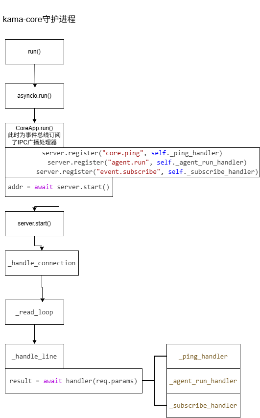
其中两个handler的执行流程：
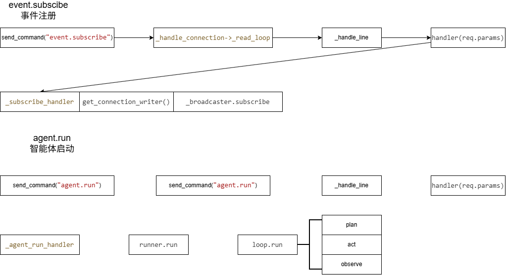

cli进程：
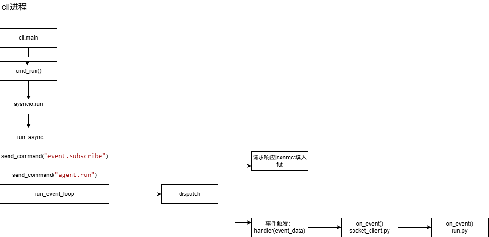

从事件发送到处理：
