# S3-trace数据流时间线与agent自主规划
## trace数据流
### 我们知道的与我们不知道的
在S2，我们把任务在两个终端很好的运行起来了，并且在cli和tui都能根据收到的事件流打印，在events.json中完整地打印了一次对话的开始到调用根据到每一个token的细节
不过这一切都只是eventBus内部的视角，以事件为单位的视角
我们并不知道json-rpc的原始数据也不知道LLM API完整的messages与收到的原始响应
所以有必要在这个系统中埋入观察点，按照时间线理解整个流程。

整个系统的数据流程有这些：
1. client->core:客户端发出的json-rpc命令
```
run.py
  await client.send_command(
            "event.subscribe",
            {
                "topics": ["run.*", "step.*", "tool.*", "llm.token", "llm.usage"],
                "scope": "global",
            },
        )
        await client.send_command("agent.run", {"goal": goal})
```
2. core->client:守护进程的响应与事件回复

```
socket_server.py

await self._send(writer, JsonRpcSuccess(id=req.id, result=result_data))
```
3. core：eventbus内部发布的事件

```
ipc_broadcaster.py

sub.writer.write(envelope.model_dump_json().encode() + b"\n")
```

4. core->llm:发出 Anthropic API 请求：

```
 response = await self._provider.chat(
                    messages=context.messages,
                    tool_schemas=self._registry.tool_schemas(),
                    bus=self._bus,
                    run_id=context.run_id,
                    step=context.step,
                )
```

5. llm->core：收到Anthropic API响应

```
provider.py
result = await self._inner.chat(messages, tool_schemas, bus, run_id, step=step)
```


### 层级划分
根据上述五种数据的流动，我们可以将其分为三层
- ipc：进程间通信层
观察客户端进程与 kama-core 之间的通信，包括客户端发来的命令、daemon 返回的响应，以及主动推送给客户端的事件。埋点位于 SocketServer 和 IpcEventBroadcaster。
client->core,core->clinet

- event：内部事件层
观察 kama-core 内部通过 EventBus 发布的事件，例如 run.started、step.started、tool.call_finished。埋点是 CoreApp 注册到 EventBus 上的 trace 订阅者。
core

- llm：模型调用层
观察 Agent 向模型发送的请求，以及模型返回的结果。埋点位于包裹真实 provider 的 TracingProvider。
core->llm,llm->core

### TraceRecord
让我们先了解TraceRecord实例，了解我们要怎么记录这些数据

```
class TraceRecord(BaseModel):
    ts: str #记录时间戳
    direction: Literal[
        "CLIENT→CORE",
        "CORE→CLIENT",
        "CORE",
        "CORE→LLM",
        "LLM→CORE",
    ]
    layer: Literal["ipc", "event", "llm"] #所属层，trace系统根据系统在不同位置观察信息区分层
    kind: str  # command / response / error / push / event / api_call / api_response
    run_id: str | None = None #关联的运行实例ID
    step: int | None = None #关联的运行步骤序号
    client_id: str | None = None
    data: dict[str, Any] #获取到的具体信息
```

### 生成的trace.jsonl应该怎么存放
就像项目作者说的，每一个trace.jsonl存在到对应的run中管理或许更好，但是这样会存在一个问题
我们的run_id只会在_agent_run_handler启动后，或者说
runner.run调用之后才会创建
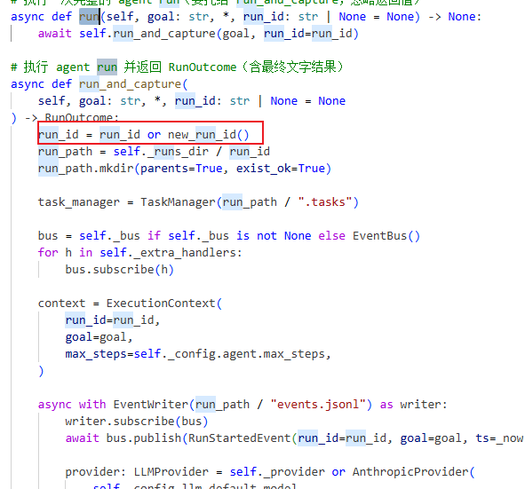
再此之前我们甚至不知道本次的对话的run_id是什么
然后事件订阅命令会先于agnet run命令
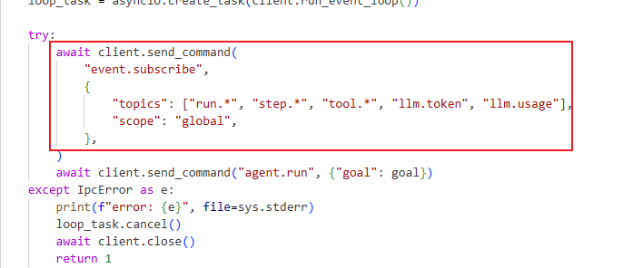

导致我们第一个埋点根本不知道往哪里找run_id（从而导致client->core的数据路径没有记录完）

因此我们只会创建一个单独的daemon.jsonl
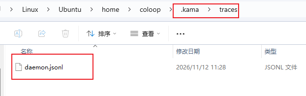

### 生产者-消费者模式/队列-drain task
其实我们这里的记录队列很有设计的
我们知道写入内存与写入磁盘的时间差别很大，如果每一次有数据记录需要写入我们都await 磁盘写入成功，会造成很大的阻塞，所以这里的设计是，如果出现需要记录的record，先放入队列，然后再持续从队列queue中读取记录
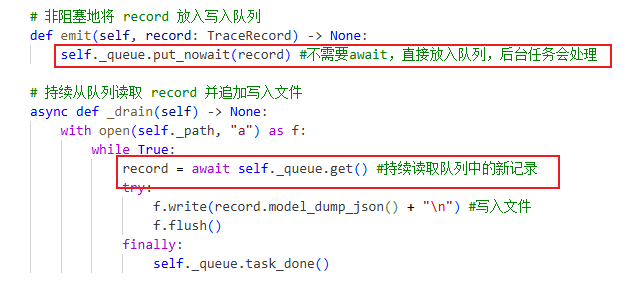

而且各位可以看到当TraceWriter实例启动后，会把_drain（）任务放入事件循环中，这样我们只会利用其他协程挂起时的空闲时间打零工写入磁盘
队列让埋点不必当场承担序列化和文件操作的成本
这样的设计是一种生产者-消费者模式，用于解耦生产数据的线程(协程)和消费数据的线程(协程)，通过共享缓冲区或对队列实现异步协作

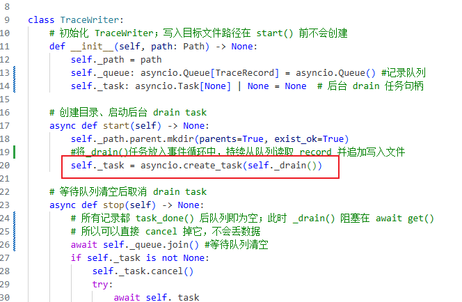

### 埋点实现
#### 埋点1 IPC层 client->core/core->client
代码都在socket_server.py

client->core
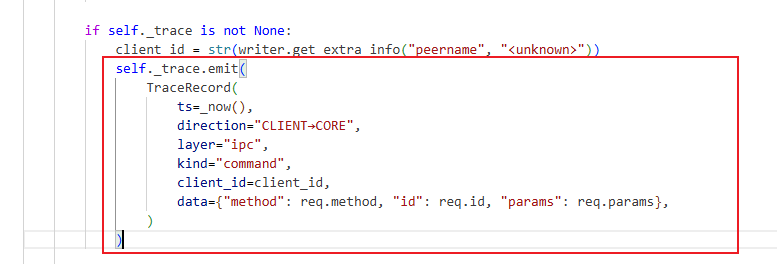

其实刚开始我也在疑惑，为什么不埋入send_command中，而且全部交给服务器呢？  
回答这个问题其实有两个原因，其一是我们的TraceWriter实例只存在于守护进程中，如果在每个客户端都创建一个TraceWriter，每个TraceWriter都有独立的queue，数据竞争起来也很麻烦

其二是，这里表示已经从客户端发出命令并成功接收且合法(当然其中的参数是否合法还没有验证)
core->client
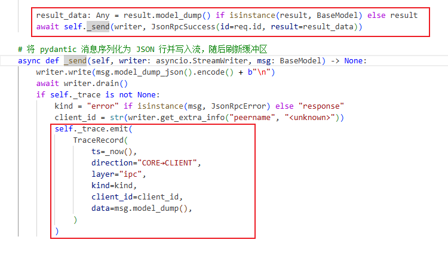

这表示core->client的响应消息,记录各种result = await handler(req.params)，各种handler的返回消息

#### 埋点2 IPC层 core->client
core->client
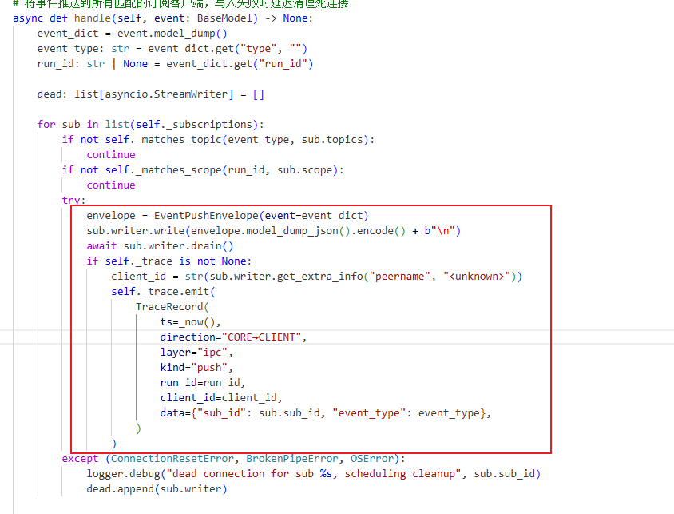

前面埋点1中的core->client都是jsonrpc类型的
`await self._send(writer, JsonRpcSuccess(id=req.id, result=result_data))`
表示收到从handler中返回的消息
这里埋点2的是从eventbus中针对用户订阅的事件类型，从而从core发给client的事件
同样是 CORE→CLIENT，命令响应包装为 JsonRpcSuccess，事件推送包装为 EventPushEnvelope，这一点我们在s2就了解到了
然后值得提到的是，我们的data只是记录了sub_id和，event_type对于事件具体内容我们并没有记录也没有关心

不过说起来按照时间线，eventbus事件总线其实是最优先接收到事件的，而IPC广播只是其中订阅的一个handler罢了
这里作者应该是为了逻辑性，按照层逻辑递进吧

#### 埋点3 EVENT层 CORE
前面我们知道想要获取eventbus中的事件直接用对应handler订阅就好，所以这里的埋点也是采用了订阅的方式
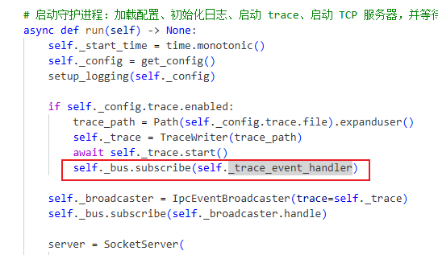

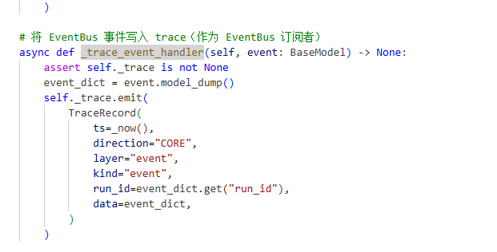

eventbus不会增加trace的逻辑，只需要转发事件给对应订阅handler就好，代码很简单这里就不详细说了

#### 埋点4 LLM层 CORE->LLM /LLM->CORE
##### 鸭子类型与Protocol类
在开始学习这部分之前，其实各位可能发现在runner.py中存在三种provider，LLMProvider、AnthropicProvider、TracingProvider
这三种provider之间没有任何继承关系，然而在交给agnetloop包装时却可以放在一起？
`loop = AgentLoop(provider, registry, bus)`
在回到一个问题之前我们先了解一个结论
“当看到一只鸟走起来像鸭子、游泳起来像鸭子、叫起来也像鸭子，那么这只鸟就可以被称为鸭子。”
这是鸭子类型的思想，鸭子类型（英语：duck typing）在程序设计中是动态类型的一种风格。在这种风格中，一个对象有效的语义，不是由继承自特定的类或实现特定的接口，而是由“当前方法和属性的集合”决定。[https://zh.wikipedia.org/wiki/%E9%B8%AD%E5%AD%90%E7%B1%BB%E5%9E%8B](https://zh.wikipedia.org/wiki/鸭子类型)
如果注意看的话，我们的LLMprovider中有继承这个Protocol类
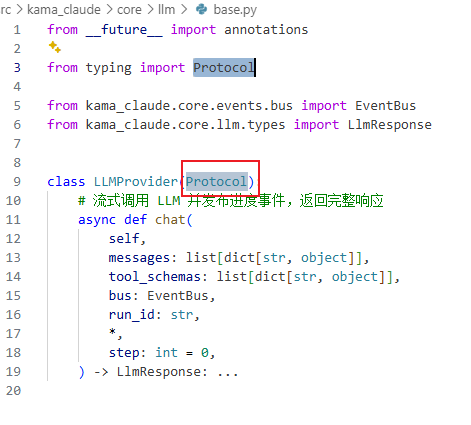

Protocol类提供结构子类型或静态鸭子类型的支持，Protocol允许开发者定义一组方法和属性的规范任何实现了这些规范的类(无论是否显示继承)都被视为该协议的子类型，无需显示声明继承关系
[https://geek-blogs.com/blog/python-protocol/](https://geek-blogs.com/blog/python-protocol/)

对于这三个provider都只有对应的方法chat，只要满足这种方法就可以不需要继承地随意放入agnetloop中包装

##### 包装器模式
最后一个埋点不是放入provider或者loop中，而且单独有一个类叫做TracingProvider，如果我们的trace存在就将provider指向TracingProvider的实例
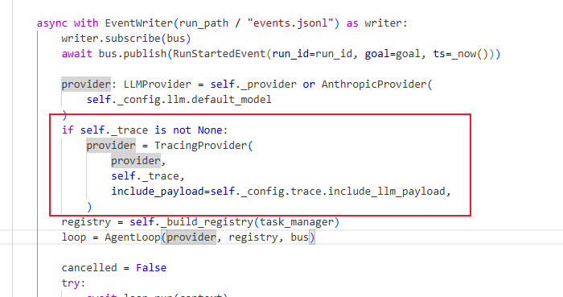

如果trace存在，就指向TraceProvider示例，并且记录CORE发给LLM的消息call_data

TraceProvider会作为AnthropicProvider实例的外壳，或者包装器，在发出请求前，先复制一份请求，然后emit放入记录队列中
这部分是CORE->LLM的请求消息
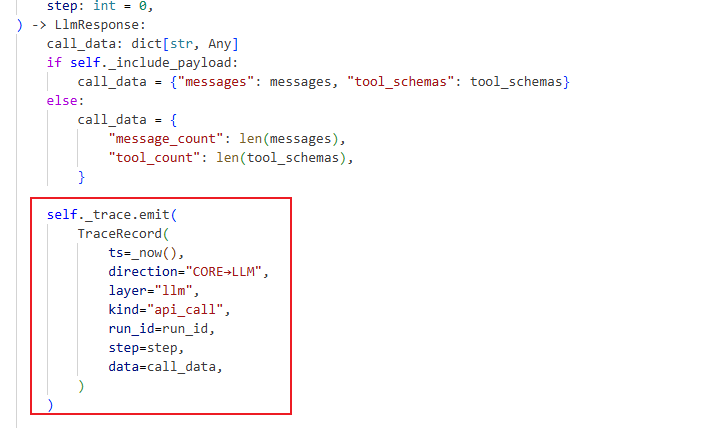

但其实真正干活的还是inner的AnthropicProvider
`result = await self._inner.chat(messages, tool_schemas, bus, run_id, step=step)`
然后再把回复的消息同样记录下来，放入记录队列中
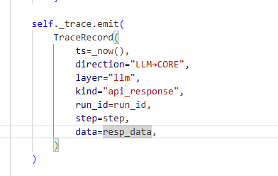

关于为什么使用包装器而不是在AnthropicProvider，作者也提到，包装器模式让两个provider完全解耦，AnthropicProvider是一个具体实现，它应该只关心"怎么调Anthropic API"

### 小结
虽然作者在文档中说是在config.toml中获取配置，但我的这个项目其实没有这个，所以使用的是`config.py`中的默认值
配置优先级我记得s0讲过config.py 默认值 < config.toml < .env < 系统环境变量

按照作者说的可以通过这些命令查看我们的trace
```
# 查看所有记录
uv run kama trace

# 只看 LLM 层（发出的请求和收到的响应）
uv run kama trace --layer llm

# 只看某次 run 的记录
uv run kama trace run-20260516-abc123

# 实时跟踪（像 tail -f）
uv run kama trace --follow

# 输出原始 NDJSON，供 jq 处理
uv run kama trace --raw | jq 'select(.direction == "LLM→CORE")'
```

不过各位`uv run kama trace`会打印出超级多的记录

作者还提供了这样的测试代码
`uv run kama trace --raw | jq 'select(.kind == "api_call") | .data.messages | length'`
这段代码的含义是检查每个种类是api_call的消息，其中带有的消息条数
各位从这里可以看出来，我们第一次CORE->LLM时，应该只会有goal输入的第一条消息
`{"ts":"2026-11-16T07:09:09.773629+00:00","direction":"CORE→LLM","layer":"llm","kind":"api_call","run_id":"20261116-070909-6d3796","step":1,"client_id":null,"data":{"messages":[{"role":"user","content":"早上好，如果见不到你，那就祝你下午好，晚上好，晚安"}],"tool_schemas":[{"name":"read_file","description":"Read the text content of a file. Path must be relative to the current working directory. Files larger than 512 KB are truncated.","input_schema":{"type":"object","properties":{"path":{"type":"string","description":"Relative path to the file (relative to current working directory)."}},"required":["path"]}},{"name":"bash","description":"Execute a shell command and return its output (stdout + stderr combined). Non-interactive only — commands requiring user input will hang and time out. Prefer short, focused commands. Output is truncated at 64 KB.","input_schema":{"type":"object","properties":{"command":{"type":"string","description":"Shell command to execute."},"timeout":{"type":"integer","description":"Maximum seconds to wait (default 60, max 120)."}},"required":["command"]}},{"name":"write_file","description":"Write text content to a file, creating it (and any parent directories) if it does not exist, or overwriting it if it does. Path must be relative to the current working directory. Content size is limited to 1 MB.","input_schema":{"type":"object","properties":{"path":{"type":"string","description":"Relative path to the file (relative to current working directory)."},"content":{"type":"string","description":"Text content to write."}},"required":["path","content"]}},{"name":"list_dir","description":"List the contents of a directory as a tree. Path must be relative to the current working directory. Hidden entries (starting with .) are included. Maximum depth is 4, maximum total entries is 200.","input_schema":{"type":"object","properties":{"path":{"type":"string","description":"Relative path to the directory (default '.')."},"max_depth":{"type":"integer","description":"How many levels deep to recurse (default 2, max 4)."}},"required":[]}},{"name":"task_create","description":"Create a new task to track a unit of work. Use this to break down a complex goal into smaller, trackable steps. Returns the created task as JSON.","input_schema":{"type":"object","properties":{"subject":{"type":"string","description":"Short title for the task."},"description":{"type":"string","description":"Optional longer description of what needs to be done."},"blocked_by":{"type":"array","items":{"type":"integer"},"description":"IDs of tasks that must be completed before this one."}},"required":["subject"]}},{"name":"task_update","description":"Update a task's status or dependency list. Set status to 'in_progress' when starting work on a task, 'completed' when finished (automatically clears it from other tasks' blocked_by). Returns the updated task as JSON.","input_schema":{"type":"object","properties":{"task_id":{"type":"integer","description":"ID of the task to update."},"status":{"type":"string","enum":["pending","in_progress","completed"],"description":"New status for the task."},"add_blocked_by":{"type":"array","items":{"type":"integer"},"description":"Task IDs to add to blocked_by."},"remove_blocked_by":{"type":"array","items":{"type":"integer"},"description":"Task IDs to remove from blocked_by."}},"required":["task_id"]}},{"name":"task_list","description":"List all tasks with their current status and blocking dependencies. Use this to check what work remains and what can be started next.","input_schema":{"type":"object","properties":{},"required":[]}},{"name":"task_get","description":"Get full details of a task by its integer ID. Returns the task as JSON.","input_schema":{"type":"object","properties":{"task_id":{"type":"integer","description":"ID of the task to retrieve."}},"required":["task_id"]}},{"name":"note_save","description":"Save a concise fact or decision to this session's notes. These notes are visible in future turns of the same session.","input_schema":{"type":"object","properties":{"content":{"type":"string","description":"The durable fact or decision to remember."}},"required":["content"]}},{"name":"spawn_agent","description":"Spawn an isolated sub-agent to handle a self-contained sub-task. The sub-agent starts with a clean context containing only the provided prompt — it does not inherit the current conversation history. Use run_in_background=true to run in parallel; retrieve result later with agent_result.","input_schema":{"type":"object","properties":{"description":{"type":"string","description":"3-5 word task description shown in progress display"},"prompt":{"type":"string","description":"Complete task description including all context the sub-agent needs. The sub-agent cannot see the parent conversation, so be explicit."},"run_in_background":{"type":"boolean","description":"When true, returns immediately with a run_id; use agent_result to poll."},"subagent_type":{"type":"string","description":"Agent role profile (planner/executor/reviewer). Leave empty for default."}},"required":["description","prompt"]}},{"name":"agent_result","description":"Retrieve the result of a background sub-agent previously started with spawn_agent. Returns 'still running' if the sub-agent has not yet completed.","input_schema":{"type":"object","properties":{"run_id":{"type":"string","description":"The run_id returned by spawn_agent(run_in_background=true)"}},"required":["run_id"]}}],"system":"You are a helpful AI assistant. Use the available tools to complete the user's goal. When the goal is fully achieved, respond with a final answer and do not call any more tools.\n\n## Project Context\n# 行为规范\n\n## 创建文件准则\n\n需要创建文件时，所有的文件都需要在 ./workspace 下创建。"}}`
虽然这条记录很长，但确实只有一条消息,因为其他是没有带有messages字段的
而其他大量内容来自于另外两个字段
- tool_schemas:告诉模型有哪些工具、参数如何填写。
- system:系统提示词和项目规范
当然如果你的对话涉及到调用工具之类的，所涉及到assistant 消息和包含 tool_result 的 user 消息也会增加的

这段命令可能会因为缺失jq报错，直接在终端安装即可`sudo apt install jq`

## agent的自主规划

虽然我们在上个部分学习了埋点的过程，不过这个阶段我们的代码其实发生了不少的变化，我们一起来看看吧

### 关于`_agent_run_handler`
在这个阶段我们对于s3新加入了一个变量叫做`_running_runs`这是用来维护正在活跃运行的run_task
对比原本s2的代码是这样写的
`self._current_run_task: asyncio.Task[None] | None = None`
从变量类型来看，这其实只是一个set集合类型
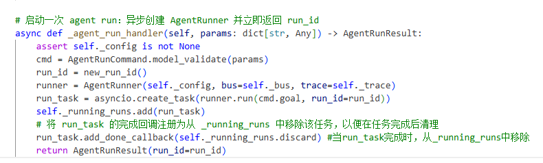
其中最费解的应该是这段代码
`run_task.add_done_callback(self._running_runs.discard)`
其中`self._running_runs.discard`
区分`self._running_runs.discard(run_task1)`,表示从集合中移除run_task1这个任务
没有带括号的表示方法，也就是从集合中移除任务的这个操作
而前面的`run_task.add_done_callback(方法)`表示如果这个run_task运行结束了，它该执行什么用的方法
所以联系到一起表示当run_task运行结束之后执行将这个run_task从running_runs中移除的方法
### runner接入TaskManager
然后我们看到runner.py中
其实只是增加了两行代码
`task_manager = TaskManager(run_path / ".tasks")`
构造task_manager，输入参数是run_path,是本次 Agent 运行的数据目录路径
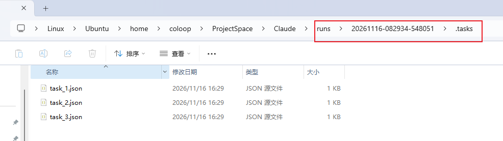

` registry = self._build_registry(task_manager)`
这里替换了源码

```
registry = ToolRegistry()
registry.register(ReadFileTool())
```

从上面的`_build_registry`来看，也就是注入了task_manager，并且注册了8个工具

### task与taskmanager
从这个阶段我们引入了task(任务)这个概念，这里的任务和asyncio中我们学习到的任务并不相同
对于人类来说，如果想要做一份复杂的工作，我们大概可能列出一份任务清单，这对于LLM也是如此，
task的作用就是将每个任务持久化为一个独立的json文件，但这不代表每一步都会创建一个任务，只要实际调用工具才会创建

对于任务的结构是这样的:

```
class Task:
    id: int #任务编号
    subject: str #任务标题
    description: str #详细要求
    status: TaskStatus #进度或状态，三种状态为等待，进行中，已完成
    blocked_by: list[int] #依赖或者阻塞的任务编号
    created_at: str #创建时间
    updated_at: str #最近更新时间
```

一个具体的例子就是
```
{
  "id": 1,
  "subject": "查看项目目录",
  "description": "列出项目目录结构，了解项目包含哪些文件和子目录",
  "status": "completed",
  "blocked_by": [],
  "created_at": "2026-11-16T08:29:35.775541+00:00",
  "updated_at": "2026-11-16T08:29:41.946818+00:00"
}
```

而对于TaskManager，其实就是用于管理所有task增删改与更新的实例，而且各位注意到，这个函数写的全是同步函数。虽然我们确实有写入磁盘这样的麻烦操作，但因为这个操作次数太少且文件很小，所以对整体时间影响不大(不像前面的埋点需要使用记录队列管理)，这也是作者说明不用数据库的原因，因为文件的操作已经够用了

作者也说明使用整数的(1,2,3,4,5)是方便LLM记忆，并且我们每一次对话的任务是独立也没必要生成UUID

可能值得说的是其中的update函数吧

```
def update(
        self,
        task_id: int,
        *,
        status: TaskStatus | None = None,
        add_blocked_by: list[int] | None = None,
        remove_blocked_by: list[int] | None = None,
    ) -> Task:
        task = self._load(task_id)
        if status is not None:
            if status not in ("pending", "in_progress", "completed"):
                raise ValueError(f"invalid status: {status!r}")
            task.status = status #更新状态
            if status == "completed":
                self._clear_dependency(task_id) #如果任务完成，清理其他任务的 blocked_by 列表
        # 增加依赖，并去重
        if add_blocked_by:
            task.blocked_by = list(set(task.blocked_by + add_blocked_by))
        # 移除依赖
        if remove_blocked_by:
            task.blocked_by = [x for x in task.blocked_by if x not in remove_blocked_by]
        task.updated_at = _now() #更新更新时间
        self._save(task) #写回
        return task
```

其中对于阻塞清理的函数比较有趣所以讲一下

```
# 将 completed_id 从所有其他任务的 blocked_by 列表中移除
    def _clear_dependency(self, completed_id: int) -> None:
        for f in self._dir.glob("task_*.json"):
            try:
                data = json.loads(f.read_text())
            except (ValueError, json.JSONDecodeError):
                continue
            # blocked是所有被阻塞的任务id列表
            blocked = [int(x) for x in data.get("blocked_by", [])] 
            if completed_id in blocked:
                data["blocked_by"] = [x for x in blocked if x != completed_id]
                data["updated_at"] = _now()
                f.write_text(json.dumps(data, indent=2, ensure_ascii=False))
```

因为上个函数update中，对应任务已经完成，所以需要解除其他对其依赖的任务对应的blocked_by
因为函数相当简单，扫描每一个被阻塞(blocked_by)的任务,更新其blocked_by数组，并且将updated_at更新到现在
因为算法就是简单的全量扫描反而让我有点惊讶

### 更新后的八个工具
我们知道在之前我们只有一个工具ReadFileTool，而这里新增了七个工具
#### TaskCreateTool与前面四个任务工具
我们在前面知道对于TaskManager中的create需要三个参数subject,description,blocked_by，而创建这些信息的就是TaskCreateTool
这个工具其实也很简单，第一部分是其成员变量,不过这部分其实我们并不会用，这是给LLM大爷看的信息，LLM看完之后再给你对应这三个参数

```
# name和description其实是说给LLM看的，告诉它这个工具是干什么的，输入输出是什么格式
    name = "task_create"
    description = (
        "Create a new task to track a unit of work. "
        "Use this to break down a complex goal into smaller, trackable steps. "
        "Returns the created task as JSON."
    )
    # 输入参数的 JSON schema，告诉 LLM 这个工具需要什么参数，参数类型和描述
    input_schema: dict[str, object] = {
        "type": "object",
        "properties": {
            "subject": {
                "type": "string",
                "description": "Short title for the task.",
            },
            "description": {
                "type": "string",
                "description": "Optional longer description of what needs to be done.",
            },
            "blocked_by": {
                "type": "array",
                "items": {"type": "integer"},
                "description": "IDs of tasks that must be completed before this one.",
            },
        },
        "required": ["subject"],
    }
```

然后的初始化中我们注册了taskmanager
然后我们唯一被调用的函数，这个函数一定很眼熟，也就是对应的invoke函数，用于调用taskmanager中的create函数创建task

这里写好了name，description和input_schema，然后向大家说明一下大模型到底是怎么知道这些信息的，其实我们看到注册表实例ToolRegistry就知道了
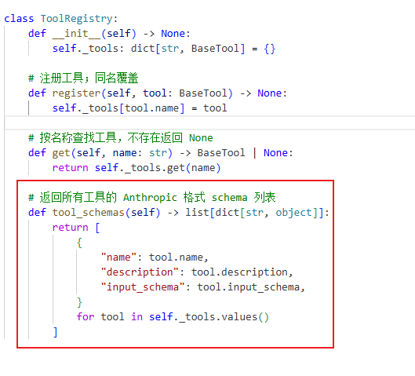

然后在我们的loop.py函数中就会调用这个函数
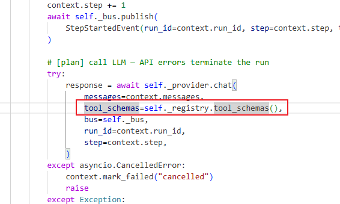

这样就可以让LLM知道我们工具注册表中每个工具的对应信息了
这四个依赖taskmanager的工具代码都很少且原理相同，就不一一解释了

- TaskCreateTool — 创建任务
提供标题、说明和可选依赖，生成任务文件，初始状态为 pending，返回任务 JSON。

- TaskUpdateTool — 更新任务
修改状态、增加或移除依赖。标记完成时，自动清理其他任务对它的依赖，返回更新后的任务 JSON。

- TaskListTool — 查看全部任务
返回简短清单，包含编号、标题、状态符号和依赖。

- TaskGetTool — 查看单个任务
根据 task_id 返回完整任务 JSON，包括详细说明、依赖和时间。

代码结构都是接收参数->调用TaskManager->包装成ToolResult返回

#### 后面四个执行工具
这里稍微说一下除了read_file之外的工具吧
1. WriteFileTool
```
# 写入文件内容；超 1MB 拒绝；禁止 .. 路径遍历；自动创建父目录
    async def invoke(self, params: dict[str, object]) -> ToolResult:
        path_str = str(params["path"]) #写入路径
        content = str(params["content"]) #写入内容

        # 不允许路径遍历，访问上一级目录
        if ".." in Path(path_str).parts:
            raise PermissionError(f"path traversal not allowed: {path_str}")

        encoded = content.encode("utf-8")
        if len(encoded) > _MAX_BYTES:
            return ToolResult(
                content=f"content too large: {len(encoded)} bytes (limit 1 MB)",
                is_error=True,
                error_type="runtime_error",
            )

        path = Path(path_str)
        path.parent.mkdir(parents=True, exist_ok=True) #确保父目录存在
        path.write_text(content, encoding="utf-8")

        return ToolResult(content=f"wrote {len(encoded)} bytes to {path_str}")
```

可以知道的是properties中会有path和content两种参数，剩下返回ToolResult和写入文件其实都很好理解
所以稍微说一下其中这个` path.parent.mkdir(parents=True, exist_ok=True) #确保父目录存在`
因为路径可能是这样表示的`path = Path("workspace/report.md")`
如果这里的workspace不存在，那这里就会重新创建一个workspace,并且写入数据(防止大模型抽风给出不存在的目录，或者用户手贱在对话时把文件夹删了)
2. list_dir

```
# 以树状格式列出目录内容，深度和条数有上限
    async def invoke(self, params: dict[str, object]) -> ToolResult:
        path_str = str(params.get("path") or ".")
        # 限制最大深度，防止过深的递归
        max_depth = min(int(str(params.get("max_depth") or 2)), _MAX_DEPTH)

        # 防止路径穿越攻击，禁止使用 ".." 来访问上级目录
        if ".." in Path(path_str).parts:
            raise PermissionError(f"path traversal not allowed: {path_str}")

        #获取绝对路径并检查是否存在且是目录
        root = Path(path_str)
        if not root.exists():
            raise FileNotFoundError(f"no such directory: {path_str}")
        if not root.is_dir():
            raise NotADirectoryError(f"not a directory: {path_str}")

        #收集目录内容，按树状格式输出，限制最大深度和最大条目数
        lines: list[str] = [str(root) + "/"]
        count = 0

        def _walk(directory: Path, depth: int, prefix: str) -> None:
            nonlocal count
            if depth > max_depth or count >= _MAX_ENTRIES:
                return
            entries = sorted(directory.iterdir(), key=lambda e: (e.is_file(), e.name))
            for i, entry in enumerate(entries):
                if count >= _MAX_ENTRIES:
                    lines.append(f"{prefix}... (truncated)")
                    return
                connector = "└── " if i == len(entries) - 1 else "├── "
                suffix = "/" if entry.is_dir() else ""
                lines.append(f"{prefix}{connector}{entry.name}{suffix}")
                count += 1
                if entry.is_dir() and depth < max_depth:
                    extension = "    " if i == len(entries) - 1 else "│   "
                    _walk(entry, depth + 1, prefix + extension)

        _walk(root, 1, "")
        return ToolResult(content="\n".join(lines))

```

其作用是从根目录开始列出直到深度的文件树结构，其结构可能类似于
```
workspace/
├── reports/
│   └── report.md
└── hello.py
```

其中的_walk可能像不错的算法题，不过这里就不深入讲解了

3. bash
bash是接收 LLM 提供的 shell 命令，在子进程中执行，并返回输出或错误
虽然看起来是使用shell很高级，不过代码意外很简单

```
async def invoke(self, params: dict[str, object]) -> ToolResult:
        #读取命令与最长等待时间
        command = str(params["command"])
        timeout = min(int(str(params.get("timeout") or _DEFAULT_TIMEOUT)), 120)

        try:
            #让 asyncio 创建一个子进程来执行 shell 命令，捕获 stdout 和 stderr
            proc = await asyncio.create_subprocess_shell(
                command,
                stdout=asyncio.subprocess.PIPE,
                stderr=asyncio.subprocess.STDOUT,
            )
            try:
                # 等待子进程完成，并设置超时时间，超时则杀死进程
                stdout_bytes, _ = await asyncio.wait_for(
                    proc.communicate(), timeout=timeout
                )
            except TimeoutError:
                proc.kill()
                await proc.communicate()
                return ToolResult(
                    content=f"[timeout after {timeout}s]",
                    is_error=True,
                    error_type="timeout",
                )
        except Exception as exc:
            return ToolResult(content=str(exc), is_error=True, error_type="runtime_error")
        # 将输出直接转换成字符串，超出 64 KB 则截断，并在末尾加上 "[truncated]" 提示
        #[truncated]是为了告诉用户输出被截断了，避免误解为完整输出
        output = stdout_bytes.decode("utf-8", errors="replace")
        truncated = len(stdout_bytes) > _MAX_OUTPUT_BYTES
        if truncated:
            output = output[:_MAX_OUTPUT_BYTES] + "\n[truncated]"

        returncode = proc.returncode or 0
        if returncode != 0:
            return ToolResult(
                content=f"[exit {returncode}]\n{output}",
                is_error=True,
                error_type="runtime_error",
            )
        return ToolResult(content=output or "[no output]")

```

和前面一样，也就是按部就班，使用LLM给出的命令执行shell，并且把对应结果返回到ToolResult

不过作者也说了，我们的bash比起前面可能导致的路径穿透更危险，没有所谓权限限制(大模型在这里的权限和你的权限一样)，也没有沙箱，误删文件之类的也可能存在

还有一点是作者也在描述时也说明了"Non-interactive only — commands requiring user input will hang and time out"
告诉大模型仅限非交互式，因为需要用户输入的将会挂起并超时

### LLM与将大象装冰箱
前面我们说明了四种辅助任务的工具与四种执行工具
我们也说明了LLM是怎么知道我们工具的存在与用途
虽然我们新加了taskmanager与新的执行工具，但本质上我们的agentloop并没有变化

注意我们的agentloop，与传统的agnetloop有所不同，传统一般是thought,action,observation

1.plan 请求模型
messages填入用户的goal消息，在provider内部还会填入系统提示词
tool_schemas填入工具注册表中所有的描述信息（名字，描述与输出格式）
2. observe 追加模型回复 ，将模型回复的消息填入blocks，处理其中的tool_calls消息，并且添加到context中
3. act 执行工具
如果模型需要工具调用，也就是response.tool_calls，依次调用需要的消息并填入工具需要的参数tc.input

我们之前的工具就是在第二步被得到描述信息，以及在第三步被调用的

大模型"看到"这些工具，在需要时就会调用

例如我们来完成一份经典的"把大象装进冰箱"的任务吧
`uv run kama run --goal "制定计划，完成将大象装入冰箱的三个步骤，为每个步骤编写一份md文件,并且在完成之后自行阅读三个文档，说明为什么 不可行，放入workspace的单独新建文件夹，第一步是分析打开冰箱门，第二步是分析将大象放入冰箱，第三步是分析关上冰箱"`

我们指明大模型需要指定计划，大模型会使用我们的任务工具指定task的
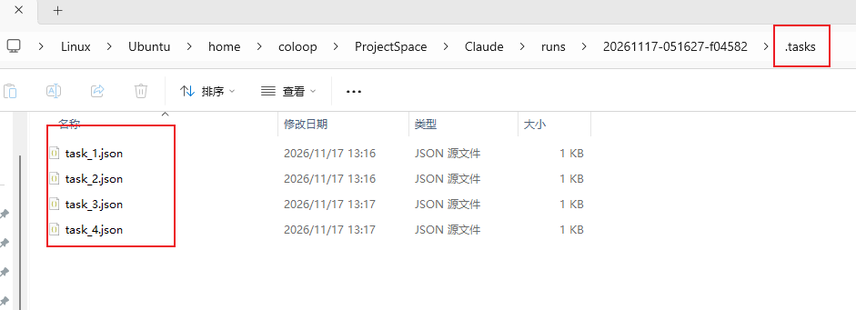

然后来看控制台的回复消息
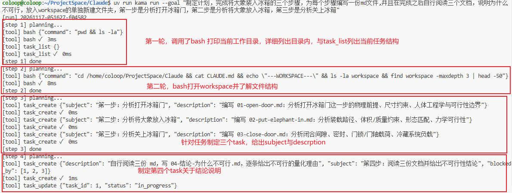
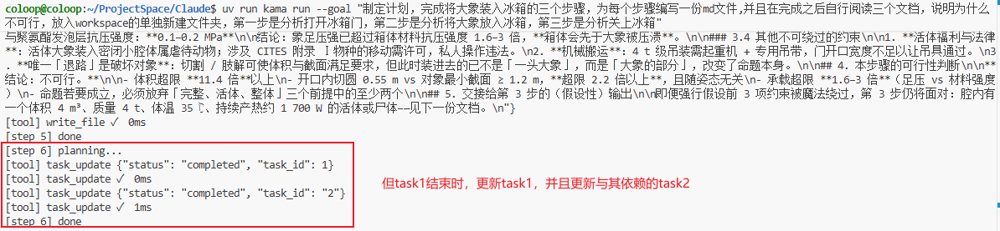

后面的输出也和这个类似，然后我们来看看结果
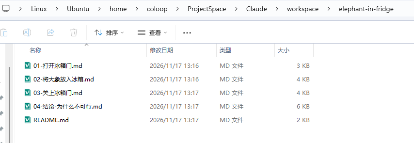

作者也提到了，任务工具调用与普通的执行工具调用在执行时其实没有区别，都是输入参数与对应工具实现，在我们的系统设计中，并不希望将任务系统暴露成独立的事件类型

### TUI修改

虽然这一部分和前面有所修改，但其实都是一些美观性的设计，或许没有前面的内容这么重要了
#### 完整流程与compose
我们来复习一下完整的tui启动与运行流程
- Texual调用compose()
- 创建标题Label和滚动容器VerticalScroll
```
def compose(self) -> ComposeResult:
        yield Label("[bold]KamaClaude[/bold]  [dim]connecting...[/dim]", id="header")
        yield VerticalScroll(id="log-view")
```
- 界面挂载后启动_socket_loop()
```
def on_mount(self) -> None:
        self.run_worker(self._socket_loop(), exclusive=True, name="socket")
```
- 创建SocketClient，连接daemon
```
client = SocketClient(self._host, self._port)
            self._client = None
            try:
                await client.connect()
```
- 启动run_event_loop()读取消息
`loop_task = asyncio.create_task(client.run_event_loop())`
- 注册客户端on_event回调
```
 async def on_event(event: dict[str, Any]) -> None:
                self._handle_event(event)

            client.on_event(on_event)
_handle_event在下方根据事件 type 路由到对应渲染逻辑
```
- 发送event.subscribe，向IPC广播注册该客户端的writer，当事件到来时写入注册的该客户端
- 当事件到底来经过dispatch执行_handle_event

#### `_handle_event`实现与流式输出
其实和我们在s2的思路差不多，首先我们区分两种事件，一种是llm.token一种不是

```
  # 根据事件 type 路由到对应渲染逻辑
    def _handle_event(self, event: dict[str, Any]) -> None:
        t = event.get("type", "")

        if t == "llm.token":
            token = event.get("token", "")
            # 如果当前没有 LLMStreamBlock，则创建一个新的并追加到日志视图中
            if self._current_llm is None:
                llm_block = LLMStreamBlock()
                self._append(llm_block)
                self._current_llm = llm_block
            self._current_llm.append_token(token) # 否则直接追加并刷新显示
            return

        self._break_llm()
```
我们会维护一个当前LLM流式块，如果当前LLM流式块存在，就直接追加并刷新显示
```
class LLMStreamBlock(Static):
    """在同一个 Static widget 中累积 LLM 流式 token。"""

    DEFAULT_CSS = "LLMStreamBlock { padding: 0 2; color: $text; }"

    # 初始化为空文本块
    def __init__(self) -> None:
        super().__init__("")
        self._text = ""

    # 追加一个 token 并刷新显示
    def append_token(self, token: str) -> None:
        self._text += token
        self.update(self._text)
```

当我们新建或者接收到其他不是llm.token的事件时，才会新建一个LLM流式块，并且赋值给当前流式块，然后追加到视图中


当然LLMStreamBlock是继承Static类的，对于Static的功能是显示文字，并支持颜色、加粗等样式，用update()替换内容，刷新显示，放入容器，通过CSS设置布局和外观
LLMStreamBlock只是提供额外的文本积累功能

```
 if t == "run.started":
            run_id = event.get("run_id", "")
            goal = event.get("goal", "")
            self._append(Static(
                f"[bold cyan]▶ run[/bold cyan]  [dim]{run_id}[/dim]\n"
                f"  [dim]goal:[/dim] {goal}",
                classes="run-header",
            ))
```

对应_append之后的逻辑是
```
# 向日志视图追加一个 widget 并滚动到底部
    def _append(self, widget: Widget) -> None:
        log_view = self.query_one("#log-view", VerticalScroll) #找到 VerticalScroll 容器
        log_view.mount(widget) #将 widget 挂载到 VerticalScroll 容器中,然后就会显示到屏幕上
        log_view.scroll_end(animate=False) #滚动到底部
```

通过这行代码就可以实现显示到屏幕中了`log_view.mount(widget)`
 
#### 工具调用块与折叠展开
如果智能体调用了工具，我们可以通过点击展开与折叠工具的调用输出结果
我们先从这里看起
```
class ToolCallBlock(Widget):
    """可折叠的工具调用块：折叠时显示摘要，点击后展开完整 params 和 output。"""

    DEFAULT_CSS = """
    ToolCallBlock { height: auto; padding: 0 0; }
    ToolCallBlock > .detail { display: none; padding: 0 4; color: $text-muted; }
    ToolCallBlock.expanded > .detail { display: block; }
    """
    
    def compose(self) -> ComposeResult:
        yield Static(self._summary(), classes="summary")
        yield Static("", classes="detail")
        
    
    # 点击时切换展开/折叠状态
    def on_click(self) -> None:
        if not self._finished:
            return
        if "expanded" in self.classes:
            self.remove_class("expanded")
        else:
            detail = self.query_one(".detail", Static)
            detail.update(
                f"[dim]params:[/dim]\n    {self._params_full}\n"
                f"[dim]output:[/dim]\n    {self._output}\n"
                f"[dim]elapsed:[/dim] {self._elapsed_ms}ms"
            )
            self.add_class("expanded")
        
```

默认显示的是摘要(summary),包含
- 工具名，例如 read_file。
- 调用参数的前 60 个字符，超出则加 …。
- 完成后补充：输出的前 50 个字符、执行耗时。
- 输出超过 50 个字符时，显示 click to expand 提示。
- 调用失败时，输出摘要标红。

详情(detail)点击展开后显示，包含：
- 完整调用参数。
- 完整输出，失败时是错误信息。(output)
- 执行耗时。

这个类被三个事件所使用，使用过程是连续的
```
elif t == "tool.call_started":
            tool_use_id = str(event.get("tool_use_id", ""))
            tool_name = str(event.get("tool_name", ""))
            params = event.get("params") or {}
            tc_block = ToolCallBlock(tool_name, params)
            self._pending_tool_blocks[tool_use_id] = tc_block #根据 tool_use_id 存储工具调用块，方便后续更新结果
            self._append(tc_block) # 把工具块挂在到滚动容器中

        elif t == "tool.call_finished":
            tool_use_id = str(event.get("tool_use_id", ""))
            elapsed_ms = int(event.get("elapsed_ms") or 0)
            output = str(event.get("output") or "")
            # 通过 tool_use_id 找到对应的工具调用块，并更新结果
            if tool_use_id in self._pending_tool_blocks:
                tc_done = self._pending_tool_blocks.pop(tool_use_id)#将对应的工具调用块从 pending 中移除并获取
                tc_done.set_result(output, elapsed_ms)

        elif t == "tool.call_failed":
            tool_use_id = str(event.get("tool_use_id", ""))
            elapsed_ms = int(event.get("elapsed_ms") or 0)
            error_msg = str(event.get("error_message") or "")
            if tool_use_id in self._pending_tool_blocks:
                tc_done = self._pending_tool_blocks.pop(tool_use_id) #将对应的工具调用块从 pending 中移除
                tc_done.set_result(error_msg, elapsed_ms, is_error=True)

```

在`tool.call_started`事件时，我们输入了名字与参数，此时我们确实可以点击，但是没有展开的输出内容
我们会创建tc_block即工具调用块，然后将其放入_pending_tool_blocks这个字典容器中
接下来在`tool.call_finished`或者`tool.call_failed`事件时，我们会从_pending_tool_blocks容器中找到并弹出对应工具调用块，然后为其更新输出结果或者错误信息

这样我们就可以从tui直接看到LLM对于工具的调用情况了

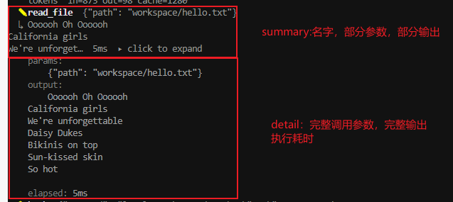


因为本节不涉及具体的流程所以也不用做流程图啦(～￣▽￣)～
比起s2，个人觉得反而s3会更简单一些
