# S4-session与agent
上个阶段我们做到了可以让agent制定分步任务，并且允许agent读写文件与调用dash，并且在tui中显示折叠的具体调用过程
不过我们的智能体是没有记忆的，这个阶段我们会将智能体从单条对话扩展到拥有记忆的智能体，也就是session


## 开始chat的对话吧
从一个简单的游戏开始吧
输入`uv run kama chat`或者输入`uv run kama-tui`
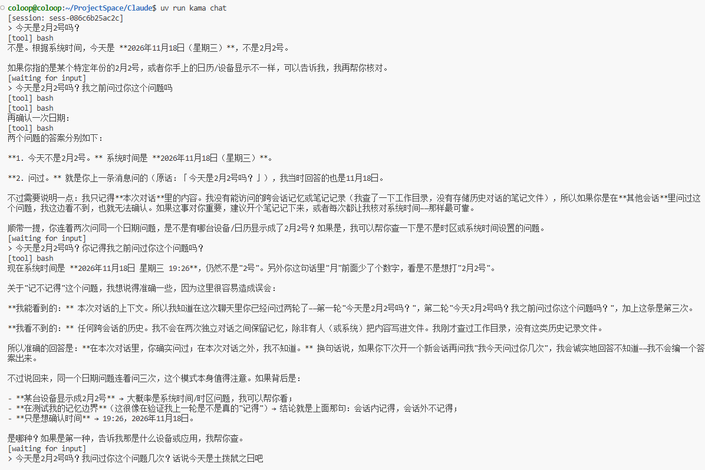

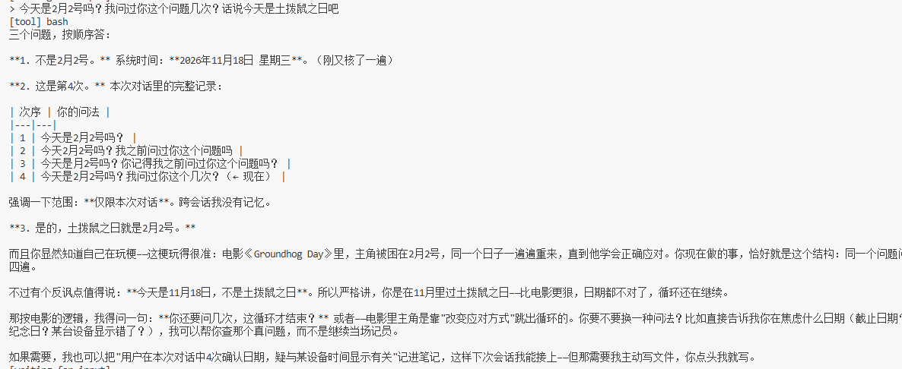

可以看到agent是可以记忆我们的对话，这里显然是在玩土拨鼠之日的梗

可以从cli端的代码看到，现在我们拥有了新的命令操作，也就是刚才我们用到的chat
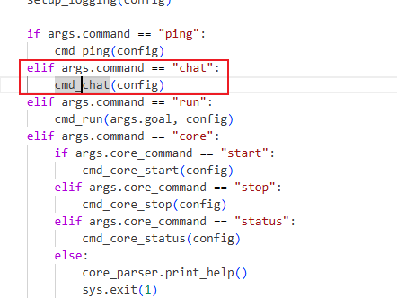

### _chat_async
在调用cmd_chat之后会进入这个函数
在看完完整代码之后我以自己理解说明一下这段代码的重要流程
连接守护进程->构造会话打印器对象，并将其handler注入`client.on_event()`->创建client.run_event_loop()后台读取循环->订阅IPC事件广播->创建chat session->循环读取用户输入->将用户输入发送到守护进程中->退出循环->关闭会话->关闭连接

然后可能有几点需要提到的
1. 两个读取对象
这个函数中存在了两个读取的函数
一个是`line = await _readline("> ")`
它会打印'>'并读取后面输入的消息
```
async def _readline(prompt: str) -> str:
    loop = asyncio.get_running_loop()
    return await loop.run_in_executor(None, input, prompt) #读取工作在线程池中，避免阻塞事件循环
```
这里值得稍微说说，首先第一个问题是，读取会带来阻塞，因为我们后面的运行需要这里读取的信息，但如果等待读取会阻塞其他事件的循环，所以我们使用了另一个线程来完成这件事，这样我们虽然会阻塞，但主线程是正常运行的，阻塞的只会是工作线程

第二是，如果每一次我们都创建一个工作线程来完成读取，在读取完成之后销毁工作线程，这其实挺浪费的，所以这里使用了线程池的思想，需要干活的时候就叫一个线程过来完成，做完了并不会销毁而是放入线程池中等待
所以具体流程是
1. 首次需要时创建工作线程，执行input(prompt)
2. 读取完成后，input()返回，随后_readline()返回，工作线程留在线程池里等待新任务
3. 下一次调用时，线程池可以复用已有线程
4. 聊天程序退出时，asyncio.run()会关闭默认线程池，等待工作线程结束


2.
```
wait client.send_command(
            "event.subscribe",
            {
                "topics": ["session.*", "run.*", "tool.*", "llm.token"],
                "scope": "global",
            },
        )
        # 这是之前的 run 命令里没有的，创建一个 chat session
        created = await client.send_command("session.create", {"mode": "chat"}
```

作者说明我们需要先完成对IPC事件广播的订阅，再创建session。这和之前我们在run.py中的一样，因为一旦agent.run创建就会出现RunStartedEvent，这里也是一样，会先出现SessionCreatedEvent，如果先创建会话就会因为没有订阅IPC广播错过这个

3.
```
 # 按事件类型打印 chat 输出和等待提示
    async def handle(self, event: dict[str, Any]) -> None:
        t = event.get("type", "")
        if t == "llm.token":
            print(event.get("token", ""), end="", flush=True)
            self._inline = True
        elif t == "tool.call_started":
            self._ensure_newline()
            print(f"[tool] {event.get('tool_name', '')}")
        elif t == "session.waiting_for_input":
            self._ensure_newline()
            print("[waiting for input]")
        elif t == "session.closed":
            self._ensure_newline()
            print("session closed.")
```

这里的handle相当简单，如果有llm.token来就打印，这里end=""表示不会换行，flush=True表示立即打印并刷新缓冲区
然后遇到其他事件，如果没有换行就会执行换行，和我们在之前tui学习到的其实一样

4.
我们在这里遇到了三条命令，应该会在后续慢慢学习的
`created = await client.send_command("session.create", {"mode": "chat"})`
`await client.send_command(
                "session.send_message",
                {"session_id": session_id, "content": content},
            )`
`await client.send_command("session.close", {"session_id": session_id})`

作者在这里也说明了，无论是chat/tui 都只是接收消息 发出消息并打印回复的，真正的session、thread、notes、run调度都在daemon里。TUI和CLI共享完全相同的协议，不各自维护状态

### sessionManager
在app.py中我们可以看到，这里新注册了几个handler
```
server.register("session.create", self._session_create_handler)
server.register("session.send_message", self._session_send_handler)
server.register("session.get_history", self._session_history_handler)
server.register("session.close", self._session_close_handler)
```

对于上面第一个命令，会执行`_session_create_handler`的函数，我们在s2就说明了从命令到执行handler的流程

所以原函数是这样的
```
# 创建 chat 或 one_shot session，并返回 session_id
    async def _session_create_handler(self, params: dict[str, Any]) -> SessionCreateResult:
        assert self._sessions is not None 
        cmd = SessionCreateCommand.model_validate(params) #校验参数并生成cmd对象
        session = await self._sessions.create(mode=cmd.mode, title=cmd.title) #创建session
        return SessionCreateResult(session_id=session.id, status=session.status)
```

然后我们来看到sessionManager类

```
class SessionManager:
    # 初始化会话管理器，接入文件存储、runner 工厂和事件总线
    def __init__(
        self,
        store: SessionStore,
        runner_factory: Callable[[], AgentRunner],
        bus: EventBus,
    ) -> None:
        self._store = store #会话文件存储器
        self._runner_factory = runner_factory  #工厂函数，用于创建新的 AgentRunner 实例
        self._bus = bus
        self._sessions: dict[str, Session] = {} #内存中会话索引
        self._locks: dict[str, asyncio.Lock] = {} #每个会话的锁，避免并发操作
```

觉得有必要说明的是这个工厂函数，其作用就是调用这个函数就能直接创建agentrunner实例
`runner = self._runner_factory()`
` runner_factory: Callable[[], AgentRunner]`
这里Callable是类型标注，说明直接调用这个函数而不需要传入任何参数

问题是我们也可以通过import这个类的方式来实现相同的功能吧，为什么要大费周章来用这样的工厂函数？
```
from kama_claude.core.runner import AgentRunner

runner = AgentRunner(config, bus=bus, trace=trace)
```

虽然我们确实可以创建一个agentrunner，不过这意味着我们需要反复传入这些参数
利用工厂函数我们只需要在创建sessionmanager时传入这些参数就行
```
self._sessions = SessionManager(
            store,
            runner_factory=lambda: AgentRunner(self._config, bus=self._bus, trace=self._trace),  # type: ignore[arg-type]
            bus=self._bus,
        )
```

这样做的好处有，让sessionManager专注于会话管理以及并不会让它持有config等参数，产生依赖
并且当runner变化之后，sessionmanager的内部结构也不会增加减少属性

然后我们再来看create函数，如何创建session的

```
# 创建新 session 并写入 meta.json
    async def create(self, mode: SessionMode, title: str = "") -> Session:
        sid = f"sess-{uuid.uuid4().hex[:12]}"
        ts = _now()
        session = Session(
            id=sid,
            mode=mode,
            status="active",
            title=title,
            created_at=ts,
            updated_at=ts,
            run_ids=[],
        )
        self._sessions[sid] = session #在会话索引中添加
        self._locks[sid] = asyncio.Lock() #为新会话创建一个锁
        self._store.write_meta(session) #将当前会话元数据写入 meta.json
        await self._bus.publish(SessionCreatedEvent(session_id=sid, mode=mode, ts=ts))
        return session
```

其中可能值得讲的是`self._store.write_meta(session)`
meta也就是metadata(元数据)的缩写
具体实现逻辑在这里

```
 # 将 session meta 写入 meta.json
    def write_meta(self, session: Session) -> None:
        path = self.session_dir(session.id)
        path.mkdir(parents=True, exist_ok=True)
        (path / "meta.json").write_text(
            json.dumps(session.to_dict(), ensure_ascii=False, indent=2) + "\n",
            encoding="utf-8",
        )
```
其存储在这个位置
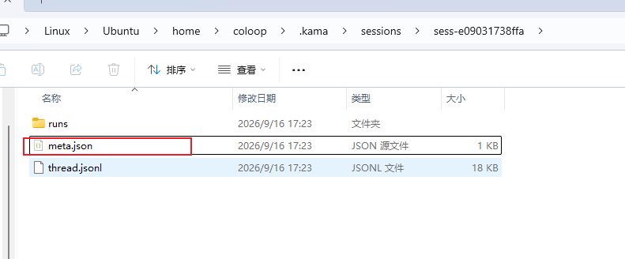

作者也说明了，在s4开始，run一轮对话作为session会话的一个回合，session作为更顶层的容器，承载其中的runs

#### send_message与锁
1. 关于锁
`lock = self._locks[sid]`在正式学习send_message之前我们先认识这里锁的概念
锁是为了防止多个执行者同时进入受保护的代码块，因为这样可能导致数据竞争的情况
本项目使用的`asyncio.lock`，协调的协程任务
> 同一把锁，一次只允许一个协程任务持有，持有者即使在代码块内await暂停，也不会释放锁

因为协程本身是没有互斥属性的，所以允许一个协程在同一个时间段被重复调用，所以为了保证我们的session信息不会被同时多次写入导致混乱

同一把锁才会互斥，不同session使用不同的锁，可以分别处理对应信息
跨线程互斥通常使用`threading.Lock`

在执行`if lock.locked():`代码时查询状态
- True：锁已被获取，尚未释放
- False：锁当前空闲
如果项目遇到True就返回busy，拒绝此次请求

在执行
```
async with lock:
    代码块
```
进入代码块时获取锁，离开时自动释放，代码块内部执行await时，即使协程暂停，锁也仍然持有。因此锁覆盖整轮处理

作者也说明了原话："这里也引入了每个 session 一把 asyncio.Lock。如果同一个 session 正在跑，用户又发来第二条消息，系统直接返回 session busy，而不是排队。"

> 但真的是这样吗？
我们做一个测试好吧，为了更准确，我们在每一次session busy时都打印一次消息到屏幕
```
if lock.locked():
            print(f"session {sid} 很忙啊，请等它处理完再发新消息")
            raise HandlerError(SESSION_BUSY, "session busy")
```
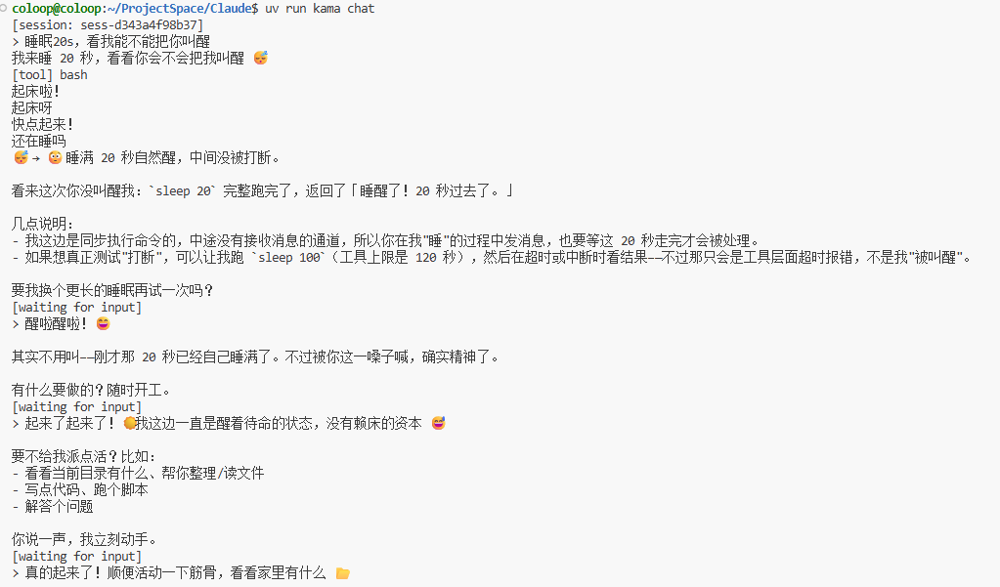

在测试中我们发现，完全没有显示session busy的情况，也不会出现错位回复的情况，而是将回复按照队列排列好了？
很奇怪吧？其实原理很简单，当我们在等待回复时，我们在等待什么，当我们输入时我们输入给了谁？
首先说明，我们一直在执行这段循环
```
 while True:
            try:
                line = await _readline("> ") #打印>提示符并读取后续用户输入
            except (EOFError, KeyboardInterrupt):
                break
            content = line.strip() #过滤空输入或者空格消息，如果是空消息就跳过
            if not content:
                continue
            # 新命令：发送消息到 daemon
            await client.send_command(
                "session.send_message",
                {"session_id": session_id, "content": content},
            )
```
这里的send_command你绝对不会陌生，要想等这段代码结束，需要获取到fut这个未来容器
```
 async def send_command(self, method: str, params: dict[str, Any]) -> dict[str, Any]:
        if self._writer is None:
            raise RuntimeError("not connected — call connect() first")
        req_id = str(uuid.uuid4())
        request = JsonRpcRequest(id=req_id, method=method, params=params)
        fut: asyncio.Future[dict[str, Any]] = asyncio.get_running_loop().create_future()
        self._pending[req_id] = fut
        self._writer.write(request.model_dump_json().encode() + b"\n")
        await self._writer.drain()
        return await fut
```
send_command确实可能会await挂起，但这只代表我们允许比如run_event_loop这种后台任务来执行，而不是返回并结束函数调用，进入下一轮循环
是的，协程函数说到底也是函数，我们只会切换到另一个就绪的协程函数而不是进入下一行代码，这很合理
所以在同一个线程中永远不会有两个协程一起在执行send_command，这也符合逻辑
而我们在途中看到后续立刻就执行我们输入的命令，则是Python的机制，在我们输入但没有函数处理时，Python会自动暂存罢了
说完同一线程，那我多开几个终端进程，这样可能会导致session.busy吗？
答案也是不行，因为每次新开uv run kama chat会导致使用uuid创建新的session编号，我们只会处理不同的session，即使各位在屏幕可能会看到输出很混乱，这只是因为我们在IPC广播分发事件与打印handler的问题，也不会同时操作一个session

至于后面的`async with lock:`
我们在正常操作时，完全不会触发这些报错，本质上因为同一个线程并不会有多个协程同时拥有CPU执行权，根本不会冲突，而多个线程会话只会进入不同编号的session，几乎永远不会进入同一个session，作者也并没有在这个阶段提供调用对应id的session的命令，所以正常情况我们永远不会触发这个报错

或许是过度防御性编程了？这一点我并不敢做决定，总之请不要过于深究，让我们进入下一步吧

2. 关于锁以外的其他
对于session有三种状态

- active：会话已创建
创建 Session 时的初始状态。

- waiting_for_input：等待下一条消息
chat 会话的一轮 run 结束后进入这个状态，会话保留，可以继续对话。

- closed：会话已关闭
one_shot 会话执行结束，或主动调用 close() 后进入。此时再发送消息会报错。

对于session还有两种模式
- chat
使用`uv run kama chat`时的模式，在发出SessionCreatCommand时填入的参数，其可以让session在完成一次对话之后进入`waiting_for_input`状态
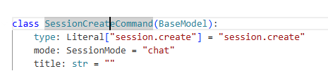

- one_shot
使用`uv run kama run --goal ""`时的模式，因为其会发出执行agent.run的命令，进入

```
async def _agent_run_handler(self, params: dict[str, Any]) -> AgentRunResult:
        assert self._sessions is not None
        cmd = AgentRunCommand.model_validate(params)
        session = await self._sessions.create(mode="one_shot", title=cmd.goal[:40])
        run_id = new_run_id()
        run_task = asyncio.create_task(
            self._sessions.send_message(session.id, cmd.goal, run_id=run_id)
        )
        self._running_runs.add(run_task)
        run_task.add_done_callback(self._running_runs.discard)
        return AgentRunResult(run_id=run_id)
```


先了解这些，对于send_message的代码注释已经很详尽了，应该很容易理解

### run_and_capture
我们对于`run_and_capture`更新了几个代码片段
```
 if session is not None and store is not None:
            # 获取当前轮次的run目录未知
            run_path = store.runs_dir(session.id) / run_id
            #从thread.jsonl中获取历史对话与工具调用以及结果，也包含刚保存的本轮用户消息
            history = store.read_messages(session.id)
            #可能需要保存的其他信息等
            notes = store.read_notes(session.id)
        else:
            run_path = self._runs_dir / run_id
            history = [{"role": "user", "content": goal}]
            notes = ""
            

context = ExecutionContext(
            run_id=run_id,
            goal=goal,
            max_steps=self._config.agent.max_steps,
            prefill_messages=history,
            session_notes=notes,
        )
```

我们对于上下文新增了两个记忆片段，一个是history消息历史，一个是note
按照作者原话
history是记录thread.jsonl中的完整对话过程，包括用户，assistant，工具调用与工具结果
notes.md记录agent主动保存的长期事实和决策

对于如何获取历史，我在store.read_message中也写好了注释
对比前面的阶段也好理解，我们从一个goal转变成了现在的history与note
值得注意的是，即使是使用`uv run kama run --goal ""`也是会创建session的，一般情况我们不会进入下面的else中，除非调用上面的`async def run(self, goal: str, *, run_id: str | None = None)`

### read_messages
刚好作者也要讲这一点，所以我也跟着写上来吧
```
def read_messages(self, sid: str) -> list[dict[str, Any]]:
        # 找到对应的thread.jsonl
        path = self.session_dir(sid) / "thread.jsonl"
        if not path.exists():
            return []
        # 逐行解析JSON，跳过空行，无法解析的行以及未知角色
        messages: list[dict[str, Any]] = []
        for line_no, line in enumerate(path.read_text(encoding="utf-8").splitlines(), start=1):
            if not line:
                continue
            try:
                row = json.loads(line)
            except json.JSONDecodeError:
                logger.warning("skip broken thread row sid=%s line=%s", sid, line_no)
                continue
            role = row.get("role")
            if role not in ("user", "assistant"):
                logger.warning(
                    "skip unknown thread role sid=%s line=%s role=%s",
                    sid,
                    line_no,
                    role,
                )
                continue
            messages.append({"role": role, "content": row.get("content", "")}) #取出每条记录中的role，content加入消息列表

        return self._trim_orphan_tool_use(messages) #裁去尚未配齐工具结果的消息片段
```

这里作者说明了一个有趣的事实，为什么我们要读取全部的thread.jsonl
作者说明如果使用滑动窗口会破坏agent的连续性，导致丢掉一些重要的历史消息或者工具结果，即使它们离本次对话可能更远

其次是因为缓存命中的严格的前缀匹配，如果采用滑动窗口或者截断，反而会导致缓存命中率更低
比如这样
```
上次请求：[固定提示词][历史 A]
本次请求：[固定提示词][历史 A][新增消息 B]
```
随着对话增长，大部分输入都是旧内容；如果它们命中缓存，多数输入token就按更便宜的缓存读取方式计费

### NoteSaveTool
作为工具类型我们在上一个阶段已经见到过很多了，其结构无非是名字描述与输出格式、初始化、invoke与其他函数
```
description = (
        "Save a concise fact or decision to this session's notes. "
        "These notes are visible in future turns of the same session."
    )
```
描述中也的很清晰，将一个事实或决定保存到会话笔记中。这些笔记将在本会话的后续回合中对你可见。
对应的调用invoke代码也如下：
```
 async def invoke(self, params: dict[str, object]) -> ToolResult:
        # 取出content并清理首尾空白
        content = str(params.get("content", "")).strip()
        if not content:
            return ToolResult(
                content="empty content",
                is_error=True,
                error_type="runtime_error",
            )
        # 将笔记追加到当前session的note.md，如果不存在就创建
        self._store.append_note(self._session_id, content, self._run_id)
        return ToolResult(content="saved")
```

相当简单的构造

作者也说明，在runner注册工具表时，只会在存在session时才会注册这个工具，这很合理，一次性的回复没必要创建note笔记

```
 registry = ToolRegistry()
        registry.register(ReadFileTool())
        registry.register(BashTool())
        registry.register(WriteFileTool())
        registry.register(ListDirTool())
        registry.register(TaskCreateTool(task_manager))
        registry.register(TaskUpdateTool(task_manager))
        registry.register(TaskListTool(task_manager))
        registry.register(TaskGetTool(task_manager))
        if session is not None and store is not None and run_id is not None:
            registry.register(NoteSaveTool(store, session.id, run_id))
        return registry
```

并且作者也说明并不适合自动创建，这样不仅会增加延迟与成本，也可能像班主任让同学写笔记并定期检查一样，可能会掺水了

### note.md的注入流程
我们知道note.md通过NoteSaveTool创建，现在我们来看看其是如何让LLM知道的吧
关键代码在这里
```
def system_prompt(self, base: str) -> str:
        if not self.session_notes.strip():
            return base
        return (
            base
            + "\n\n## Session Notes\n"
            + self.session_notes.strip()
            + "\n\nRemember important durable facts by calling note_save."
        )
```

含义是将note中的内容加入到base之后，base也就是我们之前的系统提示词
也就是如果存在note，我们的系统提示词相当于原本系统提示词+当前note

完整流程应该是
0. 当上一轮note.md创建或者更新好之后
1. 在runner中作为字符串读取文件中的对应笔记
`notes = store.read_notes(session.id)`
2. 把对应字符串加入上下文中
```
context = ExecutionContext(
            run_id=run_id,
            goal=goal,
            max_steps=self._config.agent.max_steps,
            prefill_messages=history,
            session_notes=notes,
        )
```

3. 执行agentloop,将上下文存入其中
`await loop.run(context)`
4. 在agentloop中调用对应函数，加入到系统提示词中

```
response = await self._provider.chat(
                    messages=context.messages,
                    tool_schemas=self._registry.tool_schemas(),
                    bus=self._bus,
                    run_id=context.run_id,
                    step=context.step,
                    system=context.system_prompt(
                        "You are a helpful AI assistant. "
                        "Use the available tools to complete the user's goal. "
                        "When the goal is fully achieved, respond with a final answer "
                        "and do not call any more tools."
                    ),
                )
```

5. 封装为system内容块，作为system字段发给LLM

```
system_blocks: list[dict[str, object]] = [
            {
                "type": "text",
                "text": system or _SYSTEM_PROMPT,
                "cache_control": {"type": "ephemeral"},
            },
        ]
```

如果有system则采用，否则使用全局变量_SYSTEM_PROMPT


#### 来测试吧与chat的整体流程
做到这里我们的智能体几乎完成了现代智能体的所有基础功能，让我们来尝试一下它能做到多少吧，不过请注意因为目前没有沙盒与安全框架，大模型可能会有删除重要文件的风险，请尽量选择安全

我输入的命令词是
```
我们分多轮开发一个二手购物网站，叫“禀赋效应”。项目约定：- 项目目录：home\\coloop\\ProjectSpace\\Claude\\workspace\\coloop-shop，使用独立虚拟环境。- 技术栈：Python、Flask、Jinja2、SQLite、原生 CSS。- 页面使用中文，风格为奶油白搭配墨绿色，适配手机。- 实现游客购物、购物车和模拟下单。- 金额在程序中以整数“分”计算，展示时转换为元。请通过 note_save 保存这些长期约定。本轮完成项目初始化、数据库初始化和商品首页，准备8个生活用品商品，展示名称、价格、简介，并支持查看商品详情。用 task_create 拆分本轮工作，用 task_update 跟踪状态，最后 task_list 展示结果。实际检查页面路由能正常返回，并给出我手动启动网站的命令。
```
总共进行了三轮完成了需要的内容
我们先来看一下thread.json
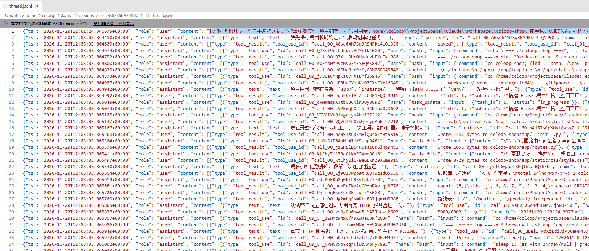

完整记录了每一次session中的user信息，assistant,工具调用与工具结果信息
以及大模型确实做了对应的note并且每一轮都在更新
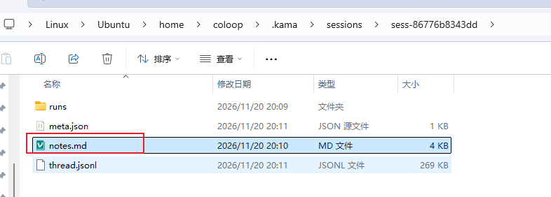
对应每一轮runs也有分割的task
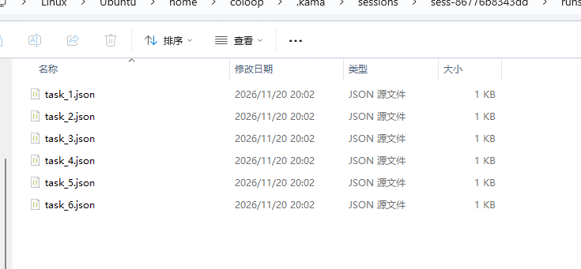

如此我们实现了现代智能体的核心框架，利用task分割每一轮次的任务步骤，利用history长期记忆以及note.md记忆关键信息，从而完成整个会话


当我们输入`uv run kama chat`时，所经过的流程到底是怎么样的？
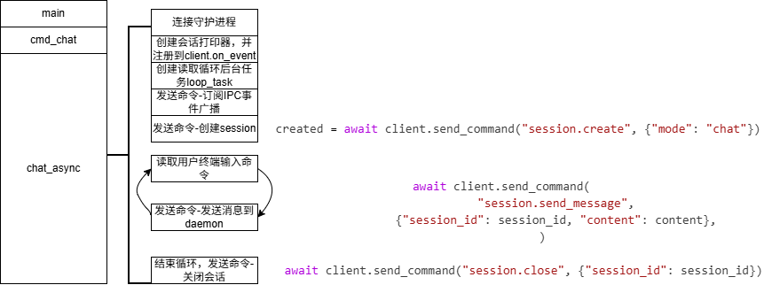

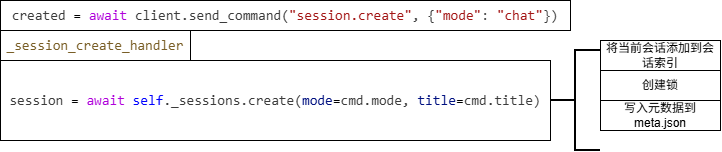
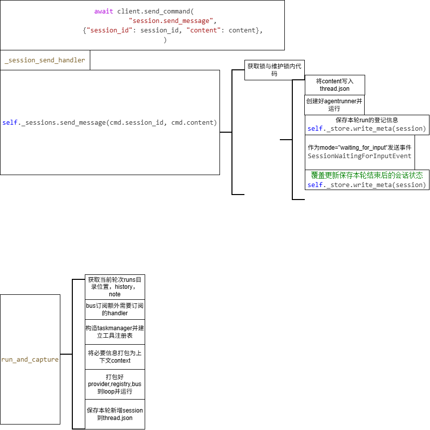


## 可对话的TUI
在这一阶段我们完成了可以会话的TUI面板，最关键的部分应该是创建了ChatTextArea这个实例
这是基于Textual的TextArea定制的多行聊天输入框
其创建位置在这`yield ChatTextArea(id="prompt", show_line_numbers=False)`
Textual 收集创建的组件，自动调用挂载方法，把它们加入当前屏幕

接收键盘输入的功能由 Textual 内置实现，然后接收到的信息会放在class Submitted(Message)的实例中，
在
```
 async def _on_key(self, event: events.Key) -> None:
        key = event.key
        #enter提交
        if key == "enter":
            event.stop()
            event.prevent_default()
            if self.text.strip():
                self.post_message(self.Submitted(self)) #创建Submitted实例
            return
```

实现提交的过程，将消息放进输入框中的消息队列
这里的消息会被`on_chat_text_area_submitted`执行，这个函数的调用貌似是内部的过程
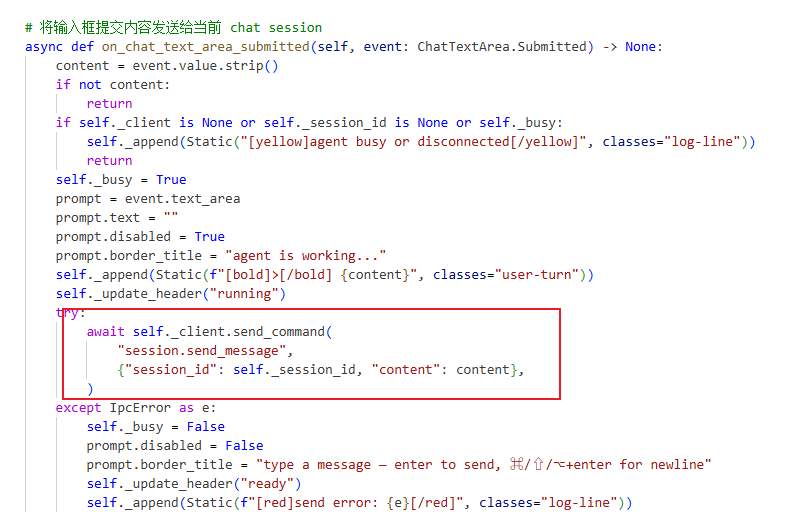

各位看到send_command应该就知道发生了什么
当然整体的服务还是发生在`_socket_loop`中，完成了订阅事件与创建session等，反正只要我们发出send_command一切都会好起来的，剩下的事情就交给daemon吧

不知不觉已经完成到了s4阶段，随着我们对这个项目更加熟悉，后面的阶段一定会更加顺手的，那就继续努力吧~

