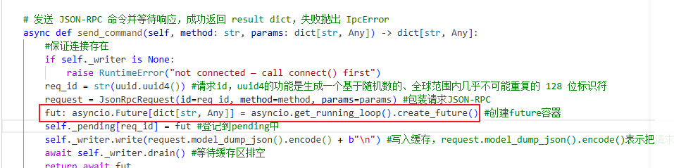
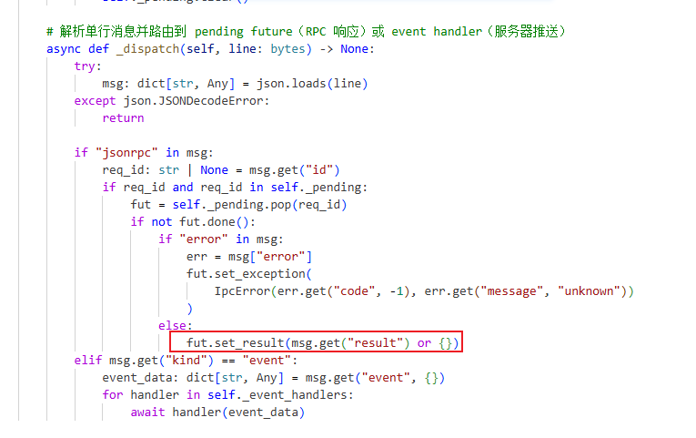
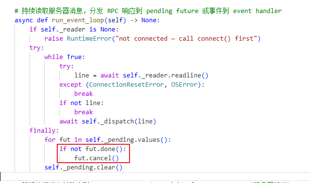
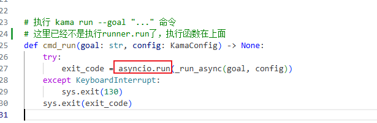
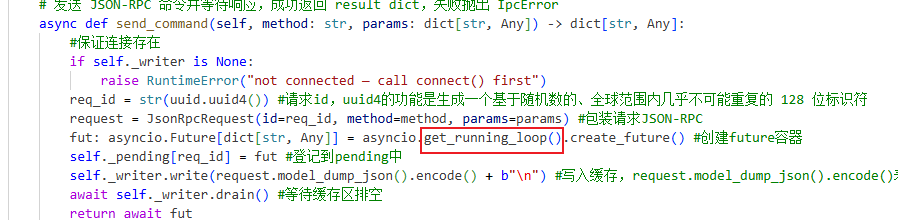

# 前置知识
存放一些Python知识或者一些其他工程开发的知识？
这里其实是存放一些与项目更无关但可能需要知道的知识，可以在任何遇到困惑时翻看，作者也会及时提醒各位回看的
## dataclass
dataclass 是 Python 3.7+ 标准库 dataclasses 提供的一个装饰器，用来简化以存储数据为主的类的编写。它会根据类中的类型注解自动生成一些常用方法
基础的用法是

```
from dataclasses import dataclass

@dataclass
class Point:
    x: int
    y: int
    z: int = 0

p = Point(1, 2)
print(p)        # Point(x=1, y=2, z=0)
print(p.x)      # 1
print(p == Point(1, 2))  # True
```

可以像这样可以使用参数指定规则

```
@dataclass(order=True)
class Item:
    price: float
    name: str
```

### field()
dataclasses提供的一个工具函数，用来给某个字段做额外配置，也就是给某个字段设置规则
比如

```
from dataclasses import dataclass, field

@dataclass
class Student:
    name: str

    # field(default_factory=list) 的意思是：
    # 每次创建 Student 对象时，都调用 list() 生成一个新的空列表作为默认值。
    # 这样每个实例的 scores 都是独立的，不会共享同一个列表。
    scores: list[int] = field(default_factory=list)

    # field(init=False) 表示这个字段不会出现在 __init__ 参数里，
    # 也就是创建对象时不能直接传入 id，比如 Student("Alice", id=1) 会报错。
    # default=0 表示这个字段的默认值是 0。
    # 通常用于内部自动生成或后续赋值。
    id: int = field(init=False, default=0)
```

## args命令解析器
`argparse`是Python标准库中用来解析命令行参数的模块。比如我们使用的git命令就是这类argparse工具在解析
它在Python有以下的函数操作
```
parser = argparse.ArgumentParser(...)      #构造命令解析器
parser.add_argument("--version", ...)      # 给解析器登记一条规则，这里只要解析器从命令行中识别到--version就会执行后续将version置为true的操作
subparsers = parser.add_subparsers(...)    #给解析器登记“子命令”能力
args = parser.parse_args()                 #启动解析器并将结果获取到args中
```
因为我们涉及到uv，所以这里讲清楚所以情况
```
uv run kama --version # 命令通过，uv识别到kama，解析器的规则识别到--version
uv run kama ping #命令通过 ，uv识别到kama，解析器识别到子命令ping，并且ping登记过
uv run gama --version #命令不通过，uv没有识别到登记的prog中的"kama"
uv run kama ping --version #命令不通过，在识别到ping之后进入了ping的子解析器，而ping的子解析器中并没有--version的子命令，这里不会把--version识别成规则，而是ping的子命令
uv run kama --version wait,what? #命令不通过，因为没有wait,what?的子命令，我们没注册过
uv run kama --version ping #命令通过，执行返回版本号，规则与子命令都成功识别
```

应该是把全部情况讨论出来，各位也能理解到底是怎么实现的了

## with ...as...
`with X as y`: 的意思：进入时执行 X.__enter__() 并把返回值给 y，离开时无论正常还是异常都执行 X.__exit__()。它是 try/finally 的语法糖，目的是让清理代码不可能被忘掉。

>with ... as = 自动管理资源的语法。
进入时调用 __enter__()，返回值给 as 后面的变量；
离开时一定调用 __exit__()，不管有没有出错。
最常见用途是文件：with open(...) as f:，省去 f.close()。

## try/except/else/finally
用很简单的例子讲清楚
```
try:
    可能出错的代码
except 异常类型1 as e: #这里的e是异常类型1的实例
    处理异常1
except 异常类型2:
    处理异常2
else:
    try 没出错时执行
finally:
    无论如何都执行
```
### raise
raise是Python里"主动抛出异常"的语句，是异常处理的源头
它有三种使用方式
```
raise 异常实例
raise 异常类
raise                # 不带参数，只能出现在 except 块里
```

- raise 异常实例
比如`raise ValueError("出错了")`
在抛出后会执行以下动作：
当前函数立刻停止执行
异常沿着调用栈向上往上传播
直到被对应的except接住，或者程序崩溃

这里说到了往上传播，实际上的逻辑是这样的
```
顶层 / main
   ↓ 调用
g()
   ↓ 调用
f()
   ↓
raise ValueError
```
比如f这里上抛异常，检查f函数有没有能够接住的，如果没有，那检查g函数有没有能够接住的，如果也没有检查main，如果都没有，说明你写的代码烂透啦！程序崩溃了
- raise 异常类
在这里Python很聪明，如果你没有实例化，也就是像前面一样先实例化，再上抛
话说回来，你可能意识到前面其实是在匿名实例化，我们用了一个我们都不知道是什么名字的实例的异常上抛了，很有趣吧，你们大学老师肯定也讲过吧

- 裸raise
只能在except或finally块里使用，作用是把当前处理的这个异常再抛出去
而有趣的是处理这个raise抛出的异常实例也必须是这个异常类才行
展示可能会有点晕的例子

```
def inner():
    try:
        raise ValueError("原始错误")
    except ValueError:
        print("inner: 记录日志，然后重新抛出")
        raise          # 裸 raise，重新抛出当前的 ValueError

def middle():
    try:
        inner()
    except TypeError:
        print("middle: 我接住了 TypeError")   # 不会执行
    print("middle: 我继续执行")               # 不会执行

def outer():
    try:
        middle()
    except ValueError as e:
        print(f"outer: 接住了 ValueError: {e}")

outer()
```

## BaseModel
BaseModel是Pydantic的核心类，用于基于Python类型提示进行数据验证、解析和序列化，只需要继承BaseModel，用类型注解声明字段，Pydantic就会自动做类型检查、数据转换、错误收集等工作

```
from pydantic import BaseModel

class User(BaseModel):
    id: int
    name: str
    age: int | None = None   # 可选字段，默认 None

# 创建实例
user = User(id=1, name="Alice")
print(user)                 # id=1 name='Alice' age=None
print(user.model_dump())    # {'id': 1, 'name': 'Alice', 'age': None}
```

- 字段通过类型注解声明。
- 没有默认值的字段必须提供，否则会报 ValidationError。
- Pydantic 会尝试把传入的值转换成注解指定的类型，比如 User(id="1", name="Bob") 会把 "1" 转成 1。
- 如果无法转换，会抛出 ValidationError，里面包含详细的错误信息。
还有很多进阶用法，总之你可以理解为一个检查类型使用到的东西，我就懒得管了(～￣▽￣)～

## 抽象类与抽象方法
这是大家面向对象都会了解的知识
- 抽象方法：只声明签名而没有实现的方法，作用是定义一份契约，任何继承本类的子类都必须要实现完所有的抽象方法
- 抽象类：含有抽象方法的类，作用是并不能直接实例化，只能被继承，子类只有把所有抽象方法都实现才能实例化，否则子类也是抽象类

这是基本定义，而在python中使用的是标记策略，需要从abc库中导入
其中：
- ABC： 继承了这个的类会在实例化时报错，用于标记抽象类
- @abstractmethod：放在方法上，标记为抽象方法，必须配合ABC使用

各位看得出来python在抽象类的实现比C++，java简单很多，仅仅是一个标记效果

作者试着稍微解释一下，因为抽象类实际上在做的事情有两件
- 多态与派发：同一个调用，作用在不同类型的对象上，会执行各种不同的实现
- 契约与检查：实例化抽象类与调用抽象方法都会报错

因为有多态，我们可以根据不同类型不同数据类型实现同一个调用(函数名相同)，实现不同的效果
这个功能在C++中初始是静态绑定的，需要使用到虚表之类的完成绑定，而在python中是动态分派的，自动完成而不需要虚表这些

## asyncio
在s2中使用到asyncio变得很多，所以有必要集中解释一下了
asyncio 是一个用于编写并发代码的库，基于 async/await 语法。它是 Python 异步框架的核心，广泛用于构建高性能的网络和 Web 服务器、数据库连接库以及分布式任务队列等
### asyncio.event
这是一个用来表示某件事已经发生的异步事件对象，用来通知一个或多个协程继续执行
内部维护一个状态值用于表示true或者false
其公共方法很少，只有4个

1.  is_set():普通方法，返回事件是否已经被设置
2. set ():普通方法，把事件设为已触发，唤醒所有正在wait()的协程
3. clear():普通方法，把事件重置为未触发，之后wait()再次阻塞
4. wait():协程，等待事件被set(),如果已设置则立即返回true

### `asyncio.StreamReader`与`asyncio.StreamWriter`
#### socket
关于socket这个词相信各位认识了不少，翻译过来叫做套接字，用于网络通信
简单定义是：socket是内核中的一个通信端点对象，用户态通过一个文件描述符(fd)操控，只需要读写字节，内核负责把字节可靠地送到对端

对其有简短的代码描述是如何运作的
```
import os
import socket

a, b = socket.socketpair()          # 内核创建一堆相互连通的socket对象
fa, fb = a.fileno(), b.fileno()    #获取对应文件描述符

# 打印fa指向的内核对象编号
print(os.readlink(f"/proc/self/fd/{fa}"))

os.write(fa, b"ping\n")             # write(fa, ...) 系统调用,发送ping与换行符
print(os.read(fb, 1024))            # read(fb, ...) 系统调用,接收到ping

a.close()
b.close()
```
#### reader和writer

`asyncio.StreamReader`与`asyncio.StreamWriter`是asyncio提供的高层流抽象，用来简化TCP连接上的读写操作
StreamReader负责从连接读数据，StreamWriter负责往连接写数据
它们通常不单独存在，而是成对出现，背后绑定的是同一个TCP连接

前面高层的含义是，这是高度抽象的实例对象，asyncio把socket包装成Transport+Protocol,再在外层包装了一层`asyncio.StreamReader`与`asyncio.StreamWriter`，隐藏了socket的文件描述符
其自底向上的理解一个是这样（GPT-image真好用啊）


并且值得注意的是两者并不是两个连接，而是同一个连接的两个方向
不过虽然是一个连接，但因为TCP是全双工的，所以并不会产生数据冲突


其两部分根据客户端与服务端从这两个函数中获取
客户端：
`reader, writer = await asyncio.open_connection("127.0.0.1", 7437)`

服务端：
```
async def handle(reader, writer):
    ...

server = await asyncio.start_server(handle, "127.0.0.1", 8888)
```

对于两者分别有以下方法：

| 方法 | 说明 |
|---|---|
| `await reader.read(n)` | 读取至多 `n` 字节，返回 `bytes` |
| `await reader.read()` | 一直读到 EOF（连接关闭），一次性读完 |
| `await reader.readline()` | 读到 `\n` 为止，返回一行 `bytes` |
| `await reader.readexactly(n)` | 精确读 `n` 字节，不够就抛 `IncompleteReadError` |
| `reader.at_eof()` | 是否已经读到 EOF |
| `reader.feed_data(data)` | 由底层调用，手动塞数据（一般不用） |


|                 方法                 |                     说明                     |
| ----------------------------------- | -------------------------------------------- |
| `writer.write(data)`                | 把 `data` 放入发送缓冲（不阻塞，不保证已发出） |
| `await writer.drain()`              | 等待缓冲区降到低水位，实现背压                 |
| `writer.writelines(seq)`            | 写多段                                       |
| `writer.close()`                    | 关闭写端，触发连接关闭流程                     |
| `await writer.wait_closed()`        | 等待真正关闭完成                              |
| `writer.is_closing()`               | 是否正在关闭                                 |
| `writer.get_extra_info("peername")` | 获取对端地址等                                |

### asyncio.Future[]
Future是一个容器，其表示"现在还没有结果，将来某个时刻会有结果或者异常"
容器这个描述很有趣，我们并非说的对于数据结构的描述，而是其在被创建时是空的，可以在某一个时间点被获取到结果
这是一个承诺的对象
其拥有关键能力:
- 可以被await:如果没有结果会被挂起协程，直到结果被设置
- 可以手动设置结果:set_result()/set_exception()
- 可以被取消:cancel()
- 可以被回调:add_done_callback()
在我们项目中其的生命周期是这样
在 `fut: asyncio.Future[dict[str, Any]] = asyncio.get_running_loop().create_future()`

get_running_loop表示获取当前事件循环，对于Event_loop我们接下来会提到

如果正确的话，会被set_result。否则会被set_exception


fut.done表示有结果或者表示这件事已经结束了，无论是结果还是异常，如果都没有会被直接取消


这个future更像是食堂打饭一样，我们端着一个空盘子去服务端请求，但是服务端并不会立刻给出结果，请你等待，服务端可能正确给出消息或者返回异常，如果什么都没给我们就只能撤掉盘子。

future的使用是一种经典的异步思维，在C++也有类似的东西叫做promise和future

### 事件循环Event Loop
这是asyncio的核心，抱歉现在才来给大家解释，其负责：
- 监听IO事件
- 调度协程
- 管理定时器
- 唤醒等待中的Future/Task

说了这么多大家肯定还是不知道这是啥
但是其创建依靠一个函数
`asyncio.run(内部回调或协程)`
其逻辑是创建一个新的事件循环->把内部回调或协程作为任务放入事件循环中跑->关闭循环
这个函数我们刚好有一个


所以事件循环可以被解释为回调调度器+IO等待器
而回调/协程被允许在这个调度器内部

在这里我们还可以看到,get_running_loop()
其作用是
> 返回当前线程正在运行的事件循环
